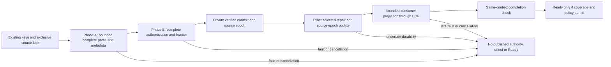

# Audit key custody bounded streaming recovery

## Goal

Design v0.1. Root accepted S1 ONLY after independent read-only review of43cad32e
by /root/audit_streaming_review (agent01a1b5a8-1a31-7751-866d-98658edaa63a).
No P0 was found in that private read-only boundary; full design remains needs-work.
Review conditions below are normative before S1 implementation. S2/S3, production
recovery/authority mutation, measured128MiB guarantees and new validation workloads
remain unapproved. Current174e5f21/110-case evidence stays historical exact-source
qualification, not proof of future S1 code. No dependency/manifest changes.

Read current framing.rs, wal.rs, recovery.rs, witness_recovery.rs,
verification/mod.rs, log/mod.rs, log/proofs.rs, merkle/mod.rs and record canonical
sources. The current decoder bounds each frame but collects every decoded frame;
WAL recovery collects segments/records/checkpoints, verification duplicates
record-hash leaves, and Log retains leaves/checkpoints. Replacing only read_line
does not establish bounded recovery. The full target includes opening the actual
writer and serving proofs without these history-sized in-memory collections.

### Frozen semantics and intentional differences

Keep audit-NNNNNNNNNN.log and checkpoints.jsonl bytes, field/default/null handling,
CRLF/blank-line behavior, canonical record bytes, HMAC and checkpoint signing
bytes unchanged. Merkle leaves are ASCII record-hash TEXT bytes, not decoded
hashes or JSON. Preserve RFC6962 domain separation, linear roots, previous writer
SIGNATURE linkage, strictly increasing checkpoint sizes and exact node identity.
Use independently provisioned HMAC/writer/distinct witness identity and exact
external checkpoint; never derive freshness from the directory or cache.
Passphrase rotation retains writer/HMAC/witness identity; signing-identity
transition remains unsupported and is not silently implemented by key_id.

Every complete record and every complete checkpoint is checked through EOF,
including bytes AFTER a trusted head. A valid prefix is never recovery success
when later complete bytes fail. RequireCovered/PreserveAmbiguousTail keep their
meaning; export, cancellation or retry must not sign/cover/replay an ambiguous
complete tail. Existing metadata/node/progression/trusted-presence checks precede
record errors. Preserve record mismatch order seq/link/hash/HMAC, then all base
checkpoint checks, then witness errors. Offline compatibility report fixtures
must remain byte-equivalent where resource limits do not refuse the input.

Intentional stricter differences: resource exhaustion returns a distinct bounded
failure, never a compatibility pass; counter overflow fails rather than wrapping.
Current Wal::open truncates an incomplete terminal frame before cryptographic
verification. New production open plans that exact truncation but performs it
ONLY after complete input authentication and explicit recovery selection. Invalid
sidecars or earlier complete corruption therefore leave original bytes intact.
No complete record is truncated, adopted as fresh history or automatically retried.

## Steps

### 1. Finite resource policy before allocation

Proposed qualification profile (not yet accepted defaults): frame4MiB including
newline; decoded string budget4MiB/frame;4096 items/array;65536 JSON values/frame;
depth64; trusted node ID256bytes; canonical record output16MiB; checkpoint signing
message16KiB; normalization pending scalars64; accounted working buffers128MiB;
4096 segments;10million records and
10million checkpoints;64GiB aggregate record bytes;4GiB checkpoint bytes;
no derived proof cache in v0.1; monotonic deadline300seconds. All values finite,
validated with checked arithmetic; zero/overflow/impossible profiles refuse.
Trusted installation policy may explicitly choose another validated profile;
input cannot select its own limits. No unbounded fallback or skipped outcome.

Frame length alone does not bound owned serde allocation: many empty/default
objects can amplify Vec element storage. Before owned Record/Checkpoint decode,
a bounded lexical structural scanner preflights depth, decoded string bytes,
per-array element counts and total JSON values without building Value trees.
Root accepted this implementation delta after identifying that deserialize_any
would convert unknown numeric literals such as1e400 which existing IgnoredAny
decodes lexically. No serde feature/dependency change is accepted. Map keys count
toward string bytes, not value count; container depth uses a fixed64-slot stack.
The scanner performs no schema, numeric-range or complete JSON validation and
cannot establish authenticated EOF. EXISTING Record/Checkpoint decoders must
accept the exact same admitted bytes AFTER resource preflight. Fixed schema
arrays and fields receive budgets BEFORE owned decoding. Resource refusal is
distinct from a wire/report pass, and never truncates a value to fit. Account
parser scratch, decoded fields/Vec capacities, normalization, signing messages
and hash buffers.

Use a shared sink-based canonical encoder in BOTH compatibility and streaming
paths, not a copied hash algorithm. Vec-returning compatibility wrappers collect
that same encoder; bounded hashing emits directly to the existing digest through
a byte-limited sink and never builds the complete canonical Vec, parts Vec or
joined array strings. Keep original raw rule/verdict versus normalized scalar/
signal-ID behavior, ordering helper and fixed confidence formatting. Normalize
through a shared Go stream-safe Unicode15 iterator with bounded pending state;
no unbounded safe-string-then-collect chain remains in the bounded path. Golden
Unicode/canonical vectors must prove byte identity before using it for authority.

Review condition: field framing writes u32 big-endian UTF-8 byte length BEFORE
payload. Use checked count-and-replay of the SAME deterministic bounded emitter
for normalized fields and joined arrays, enforcing limits in BOTH passes.
Never buffer full normalized fields/array joins merely to learn their lengths.
Preserve original-empty omission, original-ID Go ordering, raw rule/verdict bytes
and the historical seq as i64 wire representation. Overflow refuses the bounded
operation; a count/emit disagreement is an error, not a different hash.

Checkpoint signing bytes use the same frozen JSON ordering/escaping with a
bounded message buffer checked while encoding, before crypto allocation. The
16KiB cap and256-byte trusted node bound refuse outside-profile inputs rather
than changing signatures or diagnostic priority for admitted inputs. Existing
public-key/signature validation remains strict, with fixed-size hex decode where
possible; no unchecked arbitrary signature-sized allocation is accepted.

The allocation ledger must include two bounded input frames/cursors, decoder
scratch, both owned record/checkpoint strings, conservatively grown array
capacities, bounded sort references, normalization state, checkpoint message,
frontier/path descriptors and custody/witness context retained during scanning.
Record currently has only triggered_rules Vec<String> and top_signals Vec<Signal>;
4096-element limits bound their per-element overhead independently of string bytes.
No JSON Value tree, Vec<all records/checkpoints/leaves/paths>, canonical output
Vec, signature-sized input buffer or per-record retained projection is allowed.
A source-derived capacity calculation plus instrumented worst-case allocation
test must prove the profile before acceptance;128MiB is not a measured process
RSS promise. Trusted external witness implementations must declare bounded
buffers too; a trait object alone does not establish a whole-process bound.

Cancellation is checked before/after bounded frames, directory entries, crypto
work and repair steps. It stops future work and grants nothing. Synchronous OS
file I/O cannot promise a hard interrupt deadline; an owned process supervisor
supplies the external watchdog, with no foreign process termination.

### 2. Inspection under one nonextractable writer lock

Proposed WalInspection owns the existing native single-writer lock and trusted
directory configuration. It opens sources without symlink/reparse following and
reuses owner/privacy/regular-file checks. Enumerate matching segment names with
finite counters, validate exact10-digit indices and contiguity, then stream
expected names1..N; do not collect a Vec of paths or records. Checkpoints use an
independent bounded cursor. Keep at most one segment and one sidecar cursor open.
Check source identity/length before and after every pass and rescan membership
before accepting the result. Cooperative locking/trusted-directory ownership
remains a premise: this does not claim protection from a malicious same-owner
or privileged writer, nor an immutable distributed snapshot.

Inspection performs no authoritative truncate, rename, checkpoint append or
append-capable owner publication. V0.1 needs no derived staging/cache files;
acquiring the existing persistent lock inode is distinct from history repair.
Empty storage is accepted only by the existing explicit first-install rule;
existing sealed keys never regenerate. Invalid/oversized/nonterminal torn frames,
segment gaps, sidecar truncation and changed source identities refuse.

### 3. Complete streaming verification with compatibility priority

Phase A scans all bounded frames for parse/node/metadata/progression and exact
trusted-head presence, retaining scalar counters and first errors only. It also
records the last incomplete record offset as a PLAN, never mutating the source.

Presence has explicit provenance, resolving a design contradiction with existing
plan_witness_recovery. Normal open requires the actual local checkpoint chain to
contain the exact trusted head. Explicit witnessed recovery may instead hold ONE
virtual final external checkpoint when the physical latest head is strictly
earlier (or absent), allow_new=false and the independently authenticated external
head is the exact configured pin. It must extend the physical latest signature
chain, not skip unknown signed intermediate checkpoints. A same-size different
head, external head behind local state or an unavailable witness identity refuses.
The virtual candidate is joined to the actual records and checked by the SAME
node/progression/writer/signature-chain/linear/Merkle/witness rules as the existing
candidate Vec algorithm. No candidate may justify skipping complete physical
bytes or an invalid/truncated sidecar. The external tree size cannot exceed the
complete authenticated record count.

Keep PhysicalHead and VerifiedExternalCandidate facts distinct, including
physical latest checkpoint and pending append. Candidate-history authentication
may satisfy the planner's exact-pin check, but it is NOT an on-disk checkpoint,
completed repair or persisted coverage receipt. Only exact append+sync success
promotes that provenance and changes the source epoch; uncertainty remains
unavailable. RequireCovered/PreserveAmbiguousTail use the independently covered
sequence and preserve all complete trailing records, with no signing or replay.
This mirrors existing bounded-object WitnessRecoveryPlan semantics without
materializing full records/checkpoints. Legacy candidate Report counts remain
compatible; new receipts separately disclose physical versus virtual work.
Phase B streams record authentication and Merkle frontier construction. Use at
most64 hash slots plus one current record and ONE previous raw hash string bounded
by the configured frame limit (up to4MiB in the proposed profile). A valid prefix
hash is64 bytes, but malformed history can contain a larger record_hash before
refusal. Root accepted explicitly accounting this extra live buffer/peak rather
than truncating to64, inventing a new wire limit or skipping later cryptographic
checks after the first record failure. The compatibility Scope remains the first
successful prefix; actual continued attempts/successes remain separate. A second
checkpoint cursor joins strictly increasing tree sizes to exact prefix linear
and Merkle roots. Keep first base-checkpoint and first witness failures separately;
finish all record checks and prioritize base failure before witness failure,
matching frozen verification behavior. Checked counters prevent overflow.

Read-only scanner composition uses an owner-private sealed Source with one reader
per segment and a separate checkpoint reader, finite segment count and an
unchanged check under the same nonextractable native lock. Never concatenate
segments: an incomplete nonterminal frame must not join later bytes into a valid
record. Root accepted this direction only for S1 diagnostic Reports, not
VerifiedScan, healthy-owner publication or S2 authority. Native source production
stays Unsupported until actual opened-handle/reopened-path identity is accepted;
no caller boolean, path/mtime surrogate or unchecked provider may stand in for
that boundary. A native helper/dependency edge requires the owning root/native
decision and qualification; Audit introduces none independently.

Review condition: keep a separate COMPATIBILITY accumulator for error priority
and historical Scope snapshots, distinct from actual interleaved work counters.
Records-first failures carry only preceding valid records and zero checkpoint
successes. Base checkpoint failures carry all valid records plus preceding base
successes. Witness failure follows complete successful base verification, carrying
ALL base checkpoint successes but only preceding witness successes. A later bad
record/base checkpoint overrides an earlier observed witness failure. Differential
multi-failure fixtures must prove both Report wire fields and native Scope.

Factor reusable record/checkpoint validation primitives so offline and streaming
paths share canonical/HMAC/signature/error rules. Do not reimplement field rules
or call the old Vec-returning verifier inside the bounded path. Phase A and B
must both reach EOF and agree on source identity/length/count commitments.

Only then construct a private-constructor, noncloneable/nondeserializable
VerifiedScan carrying lock ownership, exact source commitments, sequence/linear
head, frontier, latest checkpoint and authenticated recovery coverage. It is not
an effect grant or distributed freshness lease. No public per-frame callback
receives authority during the unverified scan. Any trusted consumer projection
must finish verification before releasing effects or a healthy readiness state.

### 4. Bounded operational writer and proof access

Log cannot retain Vec<leaf> or Vec<checkpoint> in the bounded production path.
Keep frontier/counters/latest checkpoint; older checkpoint/record access uses
bounded authenticated cursors. Concrete v0.1 proposes bounded authenticated
rescans for proofs, preserving current functionality without a new persistent
cache format/trust boundary. Derive at most65 sibling/subproof ranges from
checked sizes/indices using existing RFC6962 split rules. Scan actual record-hash
TEXT in sequence, compute required range commitments with bounded frontiers and
retain only ordered path hashes. Sort disjoint sibling ranges by file position,
compute one range frontier at a time and restore canonical proof order using
the bounded range descriptors; keep a separate full-history verifier frontier.
Authenticate through the exact requested source
snapshot before returning any proof. Preserve existing unsigned current/prefix
inclusion and current-tip consistency APIs: verify against authenticated scanned
prefix/current frontier roots WITHOUT claiming signed coverage or auto-signing
an ambiguous tail. Checkpointed inclusion additionally requires exact PHYSICAL
checkpoint membership, signature checks and size binding; a virtual recovery
candidate or same-size caller replacement is not membership. Verify outputs with
existing proof verifiers before publication or witness use. Corruption,
resource/cancel failure returns no partial proof or checkpoint. No dependencies.

This costs O(history) I/O per proof and may refuse on the trusted scan budget;
it is not a throughput claim. Required witness consistency-proof generation
obeys the same budget and poisons/refuses rather than bypassing the witness.
A disposable on-disk index is a later optimization requiring its own format,
checked addressing and crash/authentication design. Neither path may silently
retain all leaves. The target remains actual bounded writer startup/proofs and
consumer restoration, not merely a standalone streaming verifier.

Record append remains WAL write+sync before success; no derived artifact replaces
authoritative WAL acknowledgement. Required
external witness and its actual durability gate remain mandatory. No signing
identity rotation, checkpoint rewrite, sequence reset or auto-grant replay.

Legacy records()/checkpoints() Vec materialization is explicitly outside the
bounded path. Introduce bounded cursor/fold APIs and migrate actual runtime and
authority consumers, including settings/kill restoration and proof callers.
Keep legacy helpers only with explicit materialization budgets; no production
open/proof/restore path may call them and still claim bounded recovery. Exact
cross-owner API names and consumer migrations require owner acceptance.

### 5. Repair, cancellation and restart

VerifiedScan may be consumed once for exact terminal incomplete-byte truncation
and/or appending the already authenticated missing EXTERNAL checkpoint. Recheck
source commitments under the retained lock immediately before writes. The
existing sync/poison/platform durability boundary applies. A repair failure,
uncertain rename/flush or cancelled transition grants no owner/readiness receipt;
preserve complete data and report unavailable with explicit recovery needed.
No new checkpoint signatures or business-effect replay are part of repair.

Cancel/drop before verification releases owned scan resources and the lock;
source bytes remain unchanged. Resume means a NEW full scan
under a fresh lock and independently authenticated current pins. No serialized
partial-prefix token skips input. Cancel after a possible repair mutation leaves
explicit uncertain state and requires fresh authenticated recovery, not rollback
or automatic continuation. Do not promise power-loss atomicity on Windows.

### 6. Required validation and acceptance boundaries

- Pure frontier roots/proofs versus existing Tree and immutable Go oracle vectors
  over empty/singleton/odd/power-of-two/large prefix sets; exact text-leaf encoding.
- Offline-versus-streaming Report/Scope and priority equivalence for every current
  fixture, null/default/Unicode/duplicate-field and adversarial multi-failure case.
- Generated many-segment/many-record/many-checkpoint inputs with measured owned
  allocation/capacity bounds independent of history length, plus RSS observations
  clearly distinguished from the accounted-buffer contract.
- Truncation/corruption before/at/after trusted head; terminal incomplete versus
  complete bad frame; sidecar failure after a repairable record tail; foreign key/
  node/root/signature, missing/older external head, complete ambiguous tail.
- Physical-versus-virtual checkpoint provenance: exact missing final external
  checkpoint, absent physical chain, skipped intermediate signature refusal,
  same-size fork, external head beyond records, append/sync failure and cancelled
  repair. A candidate count never establishes persisted coverage before success.
- Actual ordinary-user file fault/cancel/change/restart and both repair boundaries;
  no owner/effect callback before EOF or after resource/fault/cancel refusal.
- Proof range/address/count overflow, source change between passes and budget/
  cancellation during required witness proof generation; every emitted path
  locally verified before required witness RPC. No cache-only boot.
- Full current audit package and paired exact helper accounting, remaining OS/
  protected profiles, then actual consumer ServiceHost and Docker-only product
  outage/no-origin-effect/permission/restart proof. Unit success is not product.

### 7. Review questions blocking implementation

1. Accept the proposed finite profile and conservative predecode allocation proof?
2. Accept bounded authenticated proof rescans for v0.1, with explicit O(history)
   I/O/cancellation limits and no new persistent cache/format?
3. Accept the intentional verify-before-torn-repair tightening and cross-owner
   cursor/projection APIs? No compatibility report priority may drift silently.
4. Confirm independently pinned checkpoint acquisition and same-owner threat
   premises; a source lock/cache digest is not remote freshness or OS isolation.

### 8. Concrete implementation sequence, still design-only

S1 proposes private FrameCursor/JSON budget preflight, shared byte-limited canonical
encoder/normalizer, incremental record/checkpoint validation and Merkle frontier/
range primitives. Native read-only
WalInspection streams source handles under the existing lock. It emits only a
bounded diagnostic summary; no append-capable owner, business-effect callback
or publicly reusable trusted-state token exists. Pure vectors/differential
fixtures and actual bounded-input allocation/fault tests qualify these primitives.
S1 alone does not satisfy bounded production recovery.

S2 proposes additive SealedLog::open_streamed and recover_streamed entrypoints
with trusted validated ScanLimits and cancellation state. The composition root
keeps Config/key custody, WAL lock, witness and internal VerifiedScan within one
nonextractable construction lifetime. VerifiedScan is module-private, not a
public assertion consumers can transplant to another Config/key/source. After
both full passes, the same context performs exact selected repairs and publishes
the operational Log with frontier/latest checkpoint and bounded proof rescans.
No authority is reconstructed from a public receipt/boolean or different keys.
Old open/recover paths are explicitly legacy until consumer migration completes.

S3 migrates runtime/authority startup, settings/kill restoration and proof/export
callers to bounded cursor/projection APIs under their owners. Projections accumulate
only their declared bounded state and release no effects until successful finish.
No Vec-returning compatibility call may remain inside a claimed bounded path.
Operator/admin paths and actual Docker product faults complete the same target;
they are not inferred from S1/S2 component results. API details and resource policy
are accepted jointly with those owners before S2/S3 implementation.

Runtime owner reviewed the design and supplied concrete S3 requirements, without
accepting an API or changing source. Replace startup witnessed_through's
checkpoints().last Vec with a bounded latest authenticated head/coverage accessor.
SettingsStore journal restoration folds only bounded latest revision/digest/
parent state while preserving exact node/tenant/policy and contiguous revision
checks; a later bad settings event or ambiguous tail still refuses. KillStatus
folds scalar effect state but scans THROUGH EOF and rejects unknown runtime.kill.*
events. It never publishes early Clear/Killed merely after finding one record.

Cursor/projection completion must bind the SAME retained context/source epoch,
not just equal path/node/head text. Use module-private checked context identity
and generation, no caller-selected boolean or deserializable completion receipt.
Hold the source borrow/lock through projection finish and validate identity,
generation and full-source completion before restore/finalize/Ready. Source
mutation invalidates unfinished/stale projections; a projection from another
context cannot be transplanted. Cancellation, late corruption, unverified tail
or repair uncertainty yields no Config/apply/Ready. Preserve Pending and
unwitnessed-intent semantics; these observations never reconstruct a grant.

The proposed300-second scan profile composes with the caller's existing absolute
deadline: runtime's30-second observer/startup allowance uses the MINIMUM, never
a reset/extension. Every pass, repair and proof rescan shares that deadline and
cancellation state. Async caller integration must avoid blocking its stop/watchdog
control path; OS-read interruption still needs the owned external supervisor.
Bounded projections and O(history) rescan costs are not throughput or independent
deployment evidence. Full consumer acceptance remains a separate design gate.

Runtime boundary follow-up: retained_action_state already authenticates a native
snapshot and materializes a BTreeSet plus Vec of other consumed targets. Its
validated control-ledger capacity is1..10000; it is bounded by capacity, not a
zero-allocation or history-free operation. The whole startup ledger must count
cached ledger body, native snapshot bytes/decoded body, selected proposal clone,
distinct-target set/vector and their overlapping lifetimes, alongside bounded
WAL recovery, sealed custody and witness/client buffers. A4MiB native file limit
or post-decode capacity check alone is not a pre-allocation proof; apply the same
preflight/capacity accounting where that decoder participates in the claimed
startup bound, or explicitly keep whole-startup qualification open.
Preserve refusal of other consumed kill targets across protocol versions. A
future scalar any_other_target view could reduce allocation only through an
accepted typed API change; it must not remove that check or reinterpret absence.

Self-critique: P1 allocation amplification is addressed by predecode limits plus
required measured/conservative bounds, not trusted to frame length alone. P1
premature repair is addressed by inspection/no-write before full authentication.
P1 cached/partial-prefix authority is addressed by module-private context and
full-scan retry, not a serialized resume token. P1 hidden full-history retention
is addressed through operational writer/proof/consumer migration, not only decoder
refactoring. Residual same-owner modification and O(history) proof I/O are explicit.
Independent critique may add blocking findings; none is waived by this draft.

## Record

Captured319a5992 (Rust14f3) full audit package at allocated C actually passed140,
failed/filter/measured0;5 exact ignored helpers and2 zero binaries excluded,
11 single summaries and all named parents reconcile. Raw121350/full-*, public
122437. Captured128 path hashes unchanged; two new uncompiled parent_context
sources appeared and test-support/lib.rs activated them AFTER closing snapshot.
Current later dependency source is not qualified by140. Original mistaken derived
unwired-current classification is preserved/corrected; no broad inventory0 claim.
Session95952 terminal/C returned. Focused11 overlap140. No protected/hosted/
product/complete-S1/128MiB or production S2/S3 qualification.

Exact14f3fbdd first-attempt allocated A check/strict Clippy and11 unique Rust tests
actually pass:verification7/75filtered, Go verifier1/840rows, record1/92rows and
checkpoint2/180rows, integration filters0. Six new priority/scope/resource tests
ran.128-path hash and inventory closure unchanged; session65593 terminal/A
returned. Evidence121521/raw121350. Repeated840 differential/parity rows are not
1680unique cases. No full audit/native/production/complete-S1/memory claim.

Private incremental diagnostic source now factors record/base-checkpoint rules
for reuse by the existing sequential verifier and bounded callers. Bounded
canonical hash/signature entrypoints share existing emitters. Test-only priority
accumulation keeps compatibility prefix scope separate from attempted/successful
interleaved work; counter exhaustion poisons finalization. Six tests authored,
including840 frozen Go Report rows and sequential native Scope differential.
The fixture driver retains full history solely as a test oracle, not a bounded
scanner. Compile/Clippy/execution NOT_RUN, evidence120913. Actual Phase-A metadata,
frontier join, EOF/source checks and native inspector still remain requirements.

Allocated A atc26a5b53 plus depth:usize correction and shared signals56a2 actually
passed combined all-target check/strict Clippy and26 unique Rust tests:wire6,
framing13, checkpoint5, Go parity2. Intentional filters6/63/71/0. Frozen92/180
count/message cases, all-valid-Unicode escaping oracle and actual Go180
signatures/witness parity ran. First E0689 check failure retained; fresh second
125-path hash/inventory closure unchanged. Evidence120052/raw115851. Batch
terminal/A returned, no full audit/native/product/128MiB or whole-S1 claim.

Shared checkpoint count-and-replay source now uses root's signals escaping sink
56a2acdb, with finite byte-limited message assembly and compatibility Vec wrapper.
Signature decoding uses fixed64-byte storage. Three tests authored including180
frozen checkpoint messages/budget boundaries and partial sink/overflow refusal;
unchanged180-case checkpoint signature parity remains required. NOT_RUN, no
workload allocation or memory/production guarantee. Evidence115514.

Lexical preflight source follows the accepted numeric-compatibility delta:
fixed64-container stack, no heap/number conversion, checked counters for string
bytes, per-array elements and values. Five pure tests authored including decoded
UTF8/escape/surrogate counts, independent arrays/depth/overflow, unknown huge
numbers and92 record/180 checkpoint fixture count parity against an independent
owned Value oracle. One additional framing test pins original unknown-number
decoder behavior. Preflight is test-compiled only until an accepted read-only
bounded inspection consumer wires resource policy before owned decode. No
production path claims it yet. Compile/execution NOT_RUN, evidence115240.

Private frame cursor source authored next under restricted S1 permission:
one borrowed newline frame, checked frame/offset bounds, capped growth requests,
poison-on-error and explicit complete/torn accounting. Legacy generic decode
collects from the shared cursor, preserving framing semantics without duplicated
parsers. Four new pure tests authored; compile/execution NOT_RUN while Pages
holds the heavy build. Evidence114649. JSON preflight and authenticated EOF are
not provided by framing; no production recovery or memory qualification follows.

Merkle S1 candidate9c5f4e7c plus test-only Clippy correction actually passed
allocated A locked all-target check/Clippy, Merkle8 and unchangedGo parity1.
Go66 cases sizes0..65 assert2145 inclusion/2080 consistency exact ordered paths.
First Clippy failure retained.119 observed paths include one foreign document
drift (test-support/INTEGRATION.md),118 unchanged including Rust/manifests/fixtures;
actual depfiles/source references exclude that document. No broad zero-drift
claim. Evidence114310/raw114044. Batch terminal and A returned; no fullsuite or
memory/production qualification. Remaining S1 and S2/S3 stay incomplete.

The next restricted S1 source window opened after Runtime C and .NET D commands
were terminal. Private fixed-size append frontier and checked proof-range plans
are authored, with prefix parity, textual leaf domain, overflow/no-mutation,
disjoint visitation and maximum-u64 descriptor tests. Existing public proof
signatures remain unchanged; consistency verification uses a fixed scratch
array and refuses oversized malformed paths. Root-only computation retains one
memo entry; legacy subtree caching for proof generation remains unbounded and
does not qualify S2 operational streaming. Formatting and diff checks passed;
compiler, tests, allocation measurements and fresh source qualification remain
NOT_RUN pending an explicit bounded workload allocation. Historical115-pass
proof applies only to sourcef88e76f4, not these new edits.

Partial S1 canonical/NFC sourcef88e76f4 actual allocated Windows verification:
all-targets check/Clippy plus canonical6/normalization2/record_parity1 pass;
92 unique canonical vectors and13464 Unicode texts. Renewed A complete audit
regression115 passes/rawignored5 excluded/two zero bins/11 single summaries,
all required parents reconcile.114-file closure zero drift before/after both
batches, no repeated check/Clippy. Evidence111706/112110, private originals111549.
All handles terminal/A returned. Focused9 overlap115; full S1 capacity/remaining
primitives and all production S2/S3 remain pending. Audit Rust frozen through
dependent Runtime C/.NET D qualification until next root code window.

Restricted S1 implementation began with shared canonical/NFC core: same field
emitter counts/replays bytes, compatibility Vec wrapper and buffered hash sink,
no full normalized/joined payload buffers. Five pure tests authored including92
frozen canonical vectors. Compilation/execution NOT_RUN, no slot; all remaining
S1 primitives and capacity proof remain pending. Evidence:root/20261107110902.

Independent review verdict: S1 narrowly acceptable; full design needs-work.
The unsigned-proof P1 blocks S2 integration, not private frontier/range primitives.
Count-and-replay framing and compatibility-scope P2 conditions are mandatory for
S1 code. Root explicitly accepted that restricted S1 implementation after these
conditions were incorporated. No S2/S3 or workload allocation follows. Native
production review remains required before consumer promotion; no scoring change.
