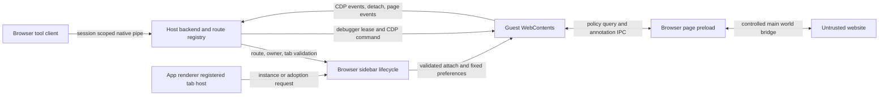

# Embedded browser artifact analysis and boundaries

## Scope and authority

Research checked 2026-11-07 KST. This is a bounded continuation explicitly
authorized for browser embedding analysis in a separate chat. The earlier Owl
clone/whole-runtime withdrawal in the browser roadmap remains applicable to
those broader activities. This document does not modify that read-only roadmap,
implement a UI, or authorize runtime debugging. No source or asset reuse is proposed.

The target is the installed Windows package OpenAI.Codex_26.1029.7803.0_x64,
whose packaged JavaScript reports openai-codex-electron 26.1029.61003. Treat those
as different version fields. ChatGPT.exe, runtimeName owl and Electron packaging
identify the shell; they alone do not establish browser embedding. [E1]

## Findings by evidence class

| Class | Finding | Boundary |
|---|---|---|
| Official product documentation | Built-in tabs use a separate regular-browser profile; developer mode provides controlled CDP access. [O1] | Product contract, not a named embedding library or current runtime trace. |
| Current installed artifact, static | Browser sidebar registers Electron will/did-attach-webview callbacks and binds guest WebContents through route/instance maps and adoption leases. [E2–E4] | Strong evidence of a guest webview architecture in shipped code; activation of this code in the current running tab was not observed. |
| Current installed artifact, static | The inspected WebContentsView constructor creates a temporary download view with downloadURL and bounded cleanup. [E5] | Does not establish that the visible browser pane is a WebContentsView. |
| Current installed artifact, static | A persistent app browser session is assigned by the host; logical conversation/tab routes remain separate. [E6] | Does not establish one physical cookie profile per chat/tab. |
| Current installed artifact, static | Session backend creates an authorized native pipe and forwards CDP/page/download events; guest control invokes WebContents.debugger. [E7–E9] | Actual endpoint, peers and active runtime policy were not inspected. |
| Current installed artifact, static | Browser-page preload uses IPC, host policy queries and a main-world annotation bridge. [E10] | No proof of a universally exposed Node API or complete IPC authorization. |
| Third-party analysis, 2026-10-24 | Cyrus Sarkosh infers an Electron webview guest and local socket/CDP control from logs and issue reports. [T1] | External inference; not an independent trace of this installation. |
| Third-party analysis, 2026-05-09 | ifuryst describes an older browser-use 0.1.0-alpha2 client and windowId/sessionId abstraction. [T2] | Historical client architecture; do not substitute its identifiers or socket paths for this build. |
| Upstream user reports | Issues 30178 and 33514 describe guest attach/navigation crashes. [T3] | Incident reports corroborate terminology; they do not prove our runtime path or a universal product defect. |
| Supplied parent-chat runtime observation | Ordinary HTTPS echo reported Chromium/Chrome major 156 without an Electron/ChatGPT UA token. [R1] | Inherited observation, not independently repeated here; UA is not engine/library attestation. |
| Unknown | Native implementation of custom adoption API, compositor ownership, CEF/WebView2 presence/absence and exact current runtime path. | Names/search misses cannot resolve these questions. |

## UI embedding and guest lifecycle

The bootstrap maps module 4482 to Electron; the main chunk imports that module
as eo. This supports API attribution beyond a bare string search. [E1, E11]
The browser sidebar manager passes its browser-page-preload path and lifecycle
callbacks into a function that installs will-attach-webview and
did-attach-webview on the owner WebContents. [E2]

Before attachment the code checks admission, route ownership, browserStorageId
and restore intent, rendererInstanceId, hostGeneration, teardown state and
adoption-lease consistency. Invalid/stale requests call preventDefault. A normal
instance queues its route by instance ID and clears src so initial navigation
belongs to the app. An adoption route checks an existing WebContents and accepted
host identity, rather than treating a renderer-supplied numeric ID as sufficient.
After attachment the matching pending instance/adoption route is consumed. [E2–E4]

The host overwrites the session and preload and applies explicit sandbox,
contextIsolation and webSecurity settings; it disables Node integration in the
guest, subframes and workers, insecure content, nested webviewTag and plugins.
Here webviewTag=false is a guest preference: it does not contradict use of a
webview guest by the owner renderer. These are observed assignments, not a
security audit or proof of native enforcement. [E2, E3]

Adoption is more specialized than a stock public view constructor: the artifact
tests for _createWebViewAdoptionLease and calls it with the owner, tracks the
lease until guest destruction, and coordinates placeTab/completeAdoption with
a registered opener. A window.open route obtains a child WebContents and
registers an adoption lease. Native implementation and rendering/composition of
this custom API remain unknown. No app restart, debugger enabling or native
attach was used to close that gap. [E4, E12]

## Profile, session and tab identity

The partition helper produces persist:codex-browser-<encoded key>. The inspected
browser-session configurator asks for the app key; browser attachment assigns
that configured session and rewrites partition to the app partition. It also
registers permission prompts, denying fallback permission handlers, downloads
and navigation restrictions. [E6]

Consequently, logical route isolation and browser storage are distinct. The
registry maps a control session to browserConversationId, ownerWebContentsId and
windowId; pages additionally carry browserTabId and guestWebContentsId. It
rejects missing session routes and dead windows. browserStorageId/restore intent
are reconciled during attachment and must not be equated with a unique Chromium
session partition. The static path supports a shared persistent app browser
session for these guests. It does not prove all product surfaces or versions
share that session, or that users cannot import profiles. [E2, E6, E7, O1]

No user profile directories, cookies, Login Data, browsing history, live memory
or authentication material were inspected. Storage isolation here is a code
observation and an official product statement, not an inspection of user data.

## Control and renderer/host boundaries

This is an analyst reconstruction of static relationships; arrows are not a
recorded runtime trace. A backend is keyed by control session, checks its current
state/route, requires a Desktop authentication supplier and passes a peer
authorizer when creating the pipe. Its server forwards CDP, detach, page and
download notifications. A historical Unix socket path is not evidence for the
Windows endpoint used here. [E7, E8]

The debugger helper attaches protocol version 1.3 only when not already attached
and tracks attachment ownership and child sessions. The backend resolves a
requested target/session before calling the guest debugger; a visible helper
rejects unsupported Target/Input method families. This is a mediated transport,
not evidence that an arbitrary external CDP port is enabled. Full developer CDP
permission remains a separate product capability; its complete static policy
and runtime state were not audited. [E9, O1]

The preload requests annotation policy over sync IPC only for a secure top-level
page in the inspected branch, invokes host messages and installs annotation
controls through contextBridge.executeInMainWorld. The attach callback checks
senderFrame against the guest mainFrame for that policy channel and returns
disabled defaults on invalid/lost state. Do not generalize this channel check to
every IPC endpoint or assume annotation and agent-control authority are equal.
[E2, E10]

## Principles transferable to the Rust browser plan

These are independently expressed design principles, not a port of recovered code:

1. Separate engine/profile identity, visible tab identity and tool-control session.
   Bind every command to a live owner and current tab generation; invalidate on
   navigation, host replacement, closure and ownership transfer.
2. Keep the engine guest and untrusted website outside application authority.
   Make host policy and narrow message contracts explicit, with disabled defaults
   for missing identity and stale callbacks.
3. Treat guest attachment/reparenting as a lifecycle transaction. Establish ownership,
   coordinate visible placement, confirm the same guest and clean up on failure.
4. Separate baseline UI operations from privileged inspection. Grant control to a
   scoped session; track who owns a debugger attachment and when to release it.
5. Separate persistent profile data from transient tool routes. Make profile and
   download permissions visible to the user without reading private data for diagnosis.

All authored application code remains Rust-only. Meari is the user-selected UI
candidate and CEF an engine candidate, not a qualified pair established by this
analysis. No Electron JavaScript shell or copied preload is needed to apply
these principles. Do not assume an Electron adoption lease has a public CEF
equivalent or that a generic webview offers equivalent CDP/session behavior.
Qualify native child-view parenting, resize/DPI/focus, sandboxed renderer/process
lifecycle, accessibility, tab transfer, profile ownership and a scoped control
adapter separately on every supported OS/architecture. Engine packaging, update
and crash behavior also need independent qualification. Implementation remains
outside this research chat; the browser roadmap is read-only here.

## Verification and residual unknowns

Read-only ASAR extraction rechecked the full SHA-256. Five small slices (17,592
bytes) parsed through REA without parse failure; graph coverage is partial and
semantic coverage unknown with 941 residual semantic unknowns. Slices intentionally
omit dependencies/aliases; the directory evidence is evidence of derived text,
not authentication of the original package by itself. The extraction manifest
links ranges/hashes back to the original artifact. [E1–E5, E9]

The preceding large-chunk REA attempt timed out at 30 seconds and retained partial
coverage/100,000 semantic unknowns. It was not repeated. Eight unpacked native
companions had declared/observed integrity mismatches in that earlier inspection;
they remain untrusted observations, not a malware diagnosis. Their status neither
changes selected packed-source hashes nor establishes custom native behavior.
Fuse sentinel absence remains unknown. [H1]

Runtime guest activation, renderer DOM placement/compositor API, exact endpoint
and peer enforcement, complete IPC/CDP policy, native adoption implementation,
actual profile persistence and cross-platform equivalence remain unverified.
No tests of product behavior, live debugging, account access or e2e were run.
The parent tool's chrome://version policy denial was not bypassed.

Evidence IDs, hashes, source ranges and source URLs are in
[the evidence index](../evidence/20261106235520-embedded-browser-analysis/index.evidence.md).
All restored source, snippets and raw REA bundles remain private under the
authorized .spec.local/root/analysis/embedded-browser directory. Public text is
an original summary. Detection/scoring and implementation files are unchanged.
