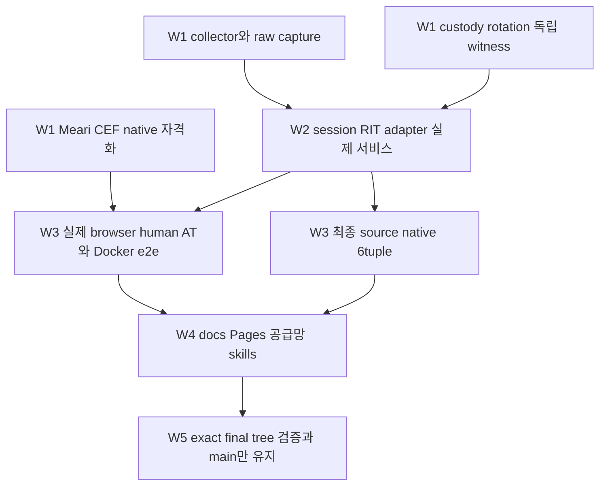

# 전체 로드맵과 마일스톤

버전 0.3.0. 2026-11-07 KST 기준 프로젝트 채팅 이력, HEAD43044be,
원격 Actions 산출물, 정본 spec 및 미커밋 collector 작업을 대조했다.
이 문서는 현재 상태·우선순위·종료 조건의 정본이다. 실행 체크리스트는
plan:root/20261106235521, 정제 근거는 evidence:root/20261106235519다.
과거 결과는 해당 evidence와 Git 이력에 보존한다. 전체 목표는 아직 미완료다.

## 범위와 상태 원칙

목표는 Rust 제품 전체 이전, Cross-OS/Cross-Platform/Cross-Lang adapter 생태계,
Meari+CEF 검증 브라우저, 실제 단위·파일럿·Docker e2e, Pages 문서와 공개
표준 draft v0, 최종 공유 main 통합이다. 모든 신규 저작 코드와 테스트는 Rust다.
Cross-Lang은 대상 서비스와 상호운용하는 계약이며 새 JS/njs 제품 구현 허가가 아니다.
외부 CEF/Meari 및 자동 생성 binding은 pin·라이선스·provenance를 따로 기록한다.

| 상태 | 판정 기준 |
|---|---|
| 구현 | 지정한 하위 범위의 코드와 실제 검증 근거가 존재 |
| 부분 구현 | 코드가 있으나 필수 제품 연결 또는 자격화가 남음 |
| 진행 중 | 미커밋 또는 통합·검증 중; 완료 수에 합산하지 않음 |
| 연구 완료 | 조사·설계만 정본화; 실행·제품 지원·표준 승인이 아님 |
| 미구현 / 미실행 | 해당 코드 또는 실제 환경 검증 근거가 없음 |
| 보류 | 명시된 선행 gate 때문에 실행을 유보 |

검증은 source SHA 또는 dirty manifest·이미지·설정·환경·실행 분모에 귀속한다.
과거 green을 후속 source에 소급하지 않는다. 채팅 completed/idle은 제품 완료가
아니다. zero-test harness, ignored helper, unsupported, tool error, CHALLENGE,
인간 ALLOW를 구분한다. 전체 완료율·완료일은 추정하지 않는다.

단일 책임·맥락별 모듈화·플랫 나열 금지·humanymous-* 네이밍·표준 Cargo
디렉토리·단위 테스트·파일럿/e2e 의무를 유지한다. scoring freeze, 필수 신호
누락 시 fail-closed, 파괴적 제어 dual-control, a11y, owned lab만 대상으로 하는
방어 전용 실험 및 T4 ceiling도 유지한다. DRM 미지원은 자동화 판정 규칙이 아니다.

## 검증된 현재 기준점

| 항목 | 실제 근거와 범위 | 남는 제한 |
|---|---|---|
| 공통 Rust | MSRV/toolchain1.99.1, edition2024, native-security까지 커밋된 root16 packages | collector를 포함한 dirty root17 packages는 별도 검증 대상;CEF native2개 통합 대기 |
| 순수 엔진 이전 | 기존 inventory314행 중 ported54/partial5/pending255, 원본 함수804개 | 과거 단위 이전 inventory이며 최신 전체 재집계·runtime parity 증거가 아님;verified_runtime_parity0 |
| native CI | c063ccd, run42324939140, Linux/macOS/Windows x64·ARM64 모두 성공 | implemented-crate-native-tests;full_runtime_qualified=false;43044be와 dirty collector 제외 |
| Windows 분모 | 각47/47 required harness,187passed,workspace 쓰기 거부 | raw ignored2/helper2를 보존;일반 skip 성공 처리 금지 |
| 실제 runtime 프로세스 | network-none,UID65532,read-only,cap-drop ALL;origin2/audit4,재시작·replay·변조·sealed custody 부정 시험 | typed fixture이며 실제 browser/human/AT 또는 full Gate가 아님 |
| CLI provisioning | 실제 binary doctor/dry-run/install/repeat/rollback,digest·변조·mode0500parent 거절 | 서비스 활성화·서명 package 설치·제품 readiness는 미완료 |
| CEF Windows 파일럿 | 43044be: 실제 Meari child 부착·resize/focus·정상/late-cancel 종료,UIA Unicode 값;core9/native4,보안 완화4종 거절 | 별도 source-linked native workspace;BrowserReady=false,전체 sandbox·IME·AX 미자격화 |
| Rust collector | L1-L3 17signal 순수 evaluator,실제 WASM API 경계;native6·Docker 실제 Firefox3·workspace/WASM Clippy 통과 | source manifest 귀속;transport/L4/guard 등 미완료,제품 전체 자격화 아님 |
| 공급망 | 최근 Cargo audit 알려진 취약점0 | ttf-parser0.25.1 RUSTSEC-2026-0192 유지보수 경고1;최종 closure 재스캔 필요 |

native6tuple 원본 report6개를 내려받아 SHA/status/범위를 대조했다. 정제 요약은
native-cli-six-tuple-results.json이다. [실제 Actions run](https://github.com/modootoday/humanymous/actions/runs/42324939140).
CEF 근거는 evidence:root/20261107012426이며 브라우저 프로세스의 일부 제한 토큰
관찰을 전체 sandbox 증명으로 바꾸지 않는다. 새 browser native bootstrap은
Windows2개 별도 Cargo package이므로 root16/dirty17 수와 중복 합산하지 않는다.

## 전체 마일스톤과 완료 조건

| ID | 영역 | 현재 상태 | 목표 완결까지 남은 작업 / 종료 조건 | 선행 |
|---|---|---|---|---|
| M0 | Rust branch·Specfold·개발 규약 | 구현 | .spec/.spec.local 구분과 증거 등록 유지;최종 규칙·skills 정리는 M11 | 없음 |
| M1 | contracts·signals·behavior·model·scoring·Pass | 부분 구현 | 원본 회귀 전수·ML lifecycle·full Pass·실제 runtime 연결;동작/판정 동결 보존 | M0 |
| M2 | network·raw capture | 부분 구현 | 실제 TLS ClientHello·ordered headers·HPACK/H2 SETTINGS/priority 관찰,connection/session binding | M1 |
| M3 | audit·keys·state | 부분 구현 | sealed custody/atomic ACL 기반 위 rotation·독립 durable witness·dual-control erasure·운영 sinks | M1 |
| M4 | Core/Gate·local authority | 제한된 runtime 구현 | raw capture·collector/RIT 전체 연결,proxy/settings/abuse/admin·dual control;필수 경로 실제 동작 | M1-M3 |
| M5 | Rust browser/WASM data plane | 진행 중 / 부분 구현 | L1-L3 실제 browser 검증→L4/env/guard/advanced·loader→session/RIT transport·recovery·Pass;ordinary browser/AT | M2-M4 |
| M6 | 서버 adapter 생태계 | 부분 구현 / 확장 연구 완료 | Node/nginx Rust-only binding·실제 authority,typed provenance·body/stream·proxy 신뢰 계약;서비스별 실행 matrix | M4-M5 |
| M7 | CLI·설치·서비스 | provisioning 구현 | 서명 artifact 검증→native 서비스 활성/readiness→재설치·rollback·remote peer 부정 파일럿 | M4 |
| M8 | 제품랩·공격/방어 | 제한된 Docker 검증 | live Gate/browser/Pass,egress 격리,origin/audit 실제 효과,공격/정상·human/AT 분모의 제품 e2e | M4-M6 |
| M9 | 자동화·모바일·provider·표준 | 연구 / 공개 draft 작성 | owned mobile/provider 실행,wire/vectors·상호운용·보안/개인정보 검토;국제 제출 준비 | M4-M6;설계 독립 가능 |
| M10 | Cross-OS·CI/OIDC·Pages | native6tuple·wiring 구현 | 최종 SHA full runtime6tuple,실제 delivery runner3개,registry 신뢰,동일 source docs 검토·Pages 배포 | M4-M8 |
| M11 | Rust-only·공급망·agents/skills | 부분 / 미완료 | foreign source 전수 disposition,최종 CVE/SBOM/image scans,.agents 정본·skills 실제 평가,배포 표면 정리 | 각 구현;최종 M10 |
| M12 | Go/폐기물 제거·main만 유지 | 보류 | 원본 oracle 퇴역 조건 충족→최신 main 통합→exact final tree 전체 gate→공유 main만 유지 | 모든 필수 gate |
| B0 | 검증 브라우저 설계 | 연구 완료 | Meari UI·CEF 확정;새 관찰/권한 계약은 계속 spec-first | M0 |
| B1 | engine/profile/control 기반 | 부분 구현 | CEF pin·bootstrap·합성 profile 기반;권한·network·lifecycle 상세 자격화 | B0 |
| B2 | Meari+CEF 실제 내장 | Windows bounded pilot 구현 | native workspace 통합;renderer 파일 거부·utility sandbox·keyboard·IME 후보창·screenreader/AX·DPI·crash·6tuple | B1 |
| B3 | 진단·server receipt 연결 | 미구현 | qualified target navigation/input,collector/session/capture/audit를 typed 관찰로 연결 | B2,M4-M5 |
| B4 | browser/mobile/AI/AT 비교 | 미실행 | ordinary Chrome 및 실제 인간/AT 대조군,관찰 개입 표시,origin/audit 효과와 오탐 측정 | B3,M8 |
| B5 | 도구 패키지·업데이트·문서 | 미구현 | 서명·native CVE/SBOM·업데이트/rollback,Pages 사용자 문서·native distribution | B2-B4,M10-M11 |

B 트랙은 제품을 검증하는 별도 도구다. B2 파일럿 성공을 M5 collector나 전체
제품 parity 성공으로 합산하지 않는다. 일반 Chrome과 Chromium의 UA 유사성,
DRM/media capability,accessibility automation은 각각 관찰 항목이며 단독 bot
증거가 아니다. 새 scoring 규칙은 이 로드맵으로 허가하지 않는다.

## 채팅 결과와 후속 작업

2026-11-07 최초 조회 시 후속3개 채팅은 모두 idle이며 마지막 turn은 completed였다.
이후 browser 채팅에서 사용자 요청에 따른 IME/AX·sandbox 후속 재개와 root native
workspace 통합 요청이 도착했다. browser는 재개,나머지2개는 조회 시 idle로 구분한다.
root의 collector 작업은 별도 진행 중이다.
기존9개 채팅 완료 기록은 chat-results.json과 각 plan에 보존돼 있다.

| 채팅 / 작업 | 실제 결과 | 후속 작업 |
|---|---|---|
| Rust 런타임 · Core/Gate 세션과 collector | 9ce3190 bounded session/ingress/RIT;root a8a3b66 sealed startup과 실제 Docker process 통합 | M2 raw capture,M5 qualified collector,full proxy/admin/Pass |
| Rust 키 저장 · sealed custody와 vault 영속성 | 5a77605 bounded custody;Windows49/Linux47;root SealedAudit가 Log+Custody 잠금 공동 소유 | rotation·독립 witness·운영 vault/dual control |
| Meari + CEF · Rust 검증 브라우저 UI | ead2dc6 관리UI 후43044be 실제 Windows CEF child·종료·UIA 검증 | root native membership/dependency/lock 통합,B2 잔여 native 검증;BrowserReady=false |
| Pages·Draft v0 | 2d98934 authored77문서,과거88browser조합/keyboard8 | 최신 source 문서 재검토·AT·실제 Pages deployment |
| CI/OIDC·Windows runner | 44e79a4 wiring,c6a2457 기반 및 후속 c063ccd6tuple | full native/browser/Docker runner3개·최종 source 전체 자격화 |
| Node/Bun·nginx | 6941032 Express/Hono14그룹;b1e10ae njs24/mock28;후속 실제 Node→authority 제한 lab | Rust-only 전환·실제 nginx authority·stream/provenance·대상 확장 |
| CLI·Rust wargame·Compose·authority | fe26b4d/671e88a/3b9c306/6f5d83a 기반;후속 native security/실제 process pilot | service activation,live browser/human/AT e2e,full Gate |
| 내장 브라우저 REA | 512a73f bounded static embedding 분석 | 정적 관찰은 참고;Owl 전체 복제·클린룸 구현은 범위 제외 |

원본 후속 Chat IDs: runtime01a1b35f-cf83-74f2-aad1-34b3aee60cda,
custody01a1b35f-d1a1-7553-a0ed-65d09b9042a7,
browser01a1b35f-d3e9-7042-91a4-10c910a15515.
공통 Cargo/lock/toolchain/CI와 모든 Git mutation은 root 단일 writer로 직렬화한다.
다른 경로는 session board claim 후 병렬 가능하다. 이 갱신은 새 채팅 생성이나
root 발신의 idle 채팅 재개를 수행하지 않는다. browser 후속 재개는 해당 채팅의
사용자 요청에 따른 것이며 공통Cargo 통합을 다음 root 작업으로 기록한다.

## 연구 backlog를 구현으로 연결하는 규칙

| 조사 영역 | 정본화된 방향 | 아직 필요한 실행 결과 |
|---|---|---|
| 서버 adapter | Node/nginx 같은 서비스 통합이 우선;OS/플랫폼/언어별 계약·우선순위 | 지원 주장별 native/owned container conformance와 Rust binding |
| AI Computer Use·접근성·crawler | 브라우저/비브라우저 API·DC IP·robots 무시·모바일 자동화까지 threat catalog | 출처·타임스탬프·신뢰 경계를 가진 bounded 이벤트,owned lab 재현·오탐/AT controls |
| DRM·CEF/Electron | CDM/license/OS/build 영향;부재만으로 automation 판정 금지 | 허용된 media capability matrix;scoring과 분리 |
| Actions·전용 runners | Windows/Linux/macOS x64·ARM64 native 실행 가능 | GUI/service/peer/collector 포함 실제 full pipeline·최종 SHA |
| Compose·Cloudflare·AWS/Lightsail | 격리 lab·외부 profile·1회성 검증 설계 | 실제 provider not_run;비용·권한·egress·teardown 및 실행 증거 |
| 국제 웹 표준 | draft v0,governance·작성·검토·제출 준비 규칙 | interoperable wire/vectors,보안/개인정보/a11y review,기관 절차·제출 근거 |
| crates 재설계 | humanymous-*와 bounded context,표준 Cargo 구조 | 새 collector/native2개 통합에도 동일 convention·dependency 방향 검증 |

표준화 공개 문서는 docs 하위에서 GitHub Pages로 서빙한다. 내부 .spec/비공개
.spec.local을 그대로 공개하지 않는다. modootoday Jekyll theme 기반 문서와
GitHub Actions 검증·배포 경로를 유지하고,명세 작성 완료와 실제 공개 deployment,
표준기관 제출·채택을 각각 구분한다. Cloudflare는 Wrangler config가 없는 경우
cf CLI를 사용한다. 실제 provider 환경 생성은 이 문서 정리에서 수행하지 않았다.

## 실행 파동과 병렬 경계

| 순서 | 구체적 후속 결과 | 병렬 가능 범위 | 통과 증거 |
|---|---|---|---|
| W0 | 기존 결과·현재 상태 정합화 | 이번 정본 갱신 | c0636tuple 산출물,43044be browser 근거,dirty collector 구분 |
| W1-A / F11 | collector L1-L3 실제 browser 검증 완료→L4/env/guard/advanced와 generated bootstrap | crates/collector 소유자 | native6/browser3·실제 오류 전파/iframe cleanup 통과;필수 runtime 경로는 미완료 시422 유지 |
| W1-B / F10 | CEF native workspace 통합·sandbox/input/AX 자격화 | browser 경로 단일 writer;공통Cargo root | pinned artifacts,실제 OS 권한 거부·IME/AT·lifecycle·native tuples |
| W1-C / F01-F02 | raw capture·session binding·witness/rotation | network와 audit 별도 owner;공유 scoring seam 직렬 | 실제 raw provenance·재시작/동시성/tamper·독립 witness |
| W2 / F03-F05 | collector/RIT application,adapter Rust-only·stream,서비스 설치 | 계약 고정 후 adapter/CLI 경로 분리 | 실제 authority/origin/audit 효과,서비스 readiness·rollback·peer 거절 |
| W3 / F06 | full native/browser/Docker runners와 live wargame | lab·CI 구분,공유 설정 직렬 | 제품 Docker e2e,공격/정상·human/AT,최종 source six tuple |
| W4 / F07-F09 | 최신 docs/Pages·registry 신뢰·CVE/SBOM·skills 평가 | docs와.agents 분리;최종 source 고정 | 같은 SHA freshness·배포 검증,최종 closure scan·실제 skill eval |
| W5 / M12 | oracle/폐기물 정리→최신main→main만 유지 | Git 전체 직렬 | exact final tree의 모든 필수 gate;선행 실패 시 병합/브랜치 삭제 보류 |

F04 authority typed provenance/secret ownership도 W2에 포함한다. UI/표준 draft/
adapter 계약 설계는 독립 진행 가능하지만 없는 제품 경로를 mock으로 대체해
W3를 통과시킬 수 없다. 모든 후속 책임은 claim과 interface 합의 후 확정한다.

## 완결을 막는 현재 gate

1. 실제 raw capture·collector/session/RIT·Pass·proxy/admin 전체 경로가 없다.
2. CEF BrowserReady=false;native2개 root 통합,전체 sandbox/IME/AX/6tuple가 남았다.
3. 독립 durable witness·rotation·dual-control 운영과 signed service install이 남았다.
4. full delivery runner3개와 live Gate/browser/human/AT 제품 e2e가 없다.
5. 최신 source docs review/Pages,registry trust,최종 scans·Rust-only/skills 정리가 남았다.
6. M12는 위 필수 gate 이후에만 진행한다. 기존 Go/oracle 제거·main 병합·branch
   삭제·publish를 현 상태에서 완료 처리하지 않는다.

CEF 프로필21개는 비공개 생성 cache로 남아 있다. 자동 승인 검토가 bulk recursive
삭제를 `blocked by policy`로 거절했고 우회하지 않았다. 프로세스/창 종료와
디스크 삭제는 별개다. 공개하지 않으며 삭제 완료라고 표시하지 않는다.
공개/scoped spec 검증과 기존 private 전체-tree 오류 역시 구분해 보고한다.

후속 collector 근거는 evidence:root/20261106235519/collector-results.json이다.
read-only/network-none/UID65532 Docker에서 actual browser3개가 통과했고 별도
collector-component workflow를 추가했다. remote 실행은 아직 별도 확인 대상이다.
Firefox가 user namespace 생성 EPERM을 보고했으므로 전체 sandbox를 증명하지
않는다. 제한을 완화하거나 Chromium runner의 no-sandbox 경로를 사용하지 않았다.
