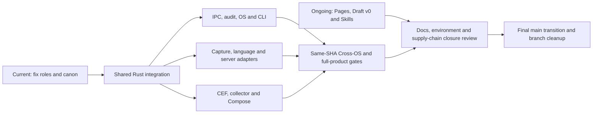
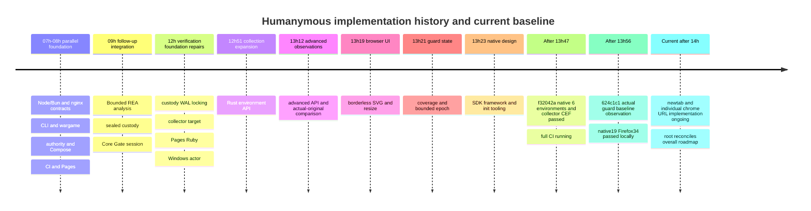
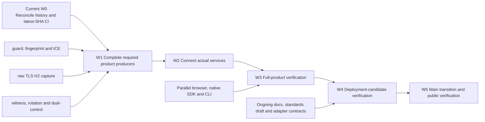

# Overall roadmap and milestones

## How to read this evolving roadmap

The current integration checkpoint below is the authoritative summary of recent
source-bound outcomes. Dated sections farther below are retained historical
snapshots, including their allocation tables, counts and then-current CI handles.
They do not grant current execution slots, supersede newer contracts or prove
freshness for later source. Actual allocation requires current root coordination
and resource admission; follow the exact live run or process handle.
## Current integration checkpoint

Snapshot: 2026-11-07T17:27:03Z. The preceding checkpoint is retained below as
history; its queued/running descriptions are not current status. Component
receipts qualify their exact inputs, not the final migration candidate.

| Area | Current source-bound outcome | Next unmet gate |
| --- | --- | --- |
| Structure and ownership | 23 live chat titles verified; structural canon aa8beef1, registry119fa52b; continuous rotation173008f0 and tooling transition41907143 recorded | Retain missing gates when rotating responsibilities; registry projection follows accepted title changes, never idle status alone |
| Public identity and host ABI | User fixes one public humanymous identity; internal adapter-* family retained. Target host canon defines lowercase managed humanymous.dll/native humanymous-native.dll, host-required extension/init symbols, single-role v1, registry-local handle limits and actual loader/version/ownership gates | Naming/facade/import/artifact migration NOT implemented or qualified; root coordinates graph/owners after reviewed target contract. No publication/namespace ownership or ABI stability inferred |
| Shared graph | CLI test-support dev edge1e977a66 and matching internal lock entry173008f0; locked/offline no-deps metadata exited0 | No external package change; final full workspace and Cross-OS candidate gates remain |
| Browser pure layer | Default ce05 plus173 graph passed30; corrected native-ui d75c351c passed42 tests/check/strict Clippy, target returned. Prior39/2,40/1,41/1 scene attempts retained; the negative disabled-attribute fixture required a boolean correction | Final scene receipt and complete CEF-source freeze pending. Actual CEF compile, tab children/cleanup, GUI/IME/AT remain unqualified; native-ui success is not native runtime success |
| CEF native candidate | Hosted d214 run42388354925 FAILED E0599; preserve that failure. Corrected fef69a92 actual Windows cached-SDK check, production build and desktop-feature strict Clippy all exited0 in approximately443/600 seconds; receipt57d0b26f retains source/SDK closure and artifact hashes | Actual GUI/navigation/tab cleanup, IME/OS AT and production credential/provider admission remain unqualified. bootstrapc qualification entry is not NativeFull; corrected remote retry remains unrun |
| CEF GUI pilot | ONE fef qualification pilot started17:01:12Z as PID33504; root verified process identity and subsequent absence17:04:35Z. Owner reports two distinct CEF IDs/both before_close/host_closed, but Back produced load_error-3 and blank local page | Navigation gate FAILED/incomplete; preserve first failure and bind private observations in the owner receipt. PID absence is not descendant termination. CtrlW versus shutdown timing unknown; no second run, IME/AT, production provider or NativeFull qualification |
| Delivery pure layer | B3 receipt bd91232d binds eaa69690 plus three exact owned overlays:93 Windows tests passed, check/strict Clippy/policy/fmt/actionlint exited0; source2786/registry3791/config20/tools4 and declared environment records unchanged. Target returned and tested overlays match committed bytes | Actual GNU wrapped-Cargo metric pilot, sparse/archive/image and full product gates remain open. Initial compiler_started=false is historical preparation, not terminal execution status |
| Browser product | Exact b4 run42394466559 TERMINAL FAILURE: preflight Go10/Lab28/Delivery90 passed; product18 assertions/16 passed/2 failed and9 required unavailable. Receipt dcfe454d records browser_selected_test_failed after DNS succeeded and matched inventory67/selected1/filtered66 | Selected-test failure is a source-reported category, not the failed assertion's root cause or authenticated browser proof. Preserve witness-exchange failure, full/release false and missing gates; no unchanged retry |
| Meari shell responsiveness | Latest ce24 normal Windows build succeeded with cached SDK; manual pilot PID2908 ended0 after15.53s, owner reports one before_close/host_closed and25 resize readbacks. Human reports shell-only150-200ms-plus perceived lag; actual pinned window path uses VelloCpuWindowRenderer/softbuffer | Human estimate is not a measured latency or proof CPU raster causes it. Browser and Performance own source/pipeline investigation and timing/GPU-window proposal; root owns Meari pin/shared graph. CEF content, GPU presence and optional offscreen GL do not qualify shell presentation |
| Audit | Historical3d325bdb SIX GNU cases passed in9bb51b44. Current private read-only owner f9b0cda3 and test-only CI seams99317a50 are source-ready; exact193 baseline files retained. Local Docker prerequisite failed before Rust execution in e506ab04 and owned container cleanup completed | Closed hosted Audit component, owner precondition gate,13 selectors and12 compiler attempts remain unrun. Test-only overlay is not unmodified f9 execution. Production native open, repair/writes/Ready and capacity gates remain unqualified |
| Watermark | Corrected2eb2069a actual29 tests/check/strict Clippy/fmt passed in9ba8e308; earlier27f Clippy failure retained | Standards-validating WASM/PNG, high-level composition and actual carrier/file/product gates remain |
| Integrity performance | c4786b67 actual27 tests; fixed-corpus release comparisonfc74b9be observed five hot paired batches13.75-18.69% shorter, paired median15.68% | Function/corpus observation only; no product/tail/allocation claim. Source ownership returned; bounded preparation tooling now prioritized |
| Network temporal layer | e1ed50ce rejects invalid Vec layouts; import correction0429731c plus public documentation overlay passed72 tests/check/strict Clippy/fmt in the third immutable attempt; frozen source and receipt306eedc8 | Initial import compile failure and subsequent82 missing-public-doc Clippy errors retained. Fleet coordinator/capture epochs/runtime integration remain unqualified |
| Native shared ownership | Actual Windows5cd2cdc9/controller ea024229 passed FIVE cooperative capture parents in ccd83927. Subsequent62f R1 shared-target allocation is NOT_QUALIFIED_COLLIDED with actual cases0. Isolated R2 receipt584aef9c records two expected outer negatives: missing-grant natural0 and live-timeout actual exit1/positive pretermination count, both Job0/original cleanup/parent_test_passed=false | Never add outer negatives to inner passing-test counts. Immediate tool closure covers10 executables; two omitted directory maps have historical comparison only. Actual bridge/ACL-at-create, producer association, interactive controller and privilege gates remain. No kernel-blocked stdin claim |
| Authority | Historical2ca6e4fa plus Network306eedc8 passed22 pure tests in14ad4378. Root accepted authorization-v2 L1 PUBLIC DATA codec/signature/binding only after final independent reviews; Hello nonce is16 bytes/32lowerhex. Existing base64.22.1 and dalek3 edges wired with locked/offline no-deps metadata0, no external package/version changes | Kernel source/tests still require validation. Signature-checked data cannot construct NativeProof/Ready or establish actual issuer/store/retained roles/one-claim/W/native transport. Full authenticated provider remains required; I!=S/O SID is not an accepted extra policy |
| Runtime temporal | Corrected1dc6eb40 source on404 base plus exact overlay passed9 selected tests/check/strict Clippy/fmt;64 filtered, receipt6af849a9. Both configure-gap and interrupted-frame review regressions included | Private L1 bookkeeping only; production temporal composition/epoch/provenance/provider gates remain. Full1dc Cargo graph was not the tested graph |
| Model standardization | Exact e7d8f9a3 passed17 library tests plus1 inference fixture in70276560. Subsequent aeefd20c metric reducer passed4 new Windows tests/check/strict Clippy/fmt,17 library tests filtered;1498 declared closure records unchanged, receipt55fd8e6a | Prior17 and inference fixture were not repeated by the reducer run. RNG, training, cohort/lifecycle and actual lab remain; no production activation, Go oracle or scoring change inferred |
| CLI consumer | Actual Windows receipt91536cce binds source c57cf0c6, consumer fb6f26ed and controller24004321: ONE selected parent passed, FOUR subcases exited0/74/74/74; natural parent exit0, Job assigned before grant, Job empty and original cleanup deadline observed in2018ms. Parent, baked fixture and controller hashes retained | Fixed cooperative component only: runtime completion simulated, kernel-blocked write unproven. Actual SCM/accounts, protected service startup, native producer association and outer-controller fault paths remain open |
| .NET consumer | Receipt50369722 binds62f47765 plus four exact overlays: launch8/protocol8/managed-scope1 Windows pure tests passed, fmt/check/strict Clippy0;81.15 seconds, declared11521 input rows unchanged and target returned | No actual Kestrel/GC/AOT/package or protected producer proof. New incremental chunk parser is source-only and requires separate validation; interactive controller and real native admission remain prerequisites |
| Legacy report | c5294b5d binds8 selected pure legacy tests/check/strict Clippy/fmt passed on exact e34 base plus owned overlays;2 ignored/17 filtered and2715 source files unchanged | Registry/tool/config closure not measured; CLI execution and actual file publication/Windows-denial pilots remain unrun |
| Lab diagnostic continuation | Actual306 hosted42390164354 TERMINAL FAILURE: preflight passed; product18 assertions/16 passed/2 failed. Safe DTO observed inventory67/selected1/filtered66/matched, actor exit1 and DNS-finished stage; CI6f290e7d and Lab c57cf0c6 retain results | DNS completion is observed, not the failure cause. Private actor/test body unavailable; no asserted root cause. Closed source-only failure classifier is next; no unchanged retry or full product qualification |
| Bounded preparation | Earlier2229d502 Windows link fixture failed OS1314 while Linux6 passed. Maintenance CLI source5c1b9447 passed full64 library plus CLI9 in c13eb782. Subsequent planner577e1940 passed full73 library and CLI4+6+3/check/Clippy/fmt in ce24fe52 with42 frozen inputs unchanged and physical lease returned | Planner outputs proposed metadata only, not independent ownership/terminal/archive/read-back or retirement authority. Full33 integration matrix, Windows link-refusal, named120-second identity binding and provider gates remain open; no speedup/cache authority claim |
| Pages | Exact29096 hosted42389773240 TERMINAL SUCCESS; Delivery90/Pages37, check/Clippy/policy, bundle audit, both-baseurl validate/package/SECONDarchive all passed. Each variant88HTML/165files; source unchanged. CI receipt0ad6c40a and Pages7130239b independently agree | Artifacts0/serving transfer null; no HTTP/IAB/AT/deployment/full-freshness qualification. GitLF candidate differs from five old prepared CRLF files; never reuse old raw artifact hashes |
| Dedicated wargame | Exact306 hosted42387564172 TERMINAL FAILURE. Preflight succeeded; product128448838263 emitted26 scheduled/19 evaluated/7 unsupported/0 errors/skipped/mismatches, all19 expectations true and72 Lab assertions passed | Required-unavailable9/blocked10 keep owner exit2 and full/release false. Raw-body hash is reported but private original body was not retrieved/independently rehashed; no unchanged retry forgreen. Unsupported/provider tasks require implementation |

The initial allocation admitted four one-job local pure owners; terminal
Browser/Delivery slots were returned before Lab/Authority allocation. The user's
subsequent CPU-capacity request raises the lightweight ceiling to SIX under the
structural canon:32 logical CPUs, sampled CPU15/13/23 percent,32.69 GiB physical
available and commit82 percent. Runtime temporal tests and model standardization
tests receive the two additional grants. Existing target exclusivity, one-job,
physical available greater than20 GiB and commit below85 percent still apply;
heavyweight work is scheduled separately. This is a dated allocation record,
not a reusable workload grant.
No package publication, tag, OIDC exchange, final main merge or branch deletion
has been performed by this checkpoint.

## Earlier integration checkpoint (historical)

Snapshot: 2026-11-07T14:41:34Z. Source-bound component results below do not
qualify the final integration candidate. Execution allocations are ephemeral;
only an explicit current root grant and resource admission authorize a new run.

| Area | Implemented or observed | Remaining gate and next action |
| --- | --- | --- |
| Workspace | Immutable77ca7d9f Windows `cargo build --workspace --all-targets --locked --offline -j1` exited0 in643.964s;2427 source files before/after, zero differences | Later graph/source is not covered; final Windows/Linux/macOS build/test and package gates remain |
| Shared native graph | Windows bridge9d0c0db9 registers40 workspace packages; locked/offline metadata and depth-one bridge graph passed; only existing windows-sys0.61.2/windows-permissions0.2.4 versions | Six-wrapper exception is explicit; source-only graph registration is not Windows API/ACL/producer qualification. Current bridge/binding/retained-capture pure checks are separately allocated |
| Capture | Genuine hosted42372114913 at e77b9792 succeeded: five actual fixtures passed, source unchanged and full=false | Serving H2, DNS/origin/witness and full Docker composition remain separate product gates |
| Audit | Captured319a5992 full140 accepted tests and PhaseB fb06c4d1 scoped33 passed; five historical helper exclusions remain explicit | Linux native3d325bdb cold validation is active after scoped offline tree resolution. Initial full-workspace metadata failed for unrelated missing ASN1 cache and was preserved; no source compiler failure was inferred. Native producer and operational capacity/custody gates remain |
| CEF | Genuine hosted42377685195 at ec4f2da0 succeeded: helper14, native build, desktop protocol4, bootstrap protocol3, actual bootstrap1 and desktop process2 passed; source unchanged | Four observed rejection cases exited78 and were reaped; browser_ready/full_runtime_qualified remain false. GUI, IME, accessibility and full sandbox remain unqualified; earlier failures retained |
| Mount custody | Baseline b482 had eight mode refusals. Repaired exact c3211e27 hosted42374587466 passed: four ordered observations/eight accepted paths, owner0/receipt valid/source unchanged/cleanup true | This supplied the prerequisite for the completed bounded c321 Go8 run; custody/full/release remain false, not a product qualification |
| Rust Gate integration for Go origins | Genuine hosted42375310198 at exact c3211e27 passed all8 ordered evaluated cases and40 known assertions; failed/not_run/unknown0, owner0/receipt valid/source unchanged/cleanup true | Bounded net/http component only; full/release=false. Other Go framework/SDK tuples remain unqualified. Older15f writer-mount failures retained |
| Apache | Exact b4000944 genuine hosted42374566498/job128409407533 passed45 unique scenarios: event15/worker15/prefork15; pilot/container/image/ledger cleanup passed; CLI exit0/reaped/no force/timeout | Exact Linux component tuple qualified only; fullProductSuccess=false. Earlier b5 35/10 and SIGTERM15 remain historical failure evidence; final composition/current graph remain separate |
| Runtime TLS | Exact1646c482 six selected actual TLS tests passed against Auditf88 | Both identities still CHALLENGE/zero origin; positive TLS ALLOW-to-origin unqualified; epoch gate pure tests do not establish production/native Ready |
| Native/.NET | Parent-context shared4/runner7 and .NET consumer13/check/Clippy passed on captured inputs; generic managed ABI079 actual once passed independently | Context remains UNVERIFIED syntax/budget data; retained partial-start/duplex source1b2e8bb2 passed12 pure and1 direct-child fixture; independent Authority expiry passed14 pure in689b95d2. Actual ASP.NET IO, native Job/reader convergence and protected owner remain open |
| Pages | c88c8e74 records both88-page/165-file variants, second archive checks and actual HTTP bytes for all165 files each; limited IAB keyboard/menu/mobile/contrast observations passed. Ledger-only36c2fc52 adds49 verified review records without changing rendered public input | Older ad04 verifier scope stays explicit. Limited observations are not whole-browser/AT/WCAG qualification; current review gaps, main artifact deployment and required AT remain open |
| Python/Ruby/Node and ABI | Scoped package, contract and selected actual native component receipts exist in owning SoTs | Default/pure tests do not prove required SDK/server/GC/GVL/cross-principal/native ABI matrix; owners retain explicit unqualified cases |
| Browser product | Baseline493 failed16/18. Diagnostic a6 passed22 Windows units and Windows/GNU checks/strict Clippy with zero declared input drift in bb763c1f; fresh Delivery consumer proof passed | Sole authorized hosted42381878489 at exactbb763c1f passed preflight and entered product job128431657269; actual product result remains pending. Stage markers are not process attestation; preserve failure and cleanup limitations |
| Watermark | Initial9b064dbd passed16 units. Expanded27f1 source authored29 but fmt/check passed then strict Clippy failed101 before tests;2eb2069a corrects the iterator without suppression | Corrected29-test candidate is queued, not passed. WASM/PNG codecs, high-level validated composition, actual resource pilot and14-row qualification remain open |
| Delivery notices | cba96264 finished-archive verifier passed81 units/checks. Next native-artifact caller initially failed82/83 on TOML parsing; corrected parser passed83 units/check/strict Clippy/policy/actionlint/fmt on declared frozen9d+9 overlays | Final proof recording follows. Actual source-bound native binary tar and image extraction/scan remain NOT_RUN; first tar/gzip-stream scope is explicit. Shipping rejection remains an expected negative, not release approval |
| Performance | Exact9b064dbd four signals library builds exited0: first15 fresh/8 rebuilt, subsequent23 fresh/0 rebuilt; Cargo rounded footers5.55s/0.18s/0.16s/0.18s; source2539/config18/tool2 unchanged in73de40c4 | Project-quiet with external load observed; CPU/RSS unknown. No runtime speedup claim. Delegated Integrity normalization optimization must preserve81 request and27 verification vectors plus Unicode/token parity before measured paired comparison |
| Integrity optimization | Exactc4786b67 passed27 Rust tests, including81 request and27 verification vectors; check/strict Clippy/fmt and declared source2563/selected registry1041 comparisons passed in5e2f9a5b | Release function benchmark is queued after cold Audit. Fixed81+6 corpus is not representative traffic; one large synthetic case can weight byte work. No measured speedup, allocator count or tail-latency claim |
| Pass protocol | ae57c13e implements pure generator/TTL/alignment;37 native challenge tests passed, including27 new Pass cases, plus check/strict Clippy/fmt;718 selected files unchanged | No independent Pass Go golden-vector or actual issuance/single-use/event-proof/attestation integration proof. Runtime owner prepares the bounded authenticated handler contract |
| Other missing core behavior | Core plan056fb2fe maps23 rows; existing behavior/PoW reused. Generic MAD37936ee0 authored12 tests and model record68898522 authored7; report/correlation/traffic/rate owners have explicit follow-ups | Source existence does not retire rows. Current pure validations, remaining kernels/producers, actual process pilots and frozen runtime composition remain required |

Audit PhaseB fb06c4d1 also passed33 scoped Rust tests in efdfdbd7 with unchanged
2488 source files and declared registry/config inputs. Native Linux source
3d325bdb is undergoing its first cold compiler/test gate; open_native remains Unsupported.
Runtime typed startup6c02bd22 passed3 pure tests in7e208649; this does not prove
actual bind/unseal/Offer/Ready or native cleanup. CLI792a2fab passed9 pure tests
and scoped checks in acc77d2c; actual blocked-output/process deadline remains open.

The convention and performance chats now have separate bounded assignments.
Convention records concrete findings and independent re-audits; performance owns
only the delegated Integrity canonicalization module, its exact test module and
one benchmark example in addition to its named specification files. Root retains
shared graph and security integration responsibility. Current Pages rendered input
015cd2fa is bound to c88c8e74; later ledger-only edits do not manufacture a fresh
Jekyll build or compiled verifier. Workload grants below this
checkpoint are historical, not permission to start concurrent compilation.

The workspace build and source-closure receipts are attached privately to
evidence:root/20261106194410. This is an archived-source inventory comparison,
not a registry/SDK/linker/OS closure attestation. The build predates072c8e5a and
all later pending source changes. New bootstrap dependencies add no packages or
versions and confer no runtime qualification.

The mount baseline identifies the strict mode predicate, but its actual numeric
mode was not recovered. Never infer0755. The repair retains distinct role UIDs,
strict0700 and existing predicates; no privileged initializer or weakened custody
rule is accepted. A green diagnostic collection is not a green custody policy.

The Apache next-run policy boundary explicitly accepts only Lab's product image
recipe change outside Apache's unchanged recipe and workflow policy inputs;
it is not an88-input zero-drift claim. Group isolation is a source-supported
candidate explanation for the historical SIGTERM15, not proof of its old PGID.

Allocation records are historical receipts, never a live slot ledger or future
permission. Audit PhaseA, Native partial/duplex, Authority expiry, Runtime native
HTTP controls, collector boundary and CI image-validator batches returned. CI image76
passed on its declared81 source/3791 registry inputs and8 config candidates;
actual image build/scan is NOT_RUN. Browser warm-only compile was interrupted
and returned without executing marker tests. Root then allocated a bounded Lab
expectation-consumer batch; it grants no actual Docker/browser launch. Every new
run still requires current admission, jobs1/incremental0, locked/offline inputs
and an exclusive target. No SCM/account/SDK/Kestrel mutation follows from this table.

Collector efe090e5 adds65537 local refusal and65536 actual Fetch boundary steps
inside the existing single selected browser test. Native consistency1, WASM
all-target check, strict Clippy and fmt passed over105 captured source/manifest
files; registry/compiler/SDK closure was not captured. Actual browser execution
of the new steps is NOT_RUN. Lab must consume fixture.effect_requests=2 and
derive exact request/audit/witness counts before the next browser candidate.
Runtime f8 native TCP controls separately passed2 tests in6fa1c192 against the
older87a fixture; these are not actual BrowserSession evidence or proof for the
new fixture. Source-specific outcomes do not transfer across these checkpoints.

## Final integration milestone order

### Shared process-helper review gate

Root source review of `crates/test-support/src/process.rs` found that
`capture_with_stderr` is not evidence of a hard cleanup deadline or joined
readers. `stop` invokes blocking `Child::wait`; output-reader JoinHandles are
discarded; startup writes are synchronous; the subsequent child wait starts a
fresh relative timeout. These are source observations, not an observed hang.
Existing component receipts retain their exact observed outcomes, but cannot
establish these broader properties. In particular, Delivery must not infer
container or reader cleanup from this helper's timeout, guard drop or comments.

Native Windows owns the shared API review; Delivery owns its Docker caller and
Convention independently audits the finding. The next design must distinguish
observed direct-child exit, reader joins, daemon-side container identity and
unknown descendant cleanup, preserve one original deadline and retain owners on
failure. Docker create can fail after the daemon created an object: recovery
must validate the unique owner label, image ID and stopped state before removal;
an unknown or foreign object must never be removed. No new helper guarantee or
actual Docker result is accepted until source review and allocated tests prove it.

Root accepts a diagnostic retained-owner implementation under an independent
outer host/job supervisor. Original run/cleanup deadlines are observation and
stop-request thresholds, not universal hard OS-call bounds. Polling may not perform
blocking wait/join/write; the owner retains the actual child and every worker.
Only completed joins and observed status may yield a settled result; expiration
returns the same unsettled owner with sticky failure and descendant coverage
Unknown. A documented blocking final join under the outer supervisor does not
become hard-bounded through an is_finished check. Dropping a must-use owner is
abandonment/Unknown, never settlement. Native owns implementation and consumer
inventory before allocated tests; existing consumers are not silently upgraded.

The exact internal delivery->test-support manifest/lock edge is registered in
74c09dd7. Actual locked/offline metadata and depth-one graph resolution passed;
no external package version changed. This graph check neither compiles the new
capture API nor qualifies image extraction. Delivery archive regression and Lab
diagnostic consumer batches retain separate frozen sources and terminal gates.

| Milestone | State | Exit requirement |
| --- | --- | --- |
| M1 shared contracts and package structure | In progress | Finish native owner/context/epoch/identity boundaries and source-bound units without weakening security |
| M2 component runtime qualification | In progress | Complete current-source adapter, CEF and Cross-OS actual pilots; failures/unknown/ignored cases resolved or explicitly outside the approved product contract |
| M3 composed product e2e | Not qualified | Actual isolated Docker browser/runtime/Authority/audit/origin/witness composition, required adversarial and accessibility checks, exact cleanup and source/image binding |
| M4 current Pages and Draft v0 | In progress | Complete current-source manual reviews, fresh dual-base builds/archive transport, browser and required AT validation; no unsupported public claims |
| M5 shared main integration | Held by M1-M4 | Exact final candidate passes all mandatory gates, then normal integration and post-merge verification |
| M6 main-only and approved Pages | Not started | Verify integrated main and approved serving, then retire authorized obsolete branches/files without losing required evidence |

M1-M4 may progress in parallel under separate file ownership. M5 and M6 are
ordered final gates. Package publication, release tags and OIDC token exchange
remain outside current authorization. The full Rust migration goal stays active.

## Go component and full-product result ownership

The dedicated Go workflow requests bounded Go8 qualification. Lab owns an
explicit typed requirement/mode that may return zero only after all eight real
scenarios, exact source/image/actor/artifact binding and owned cleanup pass. CI
consumes that sole result contract. It must not blanket accept exit2, reinterpret
unknown statuses or infer qualification from a generic process exit.

This decision supersedes earlier wording that intentionally kept every
standalone Go component job red through --require-full. The existing full-product
gate retains --require-full and must remain nonzero until every product gate
passes. A bounded component success always keeps full_product_qualified=false;
it does not close the program or waive any final gate. New typed-mode behavior
and its refusals require tests and actual hosted execution before qualification.

## Completed local workflow parity comparison

evidence:root/20261107092034 records the actual paired run: local Windows Desktop
act0.2.97 and GitHub run42360069900/job128366376073 both pass six suite records,
same control d610ab4d/workload8132117/image/lock/Rust/cgroup4CPU2GiB/UID0. Initial
workspace build is100.332s local versus157.570s GitHub; initial collector is
40.546s versus35.410s, so local is not universally faster. Initial runtime process
is17.536s versus31.047s. Hardware, cache and metric limitations remain in the
evidence. The local environment is usable and the quiet window has ended;
subsequent code still needs its own current-source qualification. The normative
execution venue table is in sot:root/rust-migration; prior hosted-only snapshots
are historical. Real Cross-OS/final hosted obligations remain unclosed.

The user subsequently authorized actual local Windows/WSL timing and resource
comparison, superseding the blanket hosted-only rule. The temporary measurement
quiet window against exact 8132117 in an isolated checkout has ended after the
paired experiment above. No hosted environment markers are spoofed. Actual SCM/account changes
remain outside this benchmark. Local Actions executor research is recorded in
evidence:root/20261107090552; wrkflw is an evaluation candidate, while the existing
Rust validation commands remain the preferred shared command authority.

The 38-package owner and remaining-gate inventory is recorded in
evidence:root/20261107085448. It inventories the dirty working graph, not an
immutable verified candidate; component passes do not close a package or the
program. A separate 4B model smoke crossed the commit guard and its owned
process was terminated without an API request. Afterward root measured 81.9%
commit and 35.41 GiB physical free. Further model initialization is held for
static KV-memory analysis; four bounded Rust verification slots remain allowed.

## Historical allocation snapshot: 2026-11-07 concurrency increase

The user explicitly requested higher local concurrency. The current ceiling is
four independently allocated pipelines (A/B/C/D), superseding earlier two-slot
snapshots. At admission, measured physical memory is 63.34 GiB with 33.21 GiB
free, commit limit 68.34 GiB with 12.75 GiB free (81.3% used), 32 logical CPUs
at 48% load and 167 GiB free disk. Physical free memory alone is not commit
headroom. Each Cargo pipeline retains jobs=1 and incremental=0 and an exclusive
target directory. Admit new work only below 85% commit and above 20 GiB free
physical memory. At 88% commit or below 16 GiB free, defer new compilation and
reduce subsequent allocations; never terminate another owner's processes.

| Slot | Current allocation | Exclusive target | Boundary |
|---|---|---|---|
| A | Actual Unix Python WSGI fixture qualification on immutable 8eb66811 | /home/smile/humanymous-validation-targets/python-native | Private native-extension/virtualenv setup; owned loopback only; actual cases still pending |
| B | Git coordination isolated regression and manual multi-path validation | target/validation-maintenance | UTC conversion defect reproduced and fixed; no shared Git index/HEAD fixture mutation |
| C | Actual Apache Desktop Docker build and45-scenario coordinator | Isolated clean e691b971 checkout and fresh private bundle | First credential-helper failure retained; corrected scoped Windows child PATH; actual build still pending |
| D | Runtime actual ordinary-user Unix library and native-process fixtures | Linux-native target/runtime-native | Immutable committed snapshot; no SCM/account mutation, Docker or external network |

These are dispatch allocations, not terminal success claims. Completed prior
batches: delivery55 pure tests and all-target Clippy passed; first Unix Python
WSGI check and Clippy passed with all2202 regular-file snapshot hashes unchanged.
No Python server or scenario execution is implied by that compilation. Audit
ordinary-user Windows actual targets passed44 tests: control_operations21,
durable_witness13 and key_custody10. Three raw ignored helpers remain excluded;
the111-file before/after closure matched. Audit check/Clippy and10 reviewed pure
units also passed; evidence:root/20261107095831 records its exact scope.

Apache Linux pilot-feature units10, all-target check and Clippy passed on
immutable271b14e1 after preserving the first2ffa4335 Clippy failure and fixing
four findings in primary source. Full extracted-source closure was unchanged.
This covers Linux coordinator/host compilation, not httpd ABI, bindgen or45
actual Docker scenarios. Desktop execution is queued until the .NET release
build returns so heavy native SDK work remains serialized. That release build
has now returned: facade76.032s and qualification harness --no-run12.616s both
passed on clean2ffa4335 with261-file zero-drift closure. Actual ASP.NET host,
SDK publish/JIT/AOT/GC and installed-package qualification remain separate gates.
The returned heavy slot is now assigned to the Apache actual coordinator.

Windows Runtime subsequently passed all46 declared library cases and the actual
native-process case with zero failures/ignored/filtered. Its476-file closure
matched before/after; Unix-only four cases and the Unix operator fixture are not
covered. CLI check, reviewed seven units and Clippy passed;15 cases were filtered
by the reviewed selector. Its366-file observed closure was unchanged but included
document/fixture differences from HEAD, so this is not a clean-candidate receipt.
Delivery subsequently passed58 pure tests and Clippy, including fail-closed Rust
image inventory coverage. No actual image scan followed; plain binaries without
package inventory must report NOT_SCANNED rather than vulnerability-free.

Production CLI observer/witness startup remains incomplete: a typed pipe helper
does not provide an authenticated bounded one-use bootstrap broker or own child
lifetime through final audit flush. Authority owns the normative bootstrap
contract, native-security independently critiques principal/PID/purpose binding,
and CLI remains fail-closed while the producer seam is missing. The independently
reviewed Audit retained-backup retirement slice is authorized separately; prior
44-test evidence does not qualify its future implementation.

Pages Windows frozen private dependency setup failed before rendering: the
initial long path failed extraction, then a shorter path reached missing OpenSSL
headers/pkg-config and MSYS keyring errors. No lock downgrade or signature bypass
occurred. WSL preflight found no native Ruby or OpenSSL header; a Windows bundle
executable inherited through PATH does not qualify Linux tooling. Hosted Linux
Pages validation remains required. Apache Windows pilot units passed ten cases
but exclude Linux httpd host code. The private official .NET SDK readiness check
passed but does not qualify the actual ASP.NET host or a separate ordinary actor.

Heavy CEF/native/bindgen builds remain mutually exclusive. Model loading needs
a separate explicit allocation and is not implicitly enabled by the new ceiling.
Manifest changes still require a root-owned integration window between builds.

## Current integration delta: 2026-11-07, after 6500ec23

This delta supersedes the live-state claims in the older briefing below; older
source-specific results remain historical evidence. There are 38 registered
workspace members, including Apache native and the .NET export facade. Shared
graph commit 6500ec23 is local and is not the source of the live hosted run.
No package publication, release tag, OIDC token exchange or main merge occurred.

| Milestone | Current evidence | Next required action and owner |
|---|---|---|
| Coherent graph | 38-member metadata and scoped spec check pass; lock incorporates approved edges without unrelated version downgrade | Compile latest native packages and freeze all required source; integration and package owners |
| Local component closure | Go latest 10 pure tests and all-targets Clippy pass; maintenance latest 36 pure tests/check/Clippy pass; Pages latest 26 pure tests/check/Clippy pass; Capture latest 22 pure tests, feature Clippy and five hosted-test compilation pass | CLI latest seven pure/check/Clippy passes remain provisional because shared inputs moved; .NET owns A and delivery owns B for bounded validation |
| Hosted policy | Run 42355168729, source 8132117: policy succeeds | Preserve narrow permissions and mandatory component gates; CI owner |
| Hosted native execution | Ubuntu builds all targets; actor executes 15 of 88 harnesses, 51 tests pass, then coverage validation fails | Provision mandatory Node/Bun pilots; collect later contained harness results while retaining final failure; host and OS-runner owners |
| Docker product lab | Actual 35 checks: 33 pass and two fail; wargame evaluates zero of 26 scheduled cases, with 19 errors and seven unsupported | Fix readiness contract mismatch and recover actual evaluation; runtime, wargame and lab owners |
| CEF component | Two explicitly provisioned desktop process tests wired under native-pilot-tests; no actual execution yet | Existing hosted runner provisions separate fresh positive/cancelled bundles and executes both; CI/browser owners |
| Cross-OS and browser | Linux/macOS stop at 15/88 with 51 passing tests; Windows builds then stops at 15/89 with 55 passing tests, all at host_process coverage; browser-product fails browser_gate_start | Inspect subsequent independent MSRV/image jobs without treating this step failure as global nonexecution |
| nginx actual component | Exact 8132117 job 128358355202 succeeds: all 35 scenario groups pass, ignored=0; module SHA-256 a911735564a23f646e2d7242d6a68f3b37a5622f860221b9ec19e92ab8f74845 | Preserve source/artifact proof; full_product_qualified remains false and does not cover later shared changes |
| Final product | Qualified collector/capture/Pass joins, actual adapter matrices, human/AT controls and complete runtime recovery remain incomplete | Complete required paths and obtain current-source actual receipts; all owning chats |
| Final integration | 336 tracked Go files still require replacement proof; Pages/freshness and main-only state unverified | Remove obsolete product code only after parity gates, finish public docs, merge/verify main and retire migration branches |

The Ubuntu failure includes three ignored Node/Bun product groups, which are not
subprocess helpers. No ignored-test waiver or denominator reduction may make
that gate pass. Future continuation is permitted only after a completed,
contained child with EOF; source/identity failures and uncontained spawn,
capture or timeout failures stop immediately. Execution completeness is distinct
from successful coverage. All later rows and the aggregate failure must survive.

The deterministic runtime/defender readiness source mismatch is a diagnosed
contract defect, not a recovered private explanation for every Docker error.
Runtime must expose one authoritative readiness builder for the defender to
reuse without dropping witness, durability or fail-closed capability checks.

## Integrated briefing: 2026-11-07 08:08 UTC

This snapshot covers all19 project chats (integration plus18 dedicated owners).
The worktree contains36workspace members; shared Cargo/lock changes are still
being integrated. A chat being idle or its last turn completing does not mean
its persistent objective or product scope is complete. Test counts below are
source-scoped checkpoints, never a combined full-product pass count.

| Owner area | Implemented or observed checkpoint | Remaining completion gate |
|---|---|---|
| Integration | Shared engine/integrity/collector,36-member working graph, opt-in local-edit profile;143obsolete files and88empty retired directories removed | Freeze a coherent committed graph; complete collector/engine parity and all cross-context joins; final candidate/main |
| Runtime/Gate | Management observer, signed sessions/ACK, bounded admission/streaming, sealed recovery and typed shutdown source | Current-source pure/hosted lifecycle, durable settings/effects, qualified collector/capture/Pass joins |
| Authority/IPC | Credential-bound normalized profiles and shared sealed-key startup source40d0bdd | New startup compile/pure tests, actual peer/ACL/replay/restart/other-UID and sealed custody pilots |
| Audit/custody/state | Retention/rotation7pure and scoped Clippy/static checks passed atc6a6492; trusted snapshot7dba59d authored | New snapshot checks; actual independent retention, repair/rotation/erasure and restart/effect ordering |
| TLS/H2 capture | Earlier21pure and scoped Clippy passed; pending-handshake ownership b0363e9 adds22-case corpus | Fresh22pure/hosted-feature compilation; actual5TLS/H2 pilots; supervised runtime binding |
| OS security/Windows | Provider/fixture/storage/strict-JSON7pure plus scoped Clippy passed | Actual service-principal WinCred/ACL/SCM, latest runner accounting and native OS tuples |
| Operational CLI | Doctor/install/provisioning and service-host source; earlier6pure passed; newest7-case scope changed | Fresh parser/FSM checks; signed install/start/readiness/stop/update/rollback and actual service fixture |
| Node/Python/Ruby | Shared framework; Node host-feature check and Clippy passed; Python native type error corrected | Python native recheck, Ruby host build, actual frameworks/body/cancel/stream and clean wheel/gem/npm installation |
| nginx | Latest14pure, package check and scoped Clippy passed | Native build/pilot Clippy and actual nginx/authority35-group hosted contract |
| Apache | Safe lifecycle checkpoint; new9-case corpus and native bridge/header pins authored | Register native graph, compile generated ABI, actual event/worker/prefork request/lifetime/cleanup pilots |
| Go compatibility | Previous3pure/all-targets Clippy passed; new response probe expands6-case scope | Fresh probe checks and actual pinned Go origin8-case isolated contact/response receipt |
| .NET | Safe lifecycle and approved3managed source files authored; Rust bridge/facade source | Register new graph; current Rust/C# compile, real Kestrel/JIT/NativeAOT/GC and package qualification |
| Native ABI/C/C++ | Earlier core15/export6pure passed; new shared version/resource APIs and header example | Latest core16/export6/example3 checks; generated header and actual C/C++ layout/dynamic-call evidence |
| Meari/CEF browser | Earlier23pure/scoped Clippy passed; native lifecycle/probe/scheme source continues | Current native build, seven-step probe, cancellation/crash/IME/AX/DPI/OS and real controls |
| Product lab/Compose | Isolated browser, DNS/witness/recovery and strict public receipt source | Actual immutable-source Docker topology/UID/egress/outage/cleanup, adapter and origin-contact qualification |
| Wargame | Shared-decoder26attacker/defender+2JSON pure checks and scoped Clippy passed | Actual owned runtime attack catalog, byte-exact public receipt and ordinary/human/AT controls |
| CI/CD/OIDC | Prior38pure/scoped Clippy; free hosted two-lane workflows;4registry environments prepared | New candidate run, actor diagnostics, explicit native-host feature gates, cache/metrics, CVE/SBOM/package closure |
| Pages/Draft v0 | Earlier88pages rendered atboth baseurls on63f69ae; current tool26lib+1bin passed beforelatest URL-segment fix | Fresh helper tests/render/browser/freshness and standards wire/interoperability/security/privacy/a11y review |
| Rules/skills/evaluation | Current34pure, all-targets check/Clippy; read-only inventory14skills/6roles/errors0/mirror drift0 | Fresh provider discovery, hosted storage/package tests and actual paired model evaluation with declared runtime |

At this historical snapshot the full CI was42348518353/source63f69ae:16jobs,3success/13failure.
No new integrated hosted result exists for the later worktree. The old six-tuple
and CEF/component successes do not qualify current complete product behavior.
336tracked Go files remain; migration is not main-only. npm/crates/pypi/rubygems
environment preparation is not package publication or external trust verification.

| Gate | Present state | Exit evidence |
|---|---|---|
| G0 Coherent candidate | In progress; committed owners plus pending shared graph | Required manifests/API sources tracked together, lock consistent, source freeze |
| G1 Component completeness | Mixed source/partial pure checkpoints | Latest selected pure/lint/static gates; full engine/Pass/collector/state scope accounted for |
| G2 Actual service joins | Source implemented in parts, unqualified | Real capture/collector/authority/audit/credential/adapter effects and refusal paths |
| G3 Product and OS verification | Waiting for latest-source hosted execution | Supported OS/arch/features, isolated Docker/browser/wargame, failure/restart/cleanup and human/AT controls |
| G4 Delivery/documentation | Partial | Package/archive/CVE/SBOM, same-source Pages/standards freshness, user/developer skill evaluation; registry preparation |
| G5 Final retirement candidate | First143files/88directories removed; Go retirement pending replacement proof | Retire Go/oracles/old images and unused surfaces, then rerun full gates on the cleaned candidate |
| G6 Main-only completion | Not started | Integrate latest main into verified candidate, update main, verify approved Pages serving, remove migration branch |

G0-G6 indicate dependency order, not dates or an invented completion percentage.
Independent research remains tracked: Computer Use/crawlers/datacenter/API/mobile,
DRM capability limits and provider-container scenarios have design/source findings,
not a demonstrated universal blocking guarantee. No paid infrastructure, package
publication, release tag or OIDC token exchange is authorized by this briefing.

## 2026-11-07 role separation and completion-gate timeline

### Where obsolete files are removed and the prerequisites

The current checkout is codex/rust, with 336 tracked Go files remaining. main retains
the existing Go project and does not incorporate the new Rust work in advance. Remove
obsolete files on the Rust branch, pass all gates on the final deletion candidate,
and then integrate into main. The order is: secure Rust replacement functionality,
owned-product verification and oracle-comparison evidence; retire references and the
deployment inventory; create the deletion candidate; run all gates on the cleaned
tree; verify main/Pages. Do not create a circular requirement that all CI failing on
CVEs in Go slated for deletion or old shipping guards must first turn green before
deletion is allowed. Equally, do not hide failures by deleting before replacement
product verification. Each owner may first clean up independently obsolete docs,
agent mirrors and duplicate configuration after reviewing references. Final
retirement of Go/oracles/old images and vendor environments is verified on the root
integration candidate. Full actualRuntime/adapter/CEF/CrossOS qualification remains
incomplete, so no final Go-deletion date is fixed. The user request remains active,
without cancellation or reduction, as part of the completion conditions.

### Adjusting local verification concurrency from measured resources

Following the user's request to raise the limit, Windows CIM measured physical
memory 63.3GiB/free 35.3GiB, commit 54.7/67.3GiB (81%), 32 logical CPUs/load 39%,
and C: free 184.9GiB. No cargo/rustc processes were running then. Use the remaining
12.6GiB of commit capacity, rather than physical memory, as the limiting resource
and raise local verification from a global 1 to 2 pipelines. A uses the existing
shared target; B runs lightweight pure verification in the separate
target/validation-agents, each retaining jobs1/incremental0. Run only explicitly
assigned slots; never put two writers on the same target. At commit >=88% or
physical free <16GiB, defer starting a new B and reduce the next allocation to 1.
CEF/native-heavy/bindgen overlap and local product execution are not authorized.
Remeasure on completion without forcibly terminating processes. Git/index and
shared-lock changes retain a single writer. Change dependency/feature manifests
only within an integration window to reduce repeated locked-verification failures.
This policy updates the earlier global-1 wording and was sent to 18 dedicated chats.
A was assigned audit pure recovery/key custody; B, maintenance pure verification.

### Workspace/language-profile integration checkpoint

The shared workspace explicitly registered framework-adapter/python-adapter/
ruby-adapter, integrating 30 members. Cargo retained the existing lock and resolved
17 new dependency packages and the path graph, incorporating the authority zeroize
edge and Node's shared-framework consumption. The first offline check failed before
execution because pyo3 was not cached; framework cargo check passed after online
resolution. CVE/host-ABI verification of the new packages remains incomplete. Lock
registration does not mean supply-chain verification is complete.

The integrity PythonAsgi/PythonWsgi/RubyRack profiles bind installation identity to
an exact normalized header mode and reject forged peer/connection/capture/stream
and raw signals. Existing Node/nginx and scoring were unchanged. Current-source
locked --lib pure checks passed for authority10/framework6/integrity22 (38 passed,
0 failed/ignored/filtered); all three crates passed --lib Clippy -D warnings. The
first CLI attempt repeated --lib and ran 0 tests due to an argument error; only the
corrected command contributes to those denominators. rustfmt check found test-layout
differences; formatting was applied and rechecked. Python/Ruby extension builds,
actual IPC/framework/native ABI and product e2e are not_run. The earlier Pages lock
mismatch preceded this integration and is checked separately by the next locked run.

The subsequent Pages retry also ran 0 tests due to lock mismatch. The parallel CLI
manifest's tokio signal feature required resolution of signal-hook-registry1.4.8.
After offline resolution, root directly reran locked offline --lib verification:
Pages22 passed/0 failed/ignored/filtered and lib Clippy -D warnings passed. Actual
Pages rendering/browser execution remain not_run. Because shared-lock changes can
move together with owner manifests, freeze dependency manifests during root's
resolution window and parallelize source work only.

This section updates the earlier 13-chat/unassigned-follow-up snapshot. Adding 5
dedicated Apache/C ABI/Go/.NET/raw-capture chats to the existing 13 yields 19 chats
including root. This counts creation/assignment, not acceptance of every goal,
build completion or product completion. 071ccef registered naming rules, the
THREADS registry and nonoverlapping lanes. Root released agents-meta normally and
handed it to maintenance. Detailed ownership follows .agents/sessions/THREADS.md
and LANES.md.

| Stage | Current status | Exit condition | Owner/parallelism |
|---|---|---|---|
| T0 Canon and roles | Rules/19 chats assigned; follow-up claims being checked | Actual goals, path owners and contracts agree | root/maintenance |
| T1 Shared Rust integration | Partial implementation; new language crates/lock integration incomplete | Shared-core reuse; exact-source unit/fmt/Clippy | root + each crate owner |
| T2 Security and service completion | authority/management/audit APIs implemented; actual operations unverified | Actual IPC peer/ACL, secret provider, witness recovery and drain verification | Separate runtime/authority/audit/OS/CLI owners |
| T3 Producers and adapters | Node/nginx partial; new Python/Ruby source; Apache/C ABI/Go/.NET/capture started | Actual framework/OS/ABI per supported profile; missing-signal rejection | Independent language/server owners |
| T4 Browser and product lab | CEF/collector/Compose source; full qualification has not passed | Actual Fetch/CEF, isolation, egress, DNS, witness and wargame | browser/root/lab/wargame |
| T5 Cross-OS and supply chain | 27 policy units passed; native 3 OS/Docker/browser/Node/advisories failed | All required jobs/denominators for exact candidate, CVE disposition and archive review | Two standard-hosted CI lanes |
| T6 Docs, standards and environments | Pages/Draft writing continues; npm/crates/pypi/rubygems environment preparation | Same-source docs render/link/a11y/skills evaluation and trust preparation | Single Pages writer/maintenance/CI |
| T7 Final transition | Not started; depends on preceding stages | All final-candidate gates, approved main integration, Pages verification and branch cleanup | Serial root Git operations |

T denotes order and dependencies, not calendar deadlines or weeks. Unresolved or
unobserved items include exceptions to existing native host-glue/unsafe rules,
actual AT/IME/human controls and external registry trust. Do not invent a fixed
completion date or percentage. Do not count source-only/filtered/ignored/unknown/
blocked results as passes.

Role rules: the existing adapter owner owns framework/Node/Python/Ruby only.
Apache, C ABI, Go Gate compatibility, .NET and capture each have a new sole owner.
Only native-abi implements shared opaque handles/ABI; host adapters do not duplicate
it. Go prioritizes the existing canonical universal HTTP Gate profile and does not
claim a new Go SDK/producer is complete. Root owns shared Cargo/lock/toolchain/
integrity/collector; CI owns workflow/build inventory; native-security owns OS
credential providers; CLI owns selectors/validation only. One Pages owner writes
public docs/**. Other owners submit INTEGRATION/spec deltas.

Execution limits are separate from chat counts. Coding/canon updates run in parallel
on nonoverlapping paths; local Cargo is globally limited to 1 and hosted-heavy work
retains the current workflow's two-lane limit. Creating more chats does not authorize
unbounded local builds or paid infrastructure. Actual deployment/publishing/tagging/
OIDC exchange remain prohibited; only environment preparation proceeds. The main
transition belongs to final integration.

Execution update: Windows native and browser also failed on
run42348518353/source63f69ae. Advisories Trivy reported 13 findings in go.mod
(UNKNOWN1/MEDIUM7/HIGH5/CRITICAL0). The original Cargo audit closure has not been
recovered, so this is not successful full vulnerability verification. The CI owner
continues recording final status for MSRV and the remaining jobs. Do not retroactively
attribute this historical run's successes/failures to new-source diagnostics,
product pilots or management-API implementation.

## Decision to use free remote verification

### Workflow naming and OIDC environment preparation

Naming checkpoint9a41374 uses scripts/ci/workflows.json as the single machine
catalog. UI names follow CI / ..., Docs / ..., Release / ..., Legacy / ...;
filenames/job keys/OIDC workflow identities remain stable technical contracts.
Rust policy checks name/job/concurrency/artifact-identifier drift across the existing
10 workflows. The delivery SoT is the implementation canon for shared policy;
operational skills refer to it. github-actions-ops/cut-release guides and checklists
were aligned with the catalog, Rust verification and product-specific OIDC environment
names. The existing Rust canon checker observed errors0 and compatibility mirror
drift92. While chats are active, recursive legacy sync is deferred under current
AGENTS and retirement contracts; mirrors are not hand-edited. Model-based skill
evaluation for this wording change remains not_run; earlier evaluation does not
apply retroactively. Detailed static results are registered in
workflow-guides-canon-check.json.

The user approved environment preparation, not deployment. Actual modootoday/specfold
settings were inspected; npm/crates environments were created in Humanymous and
readback equivalence verified. Both use required reviewer myso-kr,
prevent_self_review=false, can_admins_bypass=true, a custom branch policy and only
tag v*. Each environment had 0 actual deployments when queried. Existing github-pages
was retained. Environment settings alone do not verify npm/crates.io publisher
ownership/trust. Workflow package jobs and registry prerequisites refer respectively
to npm/crates and retain external trust verified=false. No tags, releases, package
publication or OIDC token exchange are executed. Original comparison evidence is
registered as oidc-environments-specfold-parity.json in evidence:root/20261106194410.

The user approved using a free remote environment instead of local execution. The
current gh query confirmed PUBLIC visibility for modootoday/humanymous. The default
execution target is GitHub-hosted standard Ubuntu24.04 for the public repository;
paid larger runners, paid dedicated servers and Cloudflare Containers creation are
excluded. Containers remain only a possible separately paid supplementary verification
route. Distinguish free public standard-runner compute from artifact/cache storage
costs. The free route defaults to small sanitized job logs/summaries. Do not upload
sensitive private Specfold originals or credentials as public artifacts.

The CI owner implements reuse of existing workflows, duplicate-run cancellation,
bounded timeouts/build parallelism, sequential heavy Docker checks and collection
of fixed-source-SHA results. After integrating the 27-member workspace/lock and owner
source checkpoints, root pushes only the rust branch and observes actual hosted
execution. Do not claim dirty local files as the source verified remotely. Retain
existing Docker topology/UID/egress/sandbox/witness gates and distinguish component
success from full-product completion. Application status remains implementation in
progress until the first actual free remote-run result is confirmed.

References: https://docs.github.com/en/actions/concepts/billing-and-usage and
https://docs.github.com/en/actions/reference/runners/github-hosted-runners .

### Separating local development from hosted execution

The default allocation separates local coding/scoped unit checks from hosted actual
runtime verification. Test names or #[test]/--lib alone do not establish that a check
is a pure unit test. Requirements for actual processes, ports, IPC, SCM, browsers,
permission boundaries or Docker make it component/runtime verification, assigned to
hosted execution. Local work focuses on fmt, static checks, scoped Clippy and
resource-bounded units, with 1 concurrent Cargo task. Existing memory deferrals do
not authorize unlimited local builds. Proven needs for local runtime debugging
require separate resource allocation and records, and do not replace hosted
completion evidence.

| Category | Default execution location | Completion evidence |
|---|---|---|
| Code, contracts, units, fmt and scoped Clippy | Local | Explicit package/features and actual denominators |
| Node/Bun/nginx, actual IPC, services, permissions and restart | Standard OS hosted | Actor results per OS/arch/features |
| Product topology, isolation, egress, witness and Firefox WASM | Ubuntu hosted Docker | Existing required Docker gates and image/source hashes |
| CEF, SCM and installer OS capabilities | Supported OS hosted | Capability preflight and actual positive/negative checks |
| Pages rendering, links and browser smoke | Hosted | Both baseurls and execution results for exact source |
| Humans, actual AT/IME, devices/screens and physical faults | Suitable separate real environment | Direct evidence; a hosted label alone is insufficient |

Fully serial CI would block independent results and is not adopted. Implementation
checkpoint4565026 splits work into two lanes after shared policy: A is
native→msrv→quality→documentation→pages; B is
docker→browser→images→packages→node→advisories. Each matrix uses max-parallel1 and
each job's Cargo uses jobs1. Independent results continue after earlier failures in
the same lane if policy passed and execution was not cancelled. ready always
aggregates exact required-job results and never converts failure/skip/unknown to
success. This is a heavy-work limit of 2 within that workflow, not a global limit
covering separate manual workflows. Avoid duplicate dispatches for the same source.
Do not put all jobs in one shared concurrency group where pending jobs replace or
lose one another.

Change-impact selection will be introduced only after a trustworthy classifier can
check transitive closure of manifests/shared dependencies and semantic contract
changes. For now, simple paths filters do not skip required gates. Cargo/lock/
toolchain/security/authority/runtime/shared test-support changes and unknown inputs
receive conservatively broad verification; release candidates still require the
full required OS/product denominators.

Reuse builds only with matching OS/arch/target/toolchain/lock/profile/features.
Do not combine artifacts with different feature graphs, such as nginx native and
standalone pilots, or Node host-pilot and production packages. Do not accumulate
CEF/all target/debug+release/Docker duplicates on one VM; use measured runner disk
capacity and bounded contexts. The initial free route disables remote-cache writes
and ordinary branch artifact uploads, using small allowlisted summaries,
source/image/lock digests and job logs. PUBLIC repository artifacts are not a private
vault. Do not upload sensitive raw data; without a separately approved private
recovery route, explicitly record raw-not-recovered. LLM-evaluation inference/API
costs are separate from free runner compute and are not automatically included in
this free-execution scope.

### Actual results of the first free hosted runs

Follow-up run42348518353/attempt1/source63f69ae was in progress when observed. The
shared policy job actually passed 27 Rust units, policy checks and public action
commit/entrypoint queries, confirming the fix for the initial 403 issue.
Ubuntu/macOS native jobs failed; public logs for this run lacked detailed harness
causes, so do not infer the earlier Node ignored cause. Docker's full-product gate
rejected owner exit2/errors0 component-only blocked status. Specific assertion
denominators were missing; do not retroactively apply the earlier 71 results.
Windows native and browser jobs were still running when observed. Subsequent
a0ceac3/d31520f add diagnostics exposing owner summaries/denominators without raw
traces; they do not change the earlier 63f69ae results. New collector product
fixture0ac1403 and pure contract regressions6733128 belong to the next source batch;
actual product execution is not_run.

Run42347732666/attempt1, source bfc9f62335ae41906996c6b01b0ae9e7993feeed,
ended in terminal failure. On ubuntu24.04, delivery Rust22 tests and policy checks
passed. action-pins' authenticated GitHub API public-commit query returned 403 due
to the aquasecurity organization's IP allowlist, failing the shared gate. The 13
observed jobs were policy and ready (2 failures), and 11 downstream skipped jobs.
Do not count unexecuted matrices as successful or actually executed tuples. This
failure is not evidence of action-SHA mismatch or a product-runtime vulnerability.
Original job logs and terminal run/jobs/artifacts metadata are retained in
evidence:root/20261106194410. Runtime/component verification is not_run. Reverify in
a new run after a source-bound CI fix retaining full-product requirements.

Version1.2.0. This is the canon for overall status, order and completion conditions,
reconciled against the latest turns of 13 project chats, 9 earlier handovers and
current Git/spec/Actions as of 2026-11-07 KST. The execution checklist is
plan:root/20261106235521; evidence is evidence:root/20261106235519. This snapshot
separates f32042a remote component verification from 624c1c1 local guard
implementation. Native CLI is the actual 20th workspace member; 11 units/6 processes
passed. This is not SDK/framework runtime support. The overall goal is incomplete.
Do not estimate completion percentages or dates.

## Assessment and development rules

### Every chat must continuously maintain canonical records

Alongside implementation, each owner updates SoT contracts/decisions/schema/version/
errors/permissions/lifecycle and change deltas, plus plan requirements/dependencies/
acceptance criteria/incomplete work/follow-up actions. Cross-chat API agreements
must persist proposed/accepted/implemented/verified states, rather than end in
messages alone. Keep execution commands/source SHA or dirty manifest/environment/
tool/image/artifact digests/actual denominators/failures/retries in private evidence,
preserving failure history. Sanitize public evidence and register it through
Specfold attach; distinguish LF/Git bytes and validated-working-source/
canonical-Git-source hashes. Checkpoints and lane handovers record exact files,
contracts, checks, remaining limitations, execution commands and next owner. Send
change requests rather than directly editing another owner's canon. This obligation
applies to root and all 13 work chats; documentation updates do not replace product
implementation/verification.

| Status | Meaning |
|---|---|
| Implemented and verified | Actual execution evidence for the specified source and subscope |
| Partially implemented | Code exists; product wiring, required features or qualification remain |
| In progress | Work/integration/execution ongoing; unexecuted/uncommitted results do not count as successes |
| Research/design | Investigation/canonical contracts; not runtime support, deployment or standards adoption |
| Unimplemented/not run | Required code or actual execution evidence is absent |
| Deferred | Execute only after the stated prerequisite gates are met |

Chat completed means a handover state for the assigned slice. notLoaded is only a
loading state, not failure or execution status. Past green results do not qualify
new source. Attribute source SHA/dirty manifest, image, environment and execution
denominator. Distinguish mocks, unsupported cases, ignored helpers, zero-test
harnesses, tool errors, CHALLENGE and actual human ALLOW.

Retain Rust1.99.1/edition2024, single responsibility, context-based modules, no flat
listing, humanymous-* naming, standard Cargo layout, no duplicate implementation/
code fragmentation, and required unit/pilot/e2e checks. New authored implementation/
tests use Rust. Manage upstream/generated glue and read-only legacy oracles
separately with pin/provenance and final-retirement conditions; this does not
authorize new implementation in other languages.

Retain the scoring freeze, fail-closed behavior for missing required evidence,
dual-control for destructive controls, no motor/speed requirement for a11y,
defense-only experiments in owned labs and the T4 ceiling. Do not add automation
verdicts solely for absent DRM/CDM, UA similarity or accessibility-API use.

Management functions remain local-only with authenticated local peers. Forwarded
headers alone do not grant management authority to remote requests. Adapter security
insertion/route expansion must verify ordinary headers, duplicate Set-Cookie, body,
stream/SSE, route conflicts and failure behavior in the existing service.

## Verified baselines

| Area | Actual evidence | Remaining limitation |
|---|---|---|
| Workspace | root19 packages, toolchain1.99.1; includes 2 CEF native packages | Do not count planned SDK/framework/CLI before actual registration |
| Original migration inventory | 314 rows: unit ported54/partial5/pending255; original804 functions | Historical unit inventory; verified runtime parity0, not current overall implementation percentage |
| Native6tuple | 46e941b/run42334814627 and subsequent f6d2893/run42335890743 passed | Implemented-crate scope; full_runtime_qualified=false; 5f90971 separately running |
| Actual Windows denominator | 51/51 harnesses, 214 passed and write rejection at 46e941b and f6d full-job source | Separate raw2 ignored custody helpers/zero harnesses; no retroactive application to latest source |
| Runtime/CLI Docker process | Actual origin2/audit4, session/RIT, sealed custody, restart/replay/tamper, doctor/install/dryrun/rollback | Bounded fixture; not full Gate/browser/Pass/human/AT |
| Collector | L1-L3 17 signals, passive behavior, separate env/advanced APIs; pure guard epoch | Latest local native17/actual Firefox30; guard hooks/bootstrap/session incomplete |
| Actual original comparison | behavior16 datasets and actual browser-report comparison with advanced.js | Test-only unchanged oracle; more OS/API-error matrices and retirement remain |
| Meari+CEF UI | 1a7de24 core18/native11, 1 rejection case/4 flags; separate 96DPI gesture/CEF6 readback/close evidence | Last DPI/max-edge/capture changes unit/build-only; BrowserReady=false |
| Pages | 52c2c0d and later f6d full-CI Ruby3.3.13 apex/subpath builds/artifacts passed | Latest-doc freshness/AT and production Pages deployment separate |
| Full delivery | f6d full CI failed: required native runner absent after Windows unit/actor/release build | 3 full native/browser/Docker runners, docs freshness, registry/Go shipping and other gates remain |
| Supply chain | Latest recorded Cargo audit587 deps/known vulnerabilities0 | 1 ttf-parser maintenance warning; final Rust/native/image/deployment closure needs revalidation |

Raw logs/manifests are private evidence. Public summaries in the corresponding bundle
are custody-native-remote-results.json, windows-full-actor-results.json,
advanced-collector-results.json, guard-state-results.json and pages-remote-results.json.
The cb5dce7 Linux custody failure is retained. After fixing the shared exclusive
guard, success on another source does not replace that earlier failure record.
The collector256-task failure/max2 and same-image512-task export1pass/max0 are also
retained separately; the sandbox was not disabled.

For 5f90971, collector42338082218 passed actual Firefox30/0 failed/0 ignored and
artifacts were downloaded. Native42338082261 passed all 6 environments; 6 reports
were downloaded. Each corresponding Windows source had 51/51 harnesses, 228 passed
and raw2 ignored helpers. CEF42338082212 also passed within component scope.
Full CI42338082293 was observed separately; running is not success. Later,
full CI42338082293 ended in failure: after actual native build/test/release it
rejected the missing required native runner; browser/Docker runners and shipping/
registry/docs gates also remain incomplete. Do not convert component success into
full-product success.

After canon reconciliation, the concrete crates/native-cli manifest was received,
registered as the working tree's 20th workspace member, and its dependencies resolved.
No new production dependency versions were added; existing serde/serde_json/junction
are reused. Locked all-target check passed. source862883c and
evidence:root/20261107042614 were reconciled; root also passed unit11/process6 and
Clippy. This completes attributed Cargo/lock integration. The workspace is now20,
separate from the above 5f90971 19-package baseline. registry publish=false;
SDK/framework runtime support remains unverified. Follow-up integration evidence is
roadmap-continuation-results.json. Current-source manifest writes are Windows-only;
other OSes are dryrun scope, not Cross-OS completion. Source/manifest/artifact hashes
were reconciled with the final handover. Latest native6/collector/CEF summaries are
attributed to integration-5f-remote-results.json; final native-CLI Cargo integration
to native-cli-integration-results.json.

## Outcomes and follow-up responsibilities of all parallel chats

The initial9 + follow-up runtime/keys/browser3 + REA1 = 13 chats were checked.
Root performs shared integration/collector work separately from those 13. After
native-CLI handover, the browser chat is checking actual newtab and individual
chrome:// support under the latest user approval. All others returned completed
on their last turn; notLoaded is not interpreted as execution status. The detailed
latest snapshot is roadmap-reconciliation-latest.json; earlier handovers are in
chat-results.json.

| Chat/work | Attributed result | Follow-up |
|---|---|---|
| Rust integration: Node/Bun adapters and service contracts | 6941032, Express/Hono14 groups, Node/Bun mock conformance | Rust-only binding, actual authority, stream/provenance, npm/OIDC |
| Rust nginx: plugin adapter and contract verification | b1e10ae, njs24, actual nginx/mock authority28 | Rust plugin; actual peer/ACL/replay/audit; ordinary-service impact verification |
| Rust CLI: doctor and safe install | fe26b4d, validation/dryrun/install/repeat/rollback; subsequent shared native security | Signed artifacts, service activation/readiness, actual pilots per OS |
| Rust wargame: isolated attacker/defender lab | 671e88a, shared Engine, matching seeds, 12 reserved/8 evaluated/4 unsupported | Live Gate/Pass/browser, human/AT, origin/audit effects; preserve HR-12 CHALLENGE |
| Rust Compose: isolated product lab and Cloudflare profile | 3b9c306, topology26, actual authority+Node22 and subsequent process pilot | Full Gate/collector, egress, independent witness, provider execution |
| Rust authority: IPC authentication and actual adapter wiring | 6f5d83a, UDS/named pipe, peer/scope/replay, shared scoring/audit | Typed provenance, stream, complete admin/RIT wiring |
| Windows runner: standard-user native tests | Based on c6a2457/99cf472; subsequent6tuple/full-job actor verification | Full native product/service/peer pilots, final source |
| Rust CI/CD: Cross-OS and OIDC releases | 44e79a4, wiring/docs-review tools; subsequent Rust helpers/CI repairs | Migrate remaining legacy tooling to Rust, runner3, registry trust, actual release gates |
| Rust docs: Pages and public Draft v0 | 2d98934, 77 documents, historical88 browser combinations/keyboard8; subsequent remote Pages build | Latest-source review, AT, standard wire/vectors, actual Pages serving |
| Rust runtime: Core/Gate sessions and collector | 9ce3190, actual session/ingress/RIT/audit-before-origin; root sealed startup/Docker integration | Raw TLS/H2, qualified collector, proxy/admin/Pass |
| Rust key storage: sealed custody and vault persistence | 5a77605, Windows49/Linux47; root shared guard/WAL repair/6tuple | Operational rotation, independent durable witness, dual-control issuer, backup/erasure |
| Meari + CEF: Rust verification-browser UI | 1a7de24 actual UI, 7e2d848 SDK/framework design; CLI naming/implementation now resumed | Remaining B2 qualification, B3 receipt, B6 SDK/ABI/framework/CLI execution |
| Embedded-browser analysis | 512a73f bounded REA static embedding analysis and related answers | Reference observations only; excludes full Owl cloning/clean-room implementation; no DRM generalization |

Distinguish the 4 SDK foundation crates (native-core/windows/ffi/plugin) from
subsequent Electron main-process Node-API, Tauri/winit candidates, generic C ABI
consumer and native CLI. Do not re-export the browser experiment's process-owning
DLL as an SDK. Corrected naming is humanymous-native-cli /
humanymous-native init --framework electron. Update actual init/doctor/verify
implementation/membership when code and integration evidence exist. Rust-only rules
prohibit a generator workaround emitting JS/TS or other-language templates. State
existing external hosts' connection responsibilities and the verified packaged
OS/arch/runtime boundary.

## Verification-history timeline

Times below are actual attributed commit times on 2026-11-07 KST, not CI completion
times.

## Goal-completion milestones

| ID | Scope | Status | Completion conditions/remaining work |
|---|---|---|---|
| M0 | Branch, Specfold and development rules | Implemented | Maintain .spec/.spec.local, attribution and evidence; final agents cleanup is M11 |
| M1 | Pure engine, model and Pass | Partial | All original regressions, ML lifecycle, full Pass, actual runtime parity |
| M2 | Network/raw capture | Partial | TLS ClientHello, ordered headers, HPACK/H2 settings/priority, connection/session binding |
| M3 | Audit/keys/state | Partial | Independent durable witness, operational rotation, dual-control, backup/erasure/sinks |
| M4 | Core/Gate and authority | Bounded runtime | All actual collector/capture/RIT, proxy/settings/abuse/admin paths |
| M5 | Rust collector | Partial through baseline | Local native19/Firefox34; guard hooks/CDP, fingerprint-ID/ICE, loader/session/RIT/recovery, Pass, API matrix |
| M6 | Server adapters | Partial/research | Node/Bun Express/Hono and nginx Rust-only; peer/route/header/body/stream/provenance and actual authority |
| M7 | Operational CLI and installation | Provisioning implemented | Signed package→service activation/readiness→update/rollback; native peer negative pilots |
| M8 | Product Docker wargame | Limited pilot | Live Gate/browser/Pass, egress, origin/audit, attack/ordinary/human/AT denominators |
| M9 | Automation/mobile/provider/standards | Research/draft | Owned execution, wire/vectors, interoperability/security/privacy/a11y review, international-submission preparation |
| M10 | Cross-OS, OIDC and Pages | Scoped verification/wiring | 3 full runners, final-source6tuple, registry/package trust, docs freshness, Pages artifact; deployment verification is M12 |
| M11 | Rust-only, supply chain and agents/skills | Partial | Full foreign-source disposition; CVE/SBOM/image scan; .agents/rules/skills/agents and user skills/eval |
| M12 | Retain only final main | Deferred | Latest-main integration candidate→all exact-SHA/tree gates→main update→actual Pages deployment verification→rust branch removal |
| B0/B1 | Browser design/engine/profile | Design/partial | Pin/provenance, permission/network/lifecycle qualification |
| B2 | Actual Meari+CEF UI | Partial on Windows | Full sandbox/input/IME/AX, DPI/crash, OS tuples, Chrome-rendering capability matrix |
| B3 | Diagnostics/receipt | Unimplemented | Qualified target/input; typed collector/session/capture/audit join |
| B4 | Controlled experiments | Not run | Ordinary Chrome, human/AT, observer on/off, false positives and actual effects |
| B5 | Tool distribution | Unimplemented | Native CVE/SBOM, signing/update/rollback, user docs |
| B6 | Native SDK/framework/CLI | Design/manifest init implemented | CLI11 units/6 processes; 4 foundation crates, versioned ABI/consumer, owned lifecycle/unload, framework matrix, scaffold/doctor/verify |

## Future execution timeline

W denotes dependency order, not completion dates. Parallelizable design differs
from assignment/execution completion.

| Wave | Next result | Parallel boundary | Passing evidence |
|---|---|---|---|
| W0 | Recheck13 chats, integrate20 crates/CLI, guard baseline, f32042a component success/full-CI observation | Root shared Cargo/CI/Git; browser's own lane | Source/logs/execution denominators, retained failures |
| W1 / F01-F02/F10-F11 | Guard baseline/observer/forwarding, raw capture, key operations; parallel UI/SDK/init | Separate collector/network/audit/browser writers; serial scoring seam | Actual producers, missing-signal rejection, cleanup/restart, permissions/ABI, API/OS matrix |
| W2 / F03-F05 | Qualified collector/RIT, server Rust binding, service activation | Separate adapter/CLI after contracts freeze | Actual authority/origin/audit effects, stream/header correctness, readiness/rollback |
| W3 / F06 | Full native/browser/Docker Rust runners and live wargame | Separate lab/CI and tool-SDK boundaries | Six tuples, product Docker e2e, human/AT, observer controls, SDK consumer |
| W4 / F07-F09 | Final docs, Pages artifact, OIDC/registry, supply chain, skills | Separate docs/.agents/packaging; fixed candidate source | Same-source freshness, archive review, trust, CVE/SBOM, actual modoo skills eval |
| W5 / M12 | Retire oracle/Go/waste, verify latest-main integration candidate, update main, verify Pages deployment, remove branch | Globally serial Git | All exact-candidate SHA/tree gates, actual Pages serving; defer branch removal if incomplete |

Do not create circular M12 dependencies. First verify the candidate Pages artifact;
verify actual main-triggered deployment after updating main. Incorporate prospective
main changes into the candidate first, and design the transition to avoid a new
unverified merge commit after final gates. On deployment failure, do not claim
main-only completion or remove the recovery branch first. Actual registry
publication/tags belong to prepared artifacts and the applicable release rules.

## Turning research backlog into execution

| Investigation | Canonical direction | Required follow-up evidence |
|---|---|---|
| Server adapters/languages/OS | Prioritize Node/nginx service integration; bounded context separate from SDK frameworks | Rust binding and execution matrix for each support claim |
| Computer Use/Grok/Meta/Pickle/crawler/DC IP/API/mobile | Distinguish actor/egress/authorization/provenance; no presumed robots violation | Bounded event tracking, owned reproduction, API/nonbrowser, AT controls |
| Android Monkey and similar | Separate mobile-automation threats and observations | Owned device OS/driver/actual input and ordinary controls |
| DRM/CEF/Electron/desktop-use | Capability/license/CDM/build differences; no standalone bot rule | Permitted capability matrix, observer intervention, comparison with actual original browser |
| Actions/dedicated runners | Native6tuple possible | GUI/service/browser/remote-peer/full-delivery execution |
| Compose/Cloudflare/AWS/Lightsail | Isolated profiles/labs for 1 execution | Cost/permissions/egress/teardown and actual provider execution; currently not_run |
| International web-standard draft v0 | Systematic writing/review/registration preparation in public docs/Pages | Wire/vectors, interoperability, security/privacy/a11y, institutional-process review |
| Crate/native/framework design | humanymous-*, standard Cargo, responsibility separation, shared-engine reuse | Actual membership/ABI/OS/framework-consumer compatibility |

Standards documents are served under docs through Pages. Do not copy internal specs/
private originals directly into public docs. Retain the modootoday Jekyll remote_theme
and existing design-token migration. Distinguish authoring, building, actual
deployment and standards-body submission/adoption. Cloudflare uses cf CLI when no
Wrangler configuration exists. This reconciliation does not create providers.

## Gates currently preventing completion and next work

The current client Session implements strict provisioned bootstrap, oneflight,
shared signer, zeroizing key epoch, clock expiry and counter progression only after
ACK confirmation. The runtime owner accepted the ACK contract; server-wire
implementation is separate. Collector26/integrity20+parity3, actual Firefox58,
host/WASM Clippy and independent .NET ACK vectors passed. These do not replace
actual Fetch/complete body/abort/server bootstrap/session/fresh collector join.
The transport plan is plan:root/20261107055000. Also distinguish root/body-codec1MiB
from the initial server64KiB budget.

Current explicit probe_cdp_json performs the two legacy console-preview observations
in actual Rust and verifies once-per-collector cache/status/error/late callback/stop.
Native19/actual Docker Firefox51/strict WASM Clippy are component scope and do not
guarantee CDP type or automation/human identity. Only the existing frozen-flag
evaluator is reused. The shared working-tree workspace has27 members. At25 members,
delivery/M11 tooling passed root-lock verification (maintenance7 units4 processes +
delivery16, Clippy). runtime-pilot and nginx-adapter were then added, and Windows
default cargo check passed. This is not Linux-native nginx execution qualification.
The separate M11 lock was removed after preserving its private original. Attribution
of the shared manifest/integration of other workers' final source is still ongoing.

Guard implements an actual prototype/native baseline and owned MutationObserver.
It counts only direct SCRIPT/falsy hm and verifies pending-record drain/stop/drop/
oversized input/reentrancy/failure disconnect. enable_guard_hooks is explicitly
opt-in; default constructors do not replace global eval/Function. Direct-eval lexical
changes are stated in API/canon. Current51 browser cases also cover return/throw/
this/newTarget/nested calls/partial rollback/preservation of external replacements/
restoration failure/duplicate rejection in the same realm. Distinguish default
guard.reported=false from opt-in measured coverage; neither is human/code-execution
attestation. This is component evidence from Windows-compiled WASM mounted read-only
into the existing pinned Linux image, not a new-source image build or full-product
e2e. Historical34/40/47 denominators remain in their source evidence and are not
mixed with current results.

### Browser request-codec implementation boundary

Shared integrity::request::browser Binding/canonical/BindingError/PROTOCOL are
implemented. They verify14-field byte-length framing with a separate domain, raw-body
SHA256, canonical session/JS-safe numbers/paths/headers/buffer bounds. 17 units +
3 legacy parity/strict Clippy/wasm32 check passed; fixed-vector SHA/HMAC matched an
independent .NET calculation. This is not Fetch execution/bootstrap/fresh session/
replay/qualified reports or product e2e. runtime and collector must directly consume
the same codec. canonical contains application credentials and must not appear in
logs/diagnostics/public evidence. Distinguish the initial cookie-free profile from
future route-scoped cookie-prepare support.

### Provisioned-identity contract for the shared adapter parser

The shared integrity parser provides parse_for(bytes,now,ExpectedAdapter) without
duplicating fixed protocol0.1 validation. Pass expected id/version only from
authenticated installation settings; never select them from the request envelope.
Existing parse remains fixed to the existing Node identity/version for compatibility.
Explicitly configuring another identity does not add raw TLS/H2/capture/stream
support; all existing required-field/duplicate-key/digest/deadline/provenance
rejections remain. ValidatedRequest identity/header-mode/connection-ID getters are
observations, not substitutes for peer authentication/scope/replay/audit authority.
Negative checks cover invalid configured identity, version mismatch and non-null
capture/stream.

Subsequent known profiles are explicit through parse_with_profile and
AdapterProfile::{Node,Nginx}. Nginx accepts only nginx-raw/nginx-normalized;
connectionId is always null. In normalized mode peer is also null and
rawHeaderOrder=false. Raw mode observes parsed HTTP-header order only; it does not
prove TLS/H2/capture or original-client authentication. Existing parse/parse_for
observation vocabulary is retained. Local integrity13 units +3 legacy parity and
strict Clippy passed for the new profile checks. Binding native nginx plugin and
authority credentials/profiles remains follow-up implementation in the owning chat.

1. Full raw-capture/qualified-collector/Pass/proxy/admin paths are absent.
2. Connect and qualify audit d001ee6 witness/control and CLI83397fd signed-service
   boundaries with actual runtime/OS operations/independent authority. Do not
   reclassify implemented APIs as unimplemented.
3. Full-product wiring of native/browser/Docker Rust runners, exact-source OS
   execution and actual human/AT e2e remain. Do not convert existing component/native
   fixtures into full success.
4. Browser/native SDK/framework sandbox/ABI/OS/AT qualification is incomplete.
5. Latest-doc review/production Pages, registry, final scans and Rust-only/agents/
   skills/eval remain.
6. Do not delete Go/oracles or mark main merge/branch deletion/publication complete
   before all requirements are met.

Next root implementation covers fingerprint/ICE, client fresh-session/transport and
shared27-member integration. Root owns common Cargo/lock/toolchain and final
integration; designated delivery chat owns CI; other areas each have one writer.
At the user's explicit request all existing13 chats resumed follow-up; no new
standards chat was created. The existing Pages/draft-v0 chat owns all public docs
and the ongoing standards goal. 7827477 records every chat's continuous canonical
contract/history/execution-evidence obligations. Pending R01-R17 are retained as
owner-reported status in root-private runtime-waiting-contracts.json.

Distinguish public Specfold from full private-tree status. Preserve U2, the browser
PNG automatic-secret-scan limitation, alongside its manual synthetic visual-review
scope; do not waive it. Preserve the historical automatic-approval rejection and
non-deletion record for profile deletion; do not claim a new completed deletion.

## Go core retirement versus Rust integration adapter

The user explicitly reaffirmed the distinction on2026-11-07: the historical Go
product core is a retirement target; the requested Go-origin integration adapter
is Rust-authored and remains in scope. humanymous-go-adapter consumes the shared
Rust Gate rather than maintaining a Go detector, SDK or duplicate authority.
The bounded eight-case result proves only its declared component contract, not
all six Go host families or complete Go framework execution. Do not substitute
the preceding mount-probe image digest for the runtime image tuple when that
tuple is absent from the safe public receipt. Preserve this evidence limit.

## Legacy responsibility coverage beyond the package count

A38-package workspace inventory is structural evidence, not full feature coverage.
The314 baseline Go responsibility rows remain authoritative for migration review;
336 currently tracked Go files include22 additional generators/demos. Existing
ported-unit or pending labels cannot become runtime parity through deletion.
Review routing is recorded in .agents/retirement/legacy-go-owner-routing.json.

Two dedicated review owners now cover previously unresolved root responsibilities:
watermark chat01a1b63c-3b93-7371-b055-9fc2cec587b8 reviews14 watermark Go files,
and model-training chat01a1b63c-d8c7-76c1-bc35-baf9d6cfe88c reviews mlserve,
mltrain, mlcorrect and their training commands against existing Rust inference.
Their initial scope is unique SoT/plan/evidence authoring after full source review.
No new crate/dependency/model activation or implementation is authorized until
root accepts the design. Detection weights/thresholds and runtime verdicts stay
frozen; offline training is distinct from agent-maintenance's LLM evaluation.

Active Go image builders in release.yml, CodeQL, Makefile and legacy Compose
consumers must migrate or receive a substantive reviewed retirement disposition.
No release, tag, OIDC exchange or publication is authorized by this work. Each
responsibility still needs exact Rust behavior and appropriate actual evidence,
or an explicitly reviewed disposition that does not silently drop required features.
