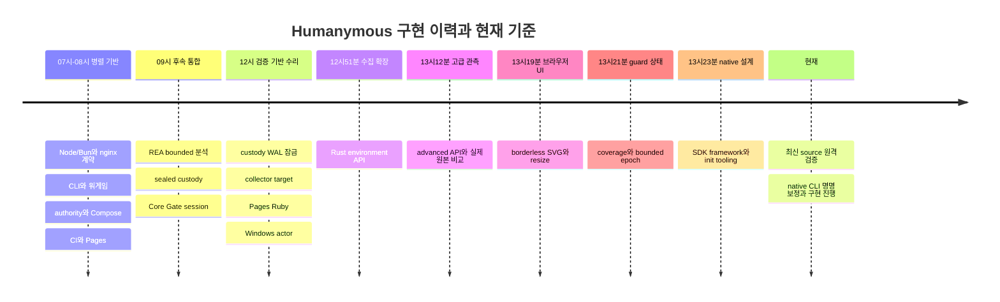
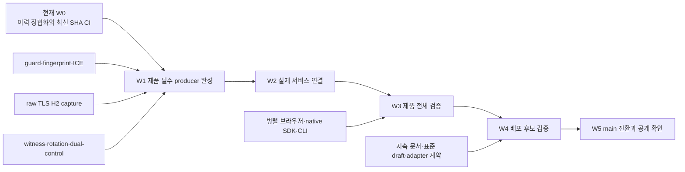

# 전체 로드맵과 마일스톤

버전1.1.0. 2026-11-07 KST 기준13개 프로젝트 채팅의 최신 turn, 기존9개
인계 기록, 현재 Git/spec/Actions를 대조한 전체 상태·순서·완료 조건의 정본이다.
실행 체크리스트는 plan:root/20261106235521, 근거는 evidence:root/20261106235519다.
이번 snapshot은5f90971 제품 통합과7e2d848 native framework 설계를 기준으로 한다.
이후 사용자 승인으로 native CLI 명명 보정·초기 구현이 재개됐으며 아직 검증된
지원으로 합산하지 않는다. 전체 목표는 미완료다. 완료율·완료일은 추정하지 않는다.

## 판정과 개발 규약

| 상태 | 의미 |
|---|---|
| 구현·검증 | 지정 source와 하위 범위의 실제 실행 증거가 있음 |
| 부분 구현 | 코드가 있으나 제품 연결·필수 기능·자격화가 남음 |
| 진행 중 | 현재 작업/통합/실행 중; 미실행·미커밋 결과를 성공으로 합산하지 않음 |
| 연구·설계 | 조사·계약 정본화; runtime 지원·배포·표준 채택이 아님 |
| 미구현·미실행 | 필요한 코드 또는 실제 실행 증거가 없음 |
| 보류 | 명시된 선행 gate 충족 후에만 실행 |

채팅 completed는 담당 slice의 인계 상태다. notLoaded는 로딩 상태일 뿐 실패나
실행 상태가 아니다. 과거 green은 새 source를 보증하지 않는다. source SHA/dirty
manifest·이미지·환경·실행 분모를 귀속한다. mock,unsupported,ignored helper,
zero-test harness,tool error,CHALLENGE,실제 human ALLOW를 구분한다.

Rust1.99.1/edition2024,단일 책임·맥락별 모듈화·플랫 나열 금지·humanymous-*
네이밍·표준 Cargo 구조·중복 구현/코드 파편화 금지·단위/파일럿/e2e 의무를 유지한다.
신규 저작 구현/테스트는 Rust다. upstream/generated glue와 읽기전용 legacy oracle은
pin/provenance 및 최종 퇴역 조건으로 따로 관리한다. 새 외국어 구현 허가가 아니다.

scoring freeze,필수 증거 누락 fail-closed,파괴적 제어 dual-control,a11y의
motor/speed 비요구,owned lab 방어 전용 실험,T4 ceiling을 유지한다. DRM/CDM 부재,
UA 유사성,접근성 API 사용만으로 자동화 판정을 추가하지 않는다.

관리 기능은 local-only/인증된 로컬 peer 원칙이다. forwarded header만으로 원격
요청에 관리 권한을 주지 않는다. adapter의 보안 삽입·라우트 확장은 기존 서비스의
정상 header·중복Set-Cookie·body·stream/SSE·라우트 충돌과 장애 동작을 검증해야 한다.

## 검증된 기준점

| 영역 | 실제 근거 | 남는 제한 |
|---|---|---|
| workspace | root19packages,toolchain1.99.1;CEF native2개 포함 | 계획된 SDK/framework/CLI는 실제 등록 전까지 합산 금지 |
| 원본 이전 inventory | 314행:unit ported54/partial5/pending255,원본804함수 | 과거 단위 inventory;verified runtime parity0,최신 전체 구현률이 아님 |
| native6tuple | 46e941b/run42334814627 및 후속 f6d2893/run42335890743 성공 | implemented-crate 범위;full_runtime_qualified=false;5f90971 별도 실행 중 |
| Windows 실제 분모 | 46e941b 및 f6d full-job source에서51/51harness·214passed·쓰기거절 | raw2ignored custody helpers·zero harness 분리;최신 source에 소급 금지 |
| runtime/CLI Docker process | 실제 origin2/audit4,session/RIT·sealed custody·restart/replay/tamper,doctor/install/dryrun/rollback | bounded fixture;full Gate/browser/Pass/human/AT 아님 |
| collector | L1-L3 17signal,passive behavior,별도 env/advanced API;pure guard epoch | 최신 local native17/actual Firefox30;guard hooks·bootstrap/session 미완료 |
| 실제 원본 비교 | behavior16datasets 및 advanced.js 실제 browser report 비교 | test-only unchanged oracle;추가 OS/API error matrix·퇴역 남음 |
| Meari+CEF UI | 1a7de24 core18/native11·거부1case/4flags;별도96DPI gesture/CEF6readback/close 근거 | 마지막 DPI/max-edge/capture 수정은 unit/build-only;BrowserReady=false |
| Pages | 52c2c0d 및 후속 f6d full CI의 Ruby3.3.13 apex/subpath build·artifact 성공 | 최신 docs freshness/AT·production Pages deploy 별도 |
| 전체 delivery | f6d full CI 실패;Windows unit/actor/release build 후 필수 native runner 부재에서 실패 | full native/browser/Docker runner3개,docs freshness,registry/Go shipping 등 gate 남음 |
| 공급망 | 최근 기록된 Cargo audit587deps/known vulnerabilities0 | ttf-parser 유지보수 경고1;최종 Rust/native/image/배포 closure 재검증 필요 |

원시 로그·manifest는 private evidence,공개 요약은 해당 bundle의
custody-native-remote-results.json,windows-full-actor-results.json,
advanced-collector-results.json,guard-state-results.json,pages-remote-results.json이다.
cb5dce7 Linux custody 실패는 보존했다. 공용 exclusive guard 수정 뒤 다른 source의
성공을 과거 실패의 대체 기록으로 쓰지 않는다. collector256-task 실패/max2와
같은 이미지의512-task export1pass/max0도 별도 보존하며 sandbox를 해제하지 않았다.

5f90971 collector42338082218은 실제Firefox30/0failed/0ignored 성공이며 산출물을
다운로드했다. native42338082261은6환경모두성공이며report6개를다운로드했다.
해당Windows source는각51/51harness·228passed·raw2ignored helpers다.
CEF42338082212도component범위성공이다. full CI42338082293은별도관측하며 실행 중은성공이아니다.
이후full CI42338082293은실패로종료됐다. 실제native build/test/release 뒤
필수native runner 부재를거절했고browser/Docker runner·shipping/registry/docs
gate도미완료다. component 성공을full product 성공으로바꾸지않는다.

정본화 이후 구체적인 crates/native-cli manifest를 받아 working tree의20번째
workspace member로등록하고의존성을resolve했다. 새production dependency version은
없고기존serde/serde_json/junction을재사용한다. locked all-target check가통과했다.
source862883c와evidence:root/20261107042614를대조했으며root에서도unit11/process6·
Clippy가통과했다. Cargo/lock의귀속통합을완료한다. 현재workspace20이다.
이는위5f90971의19package기준점과구분한다. registry publish=false,SDK/framework
runtime지원은여전히미검증이다. 후속통합근거는roadmap-continuation-results.json이다.
현재source의manifest write는Windows 전용이고다른OS는dryrun 범위다. Cross-OS
완료로표시하지않는다. source/manifest/artifact 해시는최종인계기록과대조했다.
최신native6/collector/CEF요약은integration-5f-remote-results.json,
native CLI최종Cargo통합은native-cli-integration-results.json에귀속한다.

## 모든 병렬 채팅의 결과와 후속 책임

초기9개+후속 runtime/keys/browser3개+REA1개=13개 채팅을 확인했다. root는 이
13개와 별도로 공통 통합·collector를 수행한다. browser 채팅은 최신 사용자 승인에
따라 native CLI 초기 구현을 재개했으며 나머지는 마지막 반환 turn이 completed다.
세부 최신 snapshot은 roadmap-reconciliation-latest.json,이전 인계는 chat-results.json이다.

| 채팅/작업 | 귀속 결과 | 후속 작업 |
|---|---|---|
| Rust 연동 · Node/Bun 어댑터와 서비스 계약 | 6941032,Express/Hono14그룹·Node/Bun mock conformance | Rust-only binding·실제 authority·stream/provenance·npm/OIDC |
| Rust nginx · 플러그인 어댑터와 계약 검증 | b1e10ae,njs24·실제 nginx/mock authority28 | Rust plugin·실제 peer/ACL/replay/audit·정상 서비스 영향 검증 |
| Rust CLI · doctor와 안전한 install | fe26b4d,검증·dryrun/install/repeat/rollback;후속 공용 native security | 서명 artifact·서비스 활성화/readiness·OS별 실제 파일럿 |
| Rust 워게임 · attacker와 defender 격리 실험실 | 671e88a,공유Engine·seed 일치·12예약/8평가/4미지원 | live Gate/Pass/browser·human/AT·origin/audit 효과;HR-12 CHALLENGE 보존 |
| Rust Compose · 격리 제품랩과 Cloudflare 프로필 | 3b9c306,토폴로지26·실제authority+Node22 및 후속process pilot | full Gate/collector·egress·독립witness·provider 실행 |
| Rust authority · IPC 인증과 실제 어댑터 연결 | 6f5d83a,UDS/named pipe·peer/scope/replay·공유scoring/audit | typed provenance·stream·admin/RIT 전체 연결 |
| Windows 러너 · 표준 사용자 네이티브 테스트 | c6a2457/99cf472 기반;후속6tuple·full-job actor 검증 | full native product/service/peer 파일럿·최종 source |
| Rust CI/CD · Cross-OS와 OIDC 릴리스 | 44e79a4,wiring·docs review 도구;후속Rust helper/CI 수리 | 남은 legacy tooling Rust 이전·runner3·registry trust·실제 release gates |
| Rust docs · Pages와 공개 Draft v0 | 2d98934,77문서·과거88browser조합/keyboard8;후속remote Pages build | 최신source review·AT·표준 wire/vectors·실제 Pages serving |
| Rust 런타임 · Core/Gate 세션과 collector | 9ce3190,실제session/ingress/RIT/audit-before-origin;rootsealed startup/Docker 통합 | raw TLS/H2·qualified collector·proxy/admin/Pass |
| Rust 키 저장 · sealed custody와 vault 영속성 | 5a77605,Windows49/Linux47;root공용guard·WAL 수리/6tuple | rotation운영·독립durable witness·dual-control issuer·backup/erasure |
| Meari + CEF · Rust 검증 브라우저 UI | 1a7de24 실제UI,7e2d848 SDK/framework 설계;현재CLI 명명·구현 재개 | B2잔여자격화,B3receipt,B6SDK/ABI/framework/CLI실행 |
| 내장 브라우저 분석 작업 | 512a73f bounded REA 정적 embedding 분석·관련 답변 | 참고 관찰만;Owl 전체복제/클린룸 구현 제외;DRM 일반화 금지 |

SDK 기반4crate(native-core/windows/ffi/plugin)와 후속 Electron main-process
Node-API·Tauri/winit 후보·generic C ABI consumer·native CLI는 구분한다. browser
실험용 process-owning DLL을 SDK로 재수출하지 않는다. 명명 보정은
humanymous-native-cli / humanymous-native init --framework electron이다.
init/doctor/verify의 실제 구현·membership은 코드와 통합 증거가 생길 때 갱신한다.
Rust-only 조건상 생성기가 JS/TS 등 외국어 템플릿을 만드는 우회는 허용하지 않는다.
기존 외부 호스트의 연결 책임과 검증된 packaged OS/arch/runtime 경계를 명시한다.

## 검증 이력 타임라인

아래 시간은2026-11-07 KST의 실제 귀속 commit 시점이며 CI 완료 시각과 다르다.

## 목표 완결 마일스톤

| ID | 범위 | 상태 | 완료 조건/남은 작업 |
|---|---|---|---|
| M0 | branch·Specfold·개발 규약 | 구현 | .spec/.spec.local·귀속·증거 유지,최종 agents정리는M11 |
| M1 | 순수엔진·모델·Pass | 부분 | 원본 회귀 전수·ML lifecycle·full Pass·실제runtime parity |
| M2 | network/raw capture | 부분 | TLS ClientHello·ordered headers·HPACK/H2설정/priority·connection/session binding |
| M3 | audit/keys/state | 부분 | 독립durable witness·rotation운영·dual-control·backup/erasure/sinks |
| M4 | Core/Gate·authority | bounded runtime | collector/capture/RIT·proxy/settings/abuse/admin 전체 실제 경로 |
| M5 | Rust collector | env/advanced까지 부분 | guard hooks/CDP·fingerprint-ID/ICE·loader/session/RIT/recovery·Pass·API matrix |
| M6 | 서버 adapters | 부분/연구 | Node/Bun Express/Hono·nginx Rust-only,peer/route/header/body/stream/provenance와실제authority |
| M7 | 운영 CLI·설치 | provisioning 구현 | signed package→서비스 활성/readiness→업데이트/rollback·native peer 부정 파일럿 |
| M8 | 제품 Docker 워게임 | 제한된 파일럿 | live Gate/browser/Pass·egress·origin/audit·공격/정상/human/AT 분모 |
| M9 | 자동화/모바일/provider/표준 | 연구·draft | owned 실행·wire/vectors·상호운용/security/privacy/a11y 검토·국제 제출 준비 |
| M10 | Cross-OS·OIDC·Pages | scoped검증/wiring | full runner3개·최종source6tuple·registry/package trust·docs freshness·Pages artifact;배포확인은M12 |
| M11 | Rust-only·공급망·agents/skills | 부분 | foreign-source 전수 disposition·CVE/SBOM/image scan·.agents/rules/skills/agents와사용자skills/eval |
| M12 | 최종 main만 유지 | 보류 | 최신main 통합candidate→exact SHA/tree전체gate→main갱신→Pages실제배포확인→rust branch제거 |
| B0/B1 | 브라우저 설계/engine/profile | 설계·부분 | pin/provenance·권한/network/lifecycle 자격화 |
| B2 | Meari+CEF 실제UI | Windows부분 | full sandbox/input/IME/AX·DPI/crash·OS tuples·Chrome rendering 기능matrix |
| B3 | 진단/receipt | 미구현 | qualified target/input·collector/session/capture/audit typed join |
| B4 | 대조 실험 | 미실행 | ordinary Chrome·human/AT·observer on/off·오탐 및 실제효과 |
| B5 | 도구 배포 | 미구현 | native CVE/SBOM·서명/update/rollback·사용자문서 |
| B6 | native SDK/framework/CLI | 설계/초기구현 진행 | 기반4crate·versionedABI/consumer·owned lifecycle/unload·frameworkmatrix·bounded init/doctor/verify |

## 앞으로의 실행 타임라인

W는 완료일이 아닌 의존 순서다. 설계 병렬 가능과 작업 배정/실행 완료는 다르다.

| 파동 | 다음 결과 | 병렬 경계 | 통과 증거 |
|---|---|---|---|
| W0 | 13채팅·정본 갱신,5f90971 CI와native CLI 통합요청 확인 | root공통Cargo/CI/Git;browser자기lane | source·로그·실행분모,실패보존 |
| W1 / F01-F02/F10-F11 | guard baseline/observer/forwarding,rawcapture,키 운영;UI/SDK/init 병렬 | collector/network/audit/browser 별도writer,scoring seam직렬 | 실제 producer·누락거절·cleanup/재시작·권한/ABI·API/OS matrix |
| W2 / F03-F05 | qualified collector/RIT,서버 Rust binding,서비스 활성화 | 계약고정 뒤 adapter/CLI 분리 | 실제authority/origin/audit 효과·stream/header정상성·readiness/rollback |
| W3 / F06 | full native/browser/Docker Rust runner와live워게임 | lab/CI와도구SDK 경계 분리 | six tuple·제품Docker e2e·human/AT·observer대조·SDK consumer |
| W4 / F07-F09 | 최종docs·Pages artifact·OIDC/registry·공급망·skills | docs/.agents/packaging분리,후보source고정 | 같은sourcefreshness·archive검토·trust·CVE/SBOM·실제modoo skills eval |
| W5 / M12 | oracle/Go/폐기물 퇴역,최신main통합candidate검증,main갱신·Pages배포확인·branch제거 | Git전역직렬 | exactcandidate SHA/tree전체gate,실제Pages serving,미완료시branch제거보류 |

M12의 순환 의존성을 만들지 않는다. Pages는 먼저 후보 artifact를 검증하고,
main-triggered 실제 deployment는 main 갱신 후 확인한다. 변경될main을 먼저
candidate에 반영하고 최종gate 뒤 새미검증merge commit을 만들지 않는 전환을
설계한다. 배포 실패 시 main-only 완료를 주장하거나 복구 branch를 먼저 지우지
않는다. registry 실제발행·tag는 준비된artifact와해당release운영규약에귀속한다.

## 연구 backlog의 실행 전환

| 조사 | 정본 방향 | 필요한 후속 증거 |
|---|---|---|
| 서버 adapter/언어/OS | Node/nginx 서비스 통합 우선;SDK framework와별도 bounded context | Rust binding과지원주장별실행matrix |
| Computer Use/Grok/Meta/Pickle/crawler/DC IP/API/mobile | actor/egress/authorization/provenance 구분,robots위반추정금지 | bounded eventtracking·owned재현·API/nonbrowser·AT controls |
| Android Monkey 등 | 모바일 자동화 위협/관측 분리 | owned device OS/driver/실제입력·정상 대조 |
| DRM/CEF/Electron/desktop-use | capability·license/CDM/build 차이,단독bot규칙금지 | 허용된 capability matrix·observer개입·실제원본브라우저 대조 |
| Actions/전용runner | native6tuple가능 | GUI/service/browser/remotepeer/full delivery 실행 |
| Compose/Cloudflare/AWS/Lightsail | 격리 profile/1회성lab | 비용·권한·egress·teardown 및 실제provider실행;현재not_run |
| 국제 웹 표준 draft v0 | 체계적 작성·검토·등록준비,docs/Pages공개영역 | wire/vectors·상호운용·security/privacy/a11y·기관절차 검토 |
| crate/native/framework 설계 | humanymous-*·표준Cargo·책임분리·공유엔진재사용 | 실제membership/ABI/OS/frameworkconsumer와의호환성 |

표준 문서는 docs 하위 Pages 서빙 대상이다. 내부spec/private원문은 공개 docs로
그대로 복제하지 않는다. modootoday Jekyll remote_theme·기존디자인토큰 이식을
유지하고,작성·빌드·실제배포·표준기관제출/채택을각각구분한다. Cloudflare는
Wrangler config 없는 경우cf CLI를사용한다. 이번 정리는 provider생성을 수행하지 않는다.

## 현재 종료를 막는 gate와 다음 착수

1. 전체 rawcapture/qualified collector/Pass/proxy/admin 경로가 없다.
2. 독립witness·dual-control운영·signed service activation이 남았다.
3. full native/browser/Docker runner3개 및 실제human/AT 제품 e2e가 없다.
4. 브라우저·native SDK/framework의sandbox/ABI/OS/AT 자격화가 미완료다.
5. 최신docs review/production Pages·registry·최종scan·Rust-only/agents/skills/eval이 남았다.
6. 모든요건 전에 Go/oracle을지우거나main병합/branch삭제/publish를완료처리하지않는다.

다음 root 구현은 guard의실제baseline/observer/안전한hook수명과현재native CLI의
구체적인Cargo 통합이다. missingcoverage를reported=true로위장하지않는다.
공통Cargo/lock/toolchain/CI는root,나머지는session board단일writer로관리한다.
새채팅을생성하지않았고idle채팅을임의재개하지않았다. browser재개는그채팅의
최신사용자승인에따른다. 명시적인SDK확장과CLI명명보정도이정본에반영했다.

공개 Specfold와private 전체tree상태는분리한다. browserPNG의자동secret-scan미지원
U2는manualsynthetic시각검토범위와함께보존하며면제하지않는다. 과거profile삭제의
자동승인거절·미삭제기록도이력으로유지하며새삭제완료로주장하지않는다.
