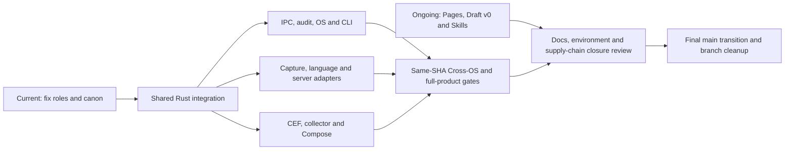
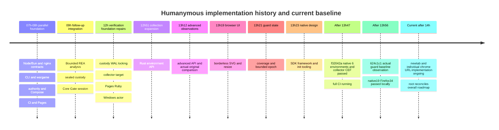
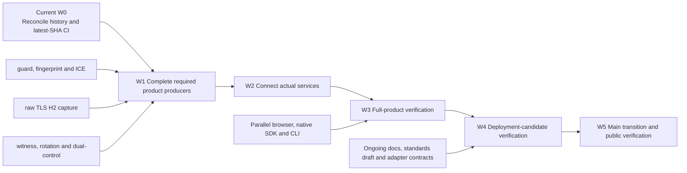

# Overall roadmap and milestones

## User-authorized concurrency increase: 2026-11-07

The user explicitly requested higher local concurrency. The current ceiling is
four independently allocated pipelines (A/B/C/D), superseding earlier two-slot
snapshots. At admission, measured physical memory is 63.34 GiB with 33.21 GiB
free, commit limit 68.34 GiB with 12.75 GiB free (81.3% used), 32 logical CPUs
at 48% load and 167 GiB free disk. Physical free memory alone is not commit
headroom. Each Cargo pipeline retains jobs=1 and incremental=0 and an exclusive
target directory. Admit new work only below 85% commit and above 20 GiB free
physical memory. At 88% commit or below 16 GiB free, defer new compilation and
reduce subsequent allocations; never terminate another owner's processes.

| Slot | Current allocation | Exclusive target | Boundary |
|---|---|---|---|
| A | Product-lab runner pure checks and Clippy | target | No actual Docker/process/network tests |
| B | Node/Python/Ruby packaging compilation | target/node-native/build | No actual framework or installer execution |
| C | Delivery 50 pure checks and scoped Clippy | target/validation-agents | No actual native/socket/GUI pilots |
| D | Apache safe units and default native-package compilation | target/validation-native | No httpd/bindgen/header features or native execution |

Heavy CEF/native/bindgen builds remain mutually exclusive. Model loading needs
a separate explicit allocation and is not implicitly enabled by the new ceiling.
Manifest changes still require a root-owned integration window between builds.

## Current integration delta: 2026-11-07, after 6500ec23

This delta supersedes the live-state claims in the older briefing below; older
source-specific results remain historical evidence. There are 38 registered
workspace members, including Apache native and the .NET export facade. Shared
graph commit 6500ec23 is local and is not the source of the live hosted run.
No package publication, release tag, OIDC token exchange or main merge occurred.

| Milestone | Current evidence | Next required action and owner |
|---|---|---|
| Coherent graph | 38-member metadata and scoped spec check pass; lock incorporates approved edges without unrelated version downgrade | Compile latest native packages and freeze all required source; integration and package owners |
| Local component closure | Go latest 10 pure tests and all-targets Clippy pass; maintenance latest 36 pure tests/check/Clippy pass; Pages latest 26 pure tests/check/Clippy pass; Capture latest 22 pure tests, feature Clippy and five hosted-test compilation pass | CLI latest seven pure/check/Clippy passes remain provisional because shared inputs moved; .NET owns A and delivery owns B for bounded validation |
| Hosted policy | Run 42355168729, source 8132117: policy succeeds | Preserve narrow permissions and mandatory component gates; CI owner |
| Hosted native execution | Ubuntu builds all targets; actor executes 15 of 88 harnesses, 51 tests pass, then coverage validation fails | Provision mandatory Node/Bun pilots; collect later contained harness results while retaining final failure; host and OS-runner owners |
| Docker product lab | Actual 35 checks: 33 pass and two fail; wargame evaluates zero of 26 scheduled cases, with 19 errors and seven unsupported | Fix readiness contract mismatch and recover actual evaluation; runtime, wargame and lab owners |
| CEF component | Two explicitly provisioned desktop process tests wired under native-pilot-tests; no actual execution yet | Existing hosted runner provisions separate fresh positive/cancelled bundles and executes both; CI/browser owners |
| Cross-OS and browser | macOS native also fails after 15 of 88 harnesses, with 51 tests passing and the same host_process coverage stop; browser job fails with wargame diagnostics; Windows and browser-product are running at observation | Observe the same run, retain immutable source identity, do not duplicate dispatch |
| Final product | Qualified collector/capture/Pass joins, actual adapter matrices, human/AT controls and complete runtime recovery remain incomplete | Complete required paths and obtain current-source actual receipts; all owning chats |
| Final integration | 336 tracked Go files still require replacement proof; Pages/freshness and main-only state unverified | Remove obsolete product code only after parity gates, finish public docs, merge/verify main and retire migration branches |

The Ubuntu failure includes three ignored Node/Bun product groups, which are not
subprocess helpers. No ignored-test waiver or denominator reduction may make
that gate pass. Future continuation is permitted only after a completed,
contained child with EOF; source/identity failures and uncontained spawn,
capture or timeout failures stop immediately. Execution completeness is distinct
from successful coverage. All later rows and the aggregate failure must survive.

The deterministic runtime/defender readiness source mismatch is a diagnosed
contract defect, not a recovered private explanation for every Docker error.
Runtime must expose one authoritative readiness builder for the defender to
reuse without dropping witness, durability or fail-closed capability checks.

## Integrated briefing: 2026-11-07 08:08 UTC

This snapshot covers all19 project chats (integration plus18 dedicated owners).
The worktree contains36workspace members; shared Cargo/lock changes are still
being integrated. A chat being idle or its last turn completing does not mean
its persistent objective or product scope is complete. Test counts below are
source-scoped checkpoints, never a combined full-product pass count.

| Owner area | Implemented or observed checkpoint | Remaining completion gate |
|---|---|---|
| Integration | Shared engine/integrity/collector,36-member working graph, opt-in local-edit profile;143obsolete files and88empty retired directories removed | Freeze a coherent committed graph; complete collector/engine parity and all cross-context joins; final candidate/main |
| Runtime/Gate | Management observer, signed sessions/ACK, bounded admission/streaming, sealed recovery and typed shutdown source | Current-source pure/hosted lifecycle, durable settings/effects, qualified collector/capture/Pass joins |
| Authority/IPC | Credential-bound normalized profiles and shared sealed-key startup source40d0bdd | New startup compile/pure tests, actual peer/ACL/replay/restart/other-UID and sealed custody pilots |
| Audit/custody/state | Retention/rotation7pure and scoped Clippy/static checks passed atc6a6492; trusted snapshot7dba59d authored | New snapshot checks; actual independent retention, repair/rotation/erasure and restart/effect ordering |
| TLS/H2 capture | Earlier21pure and scoped Clippy passed; pending-handshake ownership b0363e9 adds22-case corpus | Fresh22pure/hosted-feature compilation; actual5TLS/H2 pilots; supervised runtime binding |
| OS security/Windows | Provider/fixture/storage/strict-JSON7pure plus scoped Clippy passed | Actual service-principal WinCred/ACL/SCM, latest runner accounting and native OS tuples |
| Operational CLI | Doctor/install/provisioning and service-host source; earlier6pure passed; newest7-case scope changed | Fresh parser/FSM checks; signed install/start/readiness/stop/update/rollback and actual service fixture |
| Node/Python/Ruby | Shared framework; Node host-feature check and Clippy passed; Python native type error corrected | Python native recheck, Ruby host build, actual frameworks/body/cancel/stream and clean wheel/gem/npm installation |
| nginx | Latest14pure, package check and scoped Clippy passed | Native build/pilot Clippy and actual nginx/authority35-group hosted contract |
| Apache | Safe lifecycle checkpoint; new9-case corpus and native bridge/header pins authored | Register native graph, compile generated ABI, actual event/worker/prefork request/lifetime/cleanup pilots |
| Go compatibility | Previous3pure/all-targets Clippy passed; new response probe expands6-case scope | Fresh probe checks and actual pinned Go origin8-case isolated contact/response receipt |
| .NET | Safe lifecycle and approved3managed source files authored; Rust bridge/facade source | Register new graph; current Rust/C# compile, real Kestrel/JIT/NativeAOT/GC and package qualification |
| Native ABI/C/C++ | Earlier core15/export6pure passed; new shared version/resource APIs and header example | Latest core16/export6/example3 checks; generated header and actual C/C++ layout/dynamic-call evidence |
| Meari/CEF browser | Earlier23pure/scoped Clippy passed; native lifecycle/probe/scheme source continues | Current native build, seven-step probe, cancellation/crash/IME/AX/DPI/OS and real controls |
| Product lab/Compose | Isolated browser, DNS/witness/recovery and strict public receipt source | Actual immutable-source Docker topology/UID/egress/outage/cleanup, adapter and origin-contact qualification |
| Wargame | Shared-decoder26attacker/defender+2JSON pure checks and scoped Clippy passed | Actual owned runtime attack catalog, byte-exact public receipt and ordinary/human/AT controls |
| CI/CD/OIDC | Prior38pure/scoped Clippy; free hosted two-lane workflows;4registry environments prepared | New candidate run, actor diagnostics, explicit native-host feature gates, cache/metrics, CVE/SBOM/package closure |
| Pages/Draft v0 | Earlier88pages rendered atboth baseurls on63f69ae; current tool26lib+1bin passed beforelatest URL-segment fix | Fresh helper tests/render/browser/freshness and standards wire/interoperability/security/privacy/a11y review |
| Rules/skills/evaluation | Current34pure, all-targets check/Clippy; read-only inventory14skills/6roles/errors0/mirror drift0 | Fresh provider discovery, hosted storage/package tests and actual paired model evaluation with declared runtime |

Latest full CI remains42348518353/source63f69ae:16jobs,3success/13failure.
No new integrated hosted result exists for the later worktree. The old six-tuple
and CEF/component successes do not qualify current complete product behavior.
336tracked Go files remain; migration is not main-only. npm/crates/pypi/rubygems
environment preparation is not package publication or external trust verification.

| Gate | Present state | Exit evidence |
|---|---|---|
| G0 Coherent candidate | In progress; committed owners plus pending shared graph | Required manifests/API sources tracked together, lock consistent, source freeze |
| G1 Component completeness | Mixed source/partial pure checkpoints | Latest selected pure/lint/static gates; full engine/Pass/collector/state scope accounted for |
| G2 Actual service joins | Source implemented in parts, unqualified | Real capture/collector/authority/audit/credential/adapter effects and refusal paths |
| G3 Product and OS verification | Waiting for latest-source hosted execution | Supported OS/arch/features, isolated Docker/browser/wargame, failure/restart/cleanup and human/AT controls |
| G4 Delivery/documentation | Partial | Package/archive/CVE/SBOM, same-source Pages/standards freshness, user/developer skill evaluation; registry preparation |
| G5 Final retirement candidate | First143files/88directories removed; Go retirement pending replacement proof | Retire Go/oracles/old images and unused surfaces, then rerun full gates on the cleaned candidate |
| G6 Main-only completion | Not started | Integrate latest main into verified candidate, update main, verify approved Pages serving, remove migration branch |

G0-G6 indicate dependency order, not dates or an invented completion percentage.
Independent research remains tracked: Computer Use/crawlers/datacenter/API/mobile,
DRM capability limits and provider-container scenarios have design/source findings,
not a demonstrated universal blocking guarantee. No paid infrastructure, package
publication, release tag or OIDC token exchange is authorized by this briefing.

## 2026-11-07 role separation and completion-gate timeline

### Where obsolete files are removed and the prerequisites

The current checkout is codex/rust, with 336 tracked Go files remaining. main retains
the existing Go project and does not incorporate the new Rust work in advance. Remove
obsolete files on the Rust branch, pass all gates on the final deletion candidate,
and then integrate into main. The order is: secure Rust replacement functionality,
owned-product verification and oracle-comparison evidence; retire references and the
deployment inventory; create the deletion candidate; run all gates on the cleaned
tree; verify main/Pages. Do not create a circular requirement that all CI failing on
CVEs in Go slated for deletion or old shipping guards must first turn green before
deletion is allowed. Equally, do not hide failures by deleting before replacement
product verification. Each owner may first clean up independently obsolete docs,
agent mirrors and duplicate configuration after reviewing references. Final
retirement of Go/oracles/old images and vendor environments is verified on the root
integration candidate. Full actualRuntime/adapter/CEF/CrossOS qualification remains
incomplete, so no final Go-deletion date is fixed. The user request remains active,
without cancellation or reduction, as part of the completion conditions.

### Adjusting local verification concurrency from measured resources

Following the user's request to raise the limit, Windows CIM measured physical
memory 63.3GiB/free 35.3GiB, commit 54.7/67.3GiB (81%), 32 logical CPUs/load 39%,
and C: free 184.9GiB. No cargo/rustc processes were running then. Use the remaining
12.6GiB of commit capacity, rather than physical memory, as the limiting resource
and raise local verification from a global 1 to 2 pipelines. A uses the existing
shared target; B runs lightweight pure verification in the separate
target/validation-agents, each retaining jobs1/incremental0. Run only explicitly
assigned slots; never put two writers on the same target. At commit >=88% or
physical free <16GiB, defer starting a new B and reduce the next allocation to 1.
CEF/native-heavy/bindgen overlap and local product execution are not authorized.
Remeasure on completion without forcibly terminating processes. Git/index and
shared-lock changes retain a single writer. Change dependency/feature manifests
only within an integration window to reduce repeated locked-verification failures.
This policy updates the earlier global-1 wording and was sent to 18 dedicated chats.
A was assigned audit pure recovery/key custody; B, maintenance pure verification.

### Workspace/language-profile integration checkpoint

The shared workspace explicitly registered framework-adapter/python-adapter/
ruby-adapter, integrating 30 members. Cargo retained the existing lock and resolved
17 new dependency packages and the path graph, incorporating the authority zeroize
edge and Node's shared-framework consumption. The first offline check failed before
execution because pyo3 was not cached; framework cargo check passed after online
resolution. CVE/host-ABI verification of the new packages remains incomplete. Lock
registration does not mean supply-chain verification is complete.

The integrity PythonAsgi/PythonWsgi/RubyRack profiles bind installation identity to
an exact normalized header mode and reject forged peer/connection/capture/stream
and raw signals. Existing Node/nginx and scoring were unchanged. Current-source
locked --lib pure checks passed for authority10/framework6/integrity22 (38 passed,
0 failed/ignored/filtered); all three crates passed --lib Clippy -D warnings. The
first CLI attempt repeated --lib and ran 0 tests due to an argument error; only the
corrected command contributes to those denominators. rustfmt check found test-layout
differences; formatting was applied and rechecked. Python/Ruby extension builds,
actual IPC/framework/native ABI and product e2e are not_run. The earlier Pages lock
mismatch preceded this integration and is checked separately by the next locked run.

The subsequent Pages retry also ran 0 tests due to lock mismatch. The parallel CLI
manifest's tokio signal feature required resolution of signal-hook-registry1.4.8.
After offline resolution, root directly reran locked offline --lib verification:
Pages22 passed/0 failed/ignored/filtered and lib Clippy -D warnings passed. Actual
Pages rendering/browser execution remain not_run. Because shared-lock changes can
move together with owner manifests, freeze dependency manifests during root's
resolution window and parallelize source work only.

This section updates the earlier 13-chat/unassigned-follow-up snapshot. Adding 5
dedicated Apache/C ABI/Go/.NET/raw-capture chats to the existing 13 yields 19 chats
including root. This counts creation/assignment, not acceptance of every goal,
build completion or product completion. 071ccef registered naming rules, the
THREADS registry and nonoverlapping lanes. Root released agents-meta normally and
handed it to maintenance. Detailed ownership follows .agents/sessions/THREADS.md
and LANES.md.

| Stage | Current status | Exit condition | Owner/parallelism |
|---|---|---|---|
| T0 Canon and roles | Rules/19 chats assigned; follow-up claims being checked | Actual goals, path owners and contracts agree | root/maintenance |
| T1 Shared Rust integration | Partial implementation; new language crates/lock integration incomplete | Shared-core reuse; exact-source unit/fmt/Clippy | root + each crate owner |
| T2 Security and service completion | authority/management/audit APIs implemented; actual operations unverified | Actual IPC peer/ACL, secret provider, witness recovery and drain verification | Separate runtime/authority/audit/OS/CLI owners |
| T3 Producers and adapters | Node/nginx partial; new Python/Ruby source; Apache/C ABI/Go/.NET/capture started | Actual framework/OS/ABI per supported profile; missing-signal rejection | Independent language/server owners |
| T4 Browser and product lab | CEF/collector/Compose source; full qualification has not passed | Actual Fetch/CEF, isolation, egress, DNS, witness and wargame | browser/root/lab/wargame |
| T5 Cross-OS and supply chain | 27 policy units passed; native 3 OS/Docker/browser/Node/advisories failed | All required jobs/denominators for exact candidate, CVE disposition and archive review | Two standard-hosted CI lanes |
| T6 Docs, standards and environments | Pages/Draft writing continues; npm/crates/pypi/rubygems environment preparation | Same-source docs render/link/a11y/skills evaluation and trust preparation | Single Pages writer/maintenance/CI |
| T7 Final transition | Not started; depends on preceding stages | All final-candidate gates, approved main integration, Pages verification and branch cleanup | Serial root Git operations |

T denotes order and dependencies, not calendar deadlines or weeks. Unresolved or
unobserved items include exceptions to existing native host-glue/unsafe rules,
actual AT/IME/human controls and external registry trust. Do not invent a fixed
completion date or percentage. Do not count source-only/filtered/ignored/unknown/
blocked results as passes.

Role rules: the existing adapter owner owns framework/Node/Python/Ruby only.
Apache, C ABI, Go Gate compatibility, .NET and capture each have a new sole owner.
Only native-abi implements shared opaque handles/ABI; host adapters do not duplicate
it. Go prioritizes the existing canonical universal HTTP Gate profile and does not
claim a new Go SDK/producer is complete. Root owns shared Cargo/lock/toolchain/
integrity/collector; CI owns workflow/build inventory; native-security owns OS
credential providers; CLI owns selectors/validation only. One Pages owner writes
public docs/**. Other owners submit INTEGRATION/spec deltas.

Execution limits are separate from chat counts. Coding/canon updates run in parallel
on nonoverlapping paths; local Cargo is globally limited to 1 and hosted-heavy work
retains the current workflow's two-lane limit. Creating more chats does not authorize
unbounded local builds or paid infrastructure. Actual deployment/publishing/tagging/
OIDC exchange remain prohibited; only environment preparation proceeds. The main
transition belongs to final integration.

Execution update: Windows native and browser also failed on
run42348518353/source63f69ae. Advisories Trivy reported 13 findings in go.mod
(UNKNOWN1/MEDIUM7/HIGH5/CRITICAL0). The original Cargo audit closure has not been
recovered, so this is not successful full vulnerability verification. The CI owner
continues recording final status for MSRV and the remaining jobs. Do not retroactively
attribute this historical run's successes/failures to new-source diagnostics,
product pilots or management-API implementation.

## Decision to use free remote verification

### Workflow naming and OIDC environment preparation

Naming checkpoint9a41374 uses scripts/ci/workflows.json as the single machine
catalog. UI names follow CI / ..., Docs / ..., Release / ..., Legacy / ...;
filenames/job keys/OIDC workflow identities remain stable technical contracts.
Rust policy checks name/job/concurrency/artifact-identifier drift across the existing
10 workflows. The delivery SoT is the implementation canon for shared policy;
operational skills refer to it. github-actions-ops/cut-release guides and checklists
were aligned with the catalog, Rust verification and product-specific OIDC environment
names. The existing Rust canon checker observed errors0 and compatibility mirror
drift92. While chats are active, recursive legacy sync is deferred under current
AGENTS and retirement contracts; mirrors are not hand-edited. Model-based skill
evaluation for this wording change remains not_run; earlier evaluation does not
apply retroactively. Detailed static results are registered in
workflow-guides-canon-check.json.

The user approved environment preparation, not deployment. Actual modootoday/specfold
settings were inspected; npm/crates environments were created in Humanymous and
readback equivalence verified. Both use required reviewer myso-kr,
prevent_self_review=false, can_admins_bypass=true, a custom branch policy and only
tag v*. Each environment had 0 actual deployments when queried. Existing github-pages
was retained. Environment settings alone do not verify npm/crates.io publisher
ownership/trust. Workflow package jobs and registry prerequisites refer respectively
to npm/crates and retain external trust verified=false. No tags, releases, package
publication or OIDC token exchange are executed. Original comparison evidence is
registered as oidc-environments-specfold-parity.json in evidence:root/20261106194410.

The user approved using a free remote environment instead of local execution. The
current gh query confirmed PUBLIC visibility for modootoday/humanymous. The default
execution target is GitHub-hosted standard Ubuntu24.04 for the public repository;
paid larger runners, paid dedicated servers and Cloudflare Containers creation are
excluded. Containers remain only a possible separately paid supplementary verification
route. Distinguish free public standard-runner compute from artifact/cache storage
costs. The free route defaults to small sanitized job logs/summaries. Do not upload
sensitive private Specfold originals or credentials as public artifacts.

The CI owner implements reuse of existing workflows, duplicate-run cancellation,
bounded timeouts/build parallelism, sequential heavy Docker checks and collection
of fixed-source-SHA results. After integrating the 27-member workspace/lock and owner
source checkpoints, root pushes only the rust branch and observes actual hosted
execution. Do not claim dirty local files as the source verified remotely. Retain
existing Docker topology/UID/egress/sandbox/witness gates and distinguish component
success from full-product completion. Application status remains implementation in
progress until the first actual free remote-run result is confirmed.

References: https://docs.github.com/en/actions/concepts/billing-and-usage and
https://docs.github.com/en/actions/reference/runners/github-hosted-runners .

### Separating local development from hosted execution

The default allocation separates local coding/scoped unit checks from hosted actual
runtime verification. Test names or #[test]/--lib alone do not establish that a check
is a pure unit test. Requirements for actual processes, ports, IPC, SCM, browsers,
permission boundaries or Docker make it component/runtime verification, assigned to
hosted execution. Local work focuses on fmt, static checks, scoped Clippy and
resource-bounded units, with 1 concurrent Cargo task. Existing memory deferrals do
not authorize unlimited local builds. Proven needs for local runtime debugging
require separate resource allocation and records, and do not replace hosted
completion evidence.

| Category | Default execution location | Completion evidence |
|---|---|---|
| Code, contracts, units, fmt and scoped Clippy | Local | Explicit package/features and actual denominators |
| Node/Bun/nginx, actual IPC, services, permissions and restart | Standard OS hosted | Actor results per OS/arch/features |
| Product topology, isolation, egress, witness and Firefox WASM | Ubuntu hosted Docker | Existing required Docker gates and image/source hashes |
| CEF, SCM and installer OS capabilities | Supported OS hosted | Capability preflight and actual positive/negative checks |
| Pages rendering, links and browser smoke | Hosted | Both baseurls and execution results for exact source |
| Humans, actual AT/IME, devices/screens and physical faults | Suitable separate real environment | Direct evidence; a hosted label alone is insufficient |

Fully serial CI would block independent results and is not adopted. Implementation
checkpoint4565026 splits work into two lanes after shared policy: A is
native→msrv→quality→documentation→pages; B is
docker→browser→images→packages→node→advisories. Each matrix uses max-parallel1 and
each job's Cargo uses jobs1. Independent results continue after earlier failures in
the same lane if policy passed and execution was not cancelled. ready always
aggregates exact required-job results and never converts failure/skip/unknown to
success. This is a heavy-work limit of 2 within that workflow, not a global limit
covering separate manual workflows. Avoid duplicate dispatches for the same source.
Do not put all jobs in one shared concurrency group where pending jobs replace or
lose one another.

Change-impact selection will be introduced only after a trustworthy classifier can
check transitive closure of manifests/shared dependencies and semantic contract
changes. For now, simple paths filters do not skip required gates. Cargo/lock/
toolchain/security/authority/runtime/shared test-support changes and unknown inputs
receive conservatively broad verification; release candidates still require the
full required OS/product denominators.

Reuse builds only with matching OS/arch/target/toolchain/lock/profile/features.
Do not combine artifacts with different feature graphs, such as nginx native and
standalone pilots, or Node host-pilot and production packages. Do not accumulate
CEF/all target/debug+release/Docker duplicates on one VM; use measured runner disk
capacity and bounded contexts. The initial free route disables remote-cache writes
and ordinary branch artifact uploads, using small allowlisted summaries,
source/image/lock digests and job logs. PUBLIC repository artifacts are not a private
vault. Do not upload sensitive raw data; without a separately approved private
recovery route, explicitly record raw-not-recovered. LLM-evaluation inference/API
costs are separate from free runner compute and are not automatically included in
this free-execution scope.

### Actual results of the first free hosted runs

Follow-up run42348518353/attempt1/source63f69ae was in progress when observed. The
shared policy job actually passed 27 Rust units, policy checks and public action
commit/entrypoint queries, confirming the fix for the initial 403 issue.
Ubuntu/macOS native jobs failed; public logs for this run lacked detailed harness
causes, so do not infer the earlier Node ignored cause. Docker's full-product gate
rejected owner exit2/errors0 component-only blocked status. Specific assertion
denominators were missing; do not retroactively apply the earlier 71 results.
Windows native and browser jobs were still running when observed. Subsequent
a0ceac3/d31520f add diagnostics exposing owner summaries/denominators without raw
traces; they do not change the earlier 63f69ae results. New collector product
fixture0ac1403 and pure contract regressions6733128 belong to the next source batch;
actual product execution is not_run.

Run42347732666/attempt1, source bfc9f62335ae41906996c6b01b0ae9e7993feeed,
ended in terminal failure. On ubuntu24.04, delivery Rust22 tests and policy checks
passed. action-pins' authenticated GitHub API public-commit query returned 403 due
to the aquasecurity organization's IP allowlist, failing the shared gate. The 13
observed jobs were policy and ready (2 failures), and 11 downstream skipped jobs.
Do not count unexecuted matrices as successful or actually executed tuples. This
failure is not evidence of action-SHA mismatch or a product-runtime vulnerability.
Original job logs and terminal run/jobs/artifacts metadata are retained in
evidence:root/20261106194410. Runtime/component verification is not_run. Reverify in
a new run after a source-bound CI fix retaining full-product requirements.

Version1.2.0. This is the canon for overall status, order and completion conditions,
reconciled against the latest turns of 13 project chats, 9 earlier handovers and
current Git/spec/Actions as of 2026-11-07 KST. The execution checklist is
plan:root/20261106235521; evidence is evidence:root/20261106235519. This snapshot
separates f32042a remote component verification from 624c1c1 local guard
implementation. Native CLI is the actual 20th workspace member; 11 units/6 processes
passed. This is not SDK/framework runtime support. The overall goal is incomplete.
Do not estimate completion percentages or dates.

## Assessment and development rules

### Every chat must continuously maintain canonical records

Alongside implementation, each owner updates SoT contracts/decisions/schema/version/
errors/permissions/lifecycle and change deltas, plus plan requirements/dependencies/
acceptance criteria/incomplete work/follow-up actions. Cross-chat API agreements
must persist proposed/accepted/implemented/verified states, rather than end in
messages alone. Keep execution commands/source SHA or dirty manifest/environment/
tool/image/artifact digests/actual denominators/failures/retries in private evidence,
preserving failure history. Sanitize public evidence and register it through
Specfold attach; distinguish LF/Git bytes and validated-working-source/
canonical-Git-source hashes. Checkpoints and lane handovers record exact files,
contracts, checks, remaining limitations, execution commands and next owner. Send
change requests rather than directly editing another owner's canon. This obligation
applies to root and all 13 work chats; documentation updates do not replace product
implementation/verification.

| Status | Meaning |
|---|---|
| Implemented and verified | Actual execution evidence for the specified source and subscope |
| Partially implemented | Code exists; product wiring, required features or qualification remain |
| In progress | Work/integration/execution ongoing; unexecuted/uncommitted results do not count as successes |
| Research/design | Investigation/canonical contracts; not runtime support, deployment or standards adoption |
| Unimplemented/not run | Required code or actual execution evidence is absent |
| Deferred | Execute only after the stated prerequisite gates are met |

Chat completed means a handover state for the assigned slice. notLoaded is only a
loading state, not failure or execution status. Past green results do not qualify
new source. Attribute source SHA/dirty manifest, image, environment and execution
denominator. Distinguish mocks, unsupported cases, ignored helpers, zero-test
harnesses, tool errors, CHALLENGE and actual human ALLOW.

Retain Rust1.99.1/edition2024, single responsibility, context-based modules, no flat
listing, humanymous-* naming, standard Cargo layout, no duplicate implementation/
code fragmentation, and required unit/pilot/e2e checks. New authored implementation/
tests use Rust. Manage upstream/generated glue and read-only legacy oracles
separately with pin/provenance and final-retirement conditions; this does not
authorize new implementation in other languages.

Retain the scoring freeze, fail-closed behavior for missing required evidence,
dual-control for destructive controls, no motor/speed requirement for a11y,
defense-only experiments in owned labs and the T4 ceiling. Do not add automation
verdicts solely for absent DRM/CDM, UA similarity or accessibility-API use.

Management functions remain local-only with authenticated local peers. Forwarded
headers alone do not grant management authority to remote requests. Adapter security
insertion/route expansion must verify ordinary headers, duplicate Set-Cookie, body,
stream/SSE, route conflicts and failure behavior in the existing service.

## Verified baselines

| Area | Actual evidence | Remaining limitation |
|---|---|---|
| Workspace | root19 packages, toolchain1.99.1; includes 2 CEF native packages | Do not count planned SDK/framework/CLI before actual registration |
| Original migration inventory | 314 rows: unit ported54/partial5/pending255; original804 functions | Historical unit inventory; verified runtime parity0, not current overall implementation percentage |
| Native6tuple | 46e941b/run42334814627 and subsequent f6d2893/run42335890743 passed | Implemented-crate scope; full_runtime_qualified=false; 5f90971 separately running |
| Actual Windows denominator | 51/51 harnesses, 214 passed and write rejection at 46e941b and f6d full-job source | Separate raw2 ignored custody helpers/zero harnesses; no retroactive application to latest source |
| Runtime/CLI Docker process | Actual origin2/audit4, session/RIT, sealed custody, restart/replay/tamper, doctor/install/dryrun/rollback | Bounded fixture; not full Gate/browser/Pass/human/AT |
| Collector | L1-L3 17 signals, passive behavior, separate env/advanced APIs; pure guard epoch | Latest local native17/actual Firefox30; guard hooks/bootstrap/session incomplete |
| Actual original comparison | behavior16 datasets and actual browser-report comparison with advanced.js | Test-only unchanged oracle; more OS/API-error matrices and retirement remain |
| Meari+CEF UI | 1a7de24 core18/native11, 1 rejection case/4 flags; separate 96DPI gesture/CEF6 readback/close evidence | Last DPI/max-edge/capture changes unit/build-only; BrowserReady=false |
| Pages | 52c2c0d and later f6d full-CI Ruby3.3.13 apex/subpath builds/artifacts passed | Latest-doc freshness/AT and production Pages deployment separate |
| Full delivery | f6d full CI failed: required native runner absent after Windows unit/actor/release build | 3 full native/browser/Docker runners, docs freshness, registry/Go shipping and other gates remain |
| Supply chain | Latest recorded Cargo audit587 deps/known vulnerabilities0 | 1 ttf-parser maintenance warning; final Rust/native/image/deployment closure needs revalidation |

Raw logs/manifests are private evidence. Public summaries in the corresponding bundle
are custody-native-remote-results.json, windows-full-actor-results.json,
advanced-collector-results.json, guard-state-results.json and pages-remote-results.json.
The cb5dce7 Linux custody failure is retained. After fixing the shared exclusive
guard, success on another source does not replace that earlier failure record.
The collector256-task failure/max2 and same-image512-task export1pass/max0 are also
retained separately; the sandbox was not disabled.

For 5f90971, collector42338082218 passed actual Firefox30/0 failed/0 ignored and
artifacts were downloaded. Native42338082261 passed all 6 environments; 6 reports
were downloaded. Each corresponding Windows source had 51/51 harnesses, 228 passed
and raw2 ignored helpers. CEF42338082212 also passed within component scope.
Full CI42338082293 was observed separately; running is not success. Later,
full CI42338082293 ended in failure: after actual native build/test/release it
rejected the missing required native runner; browser/Docker runners and shipping/
registry/docs gates also remain incomplete. Do not convert component success into
full-product success.

After canon reconciliation, the concrete crates/native-cli manifest was received,
registered as the working tree's 20th workspace member, and its dependencies resolved.
No new production dependency versions were added; existing serde/serde_json/junction
are reused. Locked all-target check passed. source862883c and
evidence:root/20261107042614 were reconciled; root also passed unit11/process6 and
Clippy. This completes attributed Cargo/lock integration. The workspace is now20,
separate from the above 5f90971 19-package baseline. registry publish=false;
SDK/framework runtime support remains unverified. Follow-up integration evidence is
roadmap-continuation-results.json. Current-source manifest writes are Windows-only;
other OSes are dryrun scope, not Cross-OS completion. Source/manifest/artifact hashes
were reconciled with the final handover. Latest native6/collector/CEF summaries are
attributed to integration-5f-remote-results.json; final native-CLI Cargo integration
to native-cli-integration-results.json.

## Outcomes and follow-up responsibilities of all parallel chats

The initial9 + follow-up runtime/keys/browser3 + REA1 = 13 chats were checked.
Root performs shared integration/collector work separately from those 13. After
native-CLI handover, the browser chat is checking actual newtab and individual
chrome:// support under the latest user approval. All others returned completed
on their last turn; notLoaded is not interpreted as execution status. The detailed
latest snapshot is roadmap-reconciliation-latest.json; earlier handovers are in
chat-results.json.

| Chat/work | Attributed result | Follow-up |
|---|---|---|
| Rust integration: Node/Bun adapters and service contracts | 6941032, Express/Hono14 groups, Node/Bun mock conformance | Rust-only binding, actual authority, stream/provenance, npm/OIDC |
| Rust nginx: plugin adapter and contract verification | b1e10ae, njs24, actual nginx/mock authority28 | Rust plugin; actual peer/ACL/replay/audit; ordinary-service impact verification |
| Rust CLI: doctor and safe install | fe26b4d, validation/dryrun/install/repeat/rollback; subsequent shared native security | Signed artifacts, service activation/readiness, actual pilots per OS |
| Rust wargame: isolated attacker/defender lab | 671e88a, shared Engine, matching seeds, 12 reserved/8 evaluated/4 unsupported | Live Gate/Pass/browser, human/AT, origin/audit effects; preserve HR-12 CHALLENGE |
| Rust Compose: isolated product lab and Cloudflare profile | 3b9c306, topology26, actual authority+Node22 and subsequent process pilot | Full Gate/collector, egress, independent witness, provider execution |
| Rust authority: IPC authentication and actual adapter wiring | 6f5d83a, UDS/named pipe, peer/scope/replay, shared scoring/audit | Typed provenance, stream, complete admin/RIT wiring |
| Windows runner: standard-user native tests | Based on c6a2457/99cf472; subsequent6tuple/full-job actor verification | Full native product/service/peer pilots, final source |
| Rust CI/CD: Cross-OS and OIDC releases | 44e79a4, wiring/docs-review tools; subsequent Rust helpers/CI repairs | Migrate remaining legacy tooling to Rust, runner3, registry trust, actual release gates |
| Rust docs: Pages and public Draft v0 | 2d98934, 77 documents, historical88 browser combinations/keyboard8; subsequent remote Pages build | Latest-source review, AT, standard wire/vectors, actual Pages serving |
| Rust runtime: Core/Gate sessions and collector | 9ce3190, actual session/ingress/RIT/audit-before-origin; root sealed startup/Docker integration | Raw TLS/H2, qualified collector, proxy/admin/Pass |
| Rust key storage: sealed custody and vault persistence | 5a77605, Windows49/Linux47; root shared guard/WAL repair/6tuple | Operational rotation, independent durable witness, dual-control issuer, backup/erasure |
| Meari + CEF: Rust verification-browser UI | 1a7de24 actual UI, 7e2d848 SDK/framework design; CLI naming/implementation now resumed | Remaining B2 qualification, B3 receipt, B6 SDK/ABI/framework/CLI execution |
| Embedded-browser analysis | 512a73f bounded REA static embedding analysis and related answers | Reference observations only; excludes full Owl cloning/clean-room implementation; no DRM generalization |

Distinguish the 4 SDK foundation crates (native-core/windows/ffi/plugin) from
subsequent Electron main-process Node-API, Tauri/winit candidates, generic C ABI
consumer and native CLI. Do not re-export the browser experiment's process-owning
DLL as an SDK. Corrected naming is humanymous-native-cli /
humanymous-native init --framework electron. Update actual init/doctor/verify
implementation/membership when code and integration evidence exist. Rust-only rules
prohibit a generator workaround emitting JS/TS or other-language templates. State
existing external hosts' connection responsibilities and the verified packaged
OS/arch/runtime boundary.

## Verification-history timeline

Times below are actual attributed commit times on 2026-11-07 KST, not CI completion
times.

## Goal-completion milestones

| ID | Scope | Status | Completion conditions/remaining work |
|---|---|---|---|
| M0 | Branch, Specfold and development rules | Implemented | Maintain .spec/.spec.local, attribution and evidence; final agents cleanup is M11 |
| M1 | Pure engine, model and Pass | Partial | All original regressions, ML lifecycle, full Pass, actual runtime parity |
| M2 | Network/raw capture | Partial | TLS ClientHello, ordered headers, HPACK/H2 settings/priority, connection/session binding |
| M3 | Audit/keys/state | Partial | Independent durable witness, operational rotation, dual-control, backup/erasure/sinks |
| M4 | Core/Gate and authority | Bounded runtime | All actual collector/capture/RIT, proxy/settings/abuse/admin paths |
| M5 | Rust collector | Partial through baseline | Local native19/Firefox34; guard hooks/CDP, fingerprint-ID/ICE, loader/session/RIT/recovery, Pass, API matrix |
| M6 | Server adapters | Partial/research | Node/Bun Express/Hono and nginx Rust-only; peer/route/header/body/stream/provenance and actual authority |
| M7 | Operational CLI and installation | Provisioning implemented | Signed package→service activation/readiness→update/rollback; native peer negative pilots |
| M8 | Product Docker wargame | Limited pilot | Live Gate/browser/Pass, egress, origin/audit, attack/ordinary/human/AT denominators |
| M9 | Automation/mobile/provider/standards | Research/draft | Owned execution, wire/vectors, interoperability/security/privacy/a11y review, international-submission preparation |
| M10 | Cross-OS, OIDC and Pages | Scoped verification/wiring | 3 full runners, final-source6tuple, registry/package trust, docs freshness, Pages artifact; deployment verification is M12 |
| M11 | Rust-only, supply chain and agents/skills | Partial | Full foreign-source disposition; CVE/SBOM/image scan; .agents/rules/skills/agents and user skills/eval |
| M12 | Retain only final main | Deferred | Latest-main integration candidate→all exact-SHA/tree gates→main update→actual Pages deployment verification→rust branch removal |
| B0/B1 | Browser design/engine/profile | Design/partial | Pin/provenance, permission/network/lifecycle qualification |
| B2 | Actual Meari+CEF UI | Partial on Windows | Full sandbox/input/IME/AX, DPI/crash, OS tuples, Chrome-rendering capability matrix |
| B3 | Diagnostics/receipt | Unimplemented | Qualified target/input; typed collector/session/capture/audit join |
| B4 | Controlled experiments | Not run | Ordinary Chrome, human/AT, observer on/off, false positives and actual effects |
| B5 | Tool distribution | Unimplemented | Native CVE/SBOM, signing/update/rollback, user docs |
| B6 | Native SDK/framework/CLI | Design/manifest init implemented | CLI11 units/6 processes; 4 foundation crates, versioned ABI/consumer, owned lifecycle/unload, framework matrix, scaffold/doctor/verify |

## Future execution timeline

W denotes dependency order, not completion dates. Parallelizable design differs
from assignment/execution completion.

| Wave | Next result | Parallel boundary | Passing evidence |
|---|---|---|---|
| W0 | Recheck13 chats, integrate20 crates/CLI, guard baseline, f32042a component success/full-CI observation | Root shared Cargo/CI/Git; browser's own lane | Source/logs/execution denominators, retained failures |
| W1 / F01-F02/F10-F11 | Guard baseline/observer/forwarding, raw capture, key operations; parallel UI/SDK/init | Separate collector/network/audit/browser writers; serial scoring seam | Actual producers, missing-signal rejection, cleanup/restart, permissions/ABI, API/OS matrix |
| W2 / F03-F05 | Qualified collector/RIT, server Rust binding, service activation | Separate adapter/CLI after contracts freeze | Actual authority/origin/audit effects, stream/header correctness, readiness/rollback |
| W3 / F06 | Full native/browser/Docker Rust runners and live wargame | Separate lab/CI and tool-SDK boundaries | Six tuples, product Docker e2e, human/AT, observer controls, SDK consumer |
| W4 / F07-F09 | Final docs, Pages artifact, OIDC/registry, supply chain, skills | Separate docs/.agents/packaging; fixed candidate source | Same-source freshness, archive review, trust, CVE/SBOM, actual modoo skills eval |
| W5 / M12 | Retire oracle/Go/waste, verify latest-main integration candidate, update main, verify Pages deployment, remove branch | Globally serial Git | All exact-candidate SHA/tree gates, actual Pages serving; defer branch removal if incomplete |

Do not create circular M12 dependencies. First verify the candidate Pages artifact;
verify actual main-triggered deployment after updating main. Incorporate prospective
main changes into the candidate first, and design the transition to avoid a new
unverified merge commit after final gates. On deployment failure, do not claim
main-only completion or remove the recovery branch first. Actual registry
publication/tags belong to prepared artifacts and the applicable release rules.

## Turning research backlog into execution

| Investigation | Canonical direction | Required follow-up evidence |
|---|---|---|
| Server adapters/languages/OS | Prioritize Node/nginx service integration; bounded context separate from SDK frameworks | Rust binding and execution matrix for each support claim |
| Computer Use/Grok/Meta/Pickle/crawler/DC IP/API/mobile | Distinguish actor/egress/authorization/provenance; no presumed robots violation | Bounded event tracking, owned reproduction, API/nonbrowser, AT controls |
| Android Monkey and similar | Separate mobile-automation threats and observations | Owned device OS/driver/actual input and ordinary controls |
| DRM/CEF/Electron/desktop-use | Capability/license/CDM/build differences; no standalone bot rule | Permitted capability matrix, observer intervention, comparison with actual original browser |
| Actions/dedicated runners | Native6tuple possible | GUI/service/browser/remote-peer/full-delivery execution |
| Compose/Cloudflare/AWS/Lightsail | Isolated profiles/labs for 1 execution | Cost/permissions/egress/teardown and actual provider execution; currently not_run |
| International web-standard draft v0 | Systematic writing/review/registration preparation in public docs/Pages | Wire/vectors, interoperability, security/privacy/a11y, institutional-process review |
| Crate/native/framework design | humanymous-*, standard Cargo, responsibility separation, shared-engine reuse | Actual membership/ABI/OS/framework-consumer compatibility |

Standards documents are served under docs through Pages. Do not copy internal specs/
private originals directly into public docs. Retain the modootoday Jekyll remote_theme
and existing design-token migration. Distinguish authoring, building, actual
deployment and standards-body submission/adoption. Cloudflare uses cf CLI when no
Wrangler configuration exists. This reconciliation does not create providers.

## Gates currently preventing completion and next work

The current client Session implements strict provisioned bootstrap, oneflight,
shared signer, zeroizing key epoch, clock expiry and counter progression only after
ACK confirmation. The runtime owner accepted the ACK contract; server-wire
implementation is separate. Collector26/integrity20+parity3, actual Firefox58,
host/WASM Clippy and independent .NET ACK vectors passed. These do not replace
actual Fetch/complete body/abort/server bootstrap/session/fresh collector join.
The transport plan is plan:root/20261107055000. Also distinguish root/body-codec1MiB
from the initial server64KiB budget.

Current explicit probe_cdp_json performs the two legacy console-preview observations
in actual Rust and verifies once-per-collector cache/status/error/late callback/stop.
Native19/actual Docker Firefox51/strict WASM Clippy are component scope and do not
guarantee CDP type or automation/human identity. Only the existing frozen-flag
evaluator is reused. The shared working-tree workspace has27 members. At25 members,
delivery/M11 tooling passed root-lock verification (maintenance7 units4 processes +
delivery16, Clippy). runtime-pilot and nginx-adapter were then added, and Windows
default cargo check passed. This is not Linux-native nginx execution qualification.
The separate M11 lock was removed after preserving its private original. Attribution
of the shared manifest/integration of other workers' final source is still ongoing.

Guard implements an actual prototype/native baseline and owned MutationObserver.
It counts only direct SCRIPT/falsy hm and verifies pending-record drain/stop/drop/
oversized input/reentrancy/failure disconnect. enable_guard_hooks is explicitly
opt-in; default constructors do not replace global eval/Function. Direct-eval lexical
changes are stated in API/canon. Current51 browser cases also cover return/throw/
this/newTarget/nested calls/partial rollback/preservation of external replacements/
restoration failure/duplicate rejection in the same realm. Distinguish default
guard.reported=false from opt-in measured coverage; neither is human/code-execution
attestation. This is component evidence from Windows-compiled WASM mounted read-only
into the existing pinned Linux image, not a new-source image build or full-product
e2e. Historical34/40/47 denominators remain in their source evidence and are not
mixed with current results.

### Browser request-codec implementation boundary

Shared integrity::request::browser Binding/canonical/BindingError/PROTOCOL are
implemented. They verify14-field byte-length framing with a separate domain, raw-body
SHA256, canonical session/JS-safe numbers/paths/headers/buffer bounds. 17 units +
3 legacy parity/strict Clippy/wasm32 check passed; fixed-vector SHA/HMAC matched an
independent .NET calculation. This is not Fetch execution/bootstrap/fresh session/
replay/qualified reports or product e2e. runtime and collector must directly consume
the same codec. canonical contains application credentials and must not appear in
logs/diagnostics/public evidence. Distinguish the initial cookie-free profile from
future route-scoped cookie-prepare support.

### Provisioned-identity contract for the shared adapter parser

The shared integrity parser provides parse_for(bytes,now,ExpectedAdapter) without
duplicating fixed protocol0.1 validation. Pass expected id/version only from
authenticated installation settings; never select them from the request envelope.
Existing parse remains fixed to the existing Node identity/version for compatibility.
Explicitly configuring another identity does not add raw TLS/H2/capture/stream
support; all existing required-field/duplicate-key/digest/deadline/provenance
rejections remain. ValidatedRequest identity/header-mode/connection-ID getters are
observations, not substitutes for peer authentication/scope/replay/audit authority.
Negative checks cover invalid configured identity, version mismatch and non-null
capture/stream.

Subsequent known profiles are explicit through parse_with_profile and
AdapterProfile::{Node,Nginx}. Nginx accepts only nginx-raw/nginx-normalized;
connectionId is always null. In normalized mode peer is also null and
rawHeaderOrder=false. Raw mode observes parsed HTTP-header order only; it does not
prove TLS/H2/capture or original-client authentication. Existing parse/parse_for
observation vocabulary is retained. Local integrity13 units +3 legacy parity and
strict Clippy passed for the new profile checks. Binding native nginx plugin and
authority credentials/profiles remains follow-up implementation in the owning chat.

1. Full raw-capture/qualified-collector/Pass/proxy/admin paths are absent.
2. Connect and qualify audit d001ee6 witness/control and CLI83397fd signed-service
   boundaries with actual runtime/OS operations/independent authority. Do not
   reclassify implemented APIs as unimplemented.
3. Full-product wiring of native/browser/Docker Rust runners, exact-source OS
   execution and actual human/AT e2e remain. Do not convert existing component/native
   fixtures into full success.
4. Browser/native SDK/framework sandbox/ABI/OS/AT qualification is incomplete.
5. Latest-doc review/production Pages, registry, final scans and Rust-only/agents/
   skills/eval remain.
6. Do not delete Go/oracles or mark main merge/branch deletion/publication complete
   before all requirements are met.

Next root implementation covers fingerprint/ICE, client fresh-session/transport and
shared27-member integration. Root owns common Cargo/lock/toolchain and final
integration; designated delivery chat owns CI; other areas each have one writer.
At the user's explicit request all existing13 chats resumed follow-up; no new
standards chat was created. The existing Pages/draft-v0 chat owns all public docs
and the ongoing standards goal. 7827477 records every chat's continuous canonical
contract/history/execution-evidence obligations. Pending R01-R17 are retained as
owner-reported status in root-private runtime-waiting-contracts.json.

Distinguish public Specfold from full private-tree status. Preserve U2, the browser
PNG automatic-secret-scan limitation, alongside its manual synthetic visual-review
scope; do not waive it. Preserve the historical automatic-approval rejection and
non-deletion record for profile deletion; do not claim a new completed deletion.
