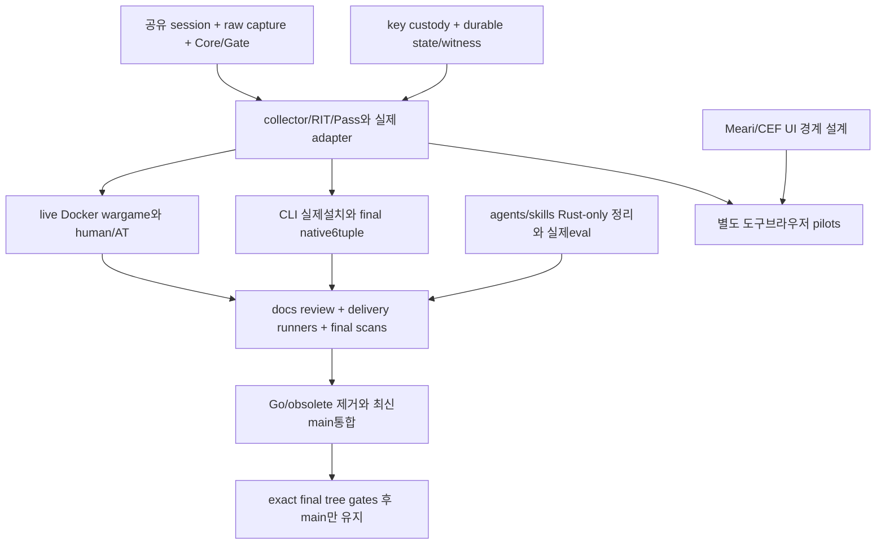

# 통합 로드맵과 마일스톤

문서 버전 0.2.0. 2026-11-07 KST 기준으로 사용자 생성 프로젝트 채팅 9개의
최신 완료 turn, 실제 커밋·파일·검증 기록을 대조했다. 새 내장 브라우저 분석
채팅도 제한된 정적 분석을512a73f에 완료했다. 이 문서가 현재 상태·우선순위의 정본이며 기존
실행 plan의 과거 기록은 이력이다. 채팅 완료, 구현 존재, 파일럿 성공, 제품
전체 자격화를 서로 대체하지 않는다. 날짜나 전체 완료율을 추정하지 않는다.

## 상태 규칙

| 표기 | 의미 |
| --- | --- |
| 구현 | 명시한 범위의 코드와 검증 근거가 존재 |
| 부분 구현 | 하위 slice는 있으나 필수 제품 경로/검증이 남음 |
| 연구 완료 | 조사·설계가 정본화됨; 실행·지원 완료가 아님 |
| 미구현 / 미실행 | 코드 또는 실제 해당 환경의 실행 증거가 없음 |
| 보류 | 선행 종료 조건 때문에 의도적으로 실행하지 않음 |

검증은 source SHA 또는 dirty snapshot manifest, 설정·이미지·환경 및 case
분모에 귀속한다. 과거 green을 후속 변경에 소급하지 않는다. zero-test harness,
ignored/skip/unsupported/error, CHALLENGE와 인간 ALLOW를 구분한다.

## 병렬 채팅 결과와 후속 연결

9개 기존 작업 turn은 모두 completed다. 앱의 idle/notLoaded는 표시 상태이며
기능 전체 완결을 뜻하지 않는다. 전체 마지막 결과 snapshot은
evidence:root/20261106235519의 chat-results.json에 기록했다.

| 작업 | 커밋 / 검증된 결과 | 후속 작업 |
| --- | --- | --- |
| Pages·Draft v0 | 2d98934; authored77문서, 두 baseurl, 브라우저88조합, keyboard8 | 새 코드 반영 재검토, 실제 AT·같은 SHA delivery와 Pages 배포 |
| CI/OIDC | 44e79a4; reusable validation, release/Pages, review freshness 도구 | 전체 제품 runner3개, registry 신뢰/소유 설정, 최종 scope 검증 |
| Node/Bun | 6941032; Express/Hono,14그룹과 native HTTP mock conformance | 후속 authority lab 범위 반영, Rust-only binding·full browser 경로 |
| CLI | fe26b4d; doctor/dry-run/install/repeat/rollback와 Windows6테스트 | 실제 서비스 활성화·runtime readiness·서명 artifact 설치 |
| nginx | b1e10ae; njs unit24, Docker mock28 | Rust native/bridge로 전환, 공동 protocol 및 실제 authority 연결 |
| Rust wargame | 671e88a; unit8, network-none 반복/replay;12예약/8평가/4미지원 | live Gate·browser·Pass·실제 topology와 human/AT controls |
| Windows runner | c6a2457 실행,99cf472 근거;6native tuples 통과 | 최종 SHA 전체 runtime/GUI/service와 remote-peer 부정 시험 |
| Rust authority | 6f5d83a; Windows15/Linux Docker14 및 다른 UID 거부 | full Core/Gate/capture/collector/RIT/admin과 독립 witness |
| Compose 제품랩 | 3b9c306; topology26/26,actual authority22/22,경계unit2 | releaseReady=false 유지;fullRequiredExit2의 미완료 기능 구현 |
| 내장 브라우저 REA | 512a73f;guest attach·adoption·session/control의 bounded static 분석 | 현재runtime activation/native compositor는 미관측;Owl 복제는 제외 |

root 통합 후 CLI/wargame workspace membership, authority와 key/vault의 실제
Cargo 통합이 추가됐다. 각 채팅이 남긴 당시의 'root 통합 필요'는 이 후속
커밋으로 일부 해소됐지만 전체 runtime이 완료된 것은 아니다.

## 현재 구현 근거의 범위

- 기존13개 Cargo packages에 runtime/browser2개를 통합 중이며, edition2024, 사용자 승인 core MSRV/toolchain1.99.1,
  shared unsafe forbid. 이전1.88 실행 기록은 당시의 이력으로 보존한다.
- migration inventory314행: unit-parity ported54 / partial5 / pending255,
  verified_runtime_parity0. 원본 테스트 함수804개. 파일 수는 전체 완료율이 아니다.
- 기록된 integrated-key 전체 workspace151테스트와 Clippy/MSRV/WASM 검증,
  당시 Cargo audit101dependencies/0findings/0warnings. 새 HEAD 재실행 주장이 아니다.
- audit canonicalization/Merkle/서명/fsync WAL/인증 restart/Log/proof와 witness
  연결, zeroized sealed key/pseudonym vault가 실제 workspace에 통합됐다.
  운영 custody·rotation·durable erasure와 독립 witness 서비스는 남아 있다.
- 원격 run42309353245는 c6a245751e3dd4654157f5482f8ef8757a153707에서 성공했다.
  Linux/macOS x64·ARM64 각130테스트, Windows x64·ARM64 각131테스트,
  Windows37/37harness·CLI6·실제 비관리자 token·workspace 쓰기 거부·cleanup.
  full_runtime_qualified=false이며 후속151테스트 상태에 소급할 수 없다.
- Docker lab의 실제 Node→Rust authority·replay·WAL 등 제한된 경로는 검증됐다.
  missing browser evidence의 거절/CHALLENGE와 origin effect0는 인간 ALLOW나
  전체 Gate 보호 성공이 아니다. 당시 source가 dirty였으므로 manifest/hash를
  보존하며 커밋 SHA만으로 재현 완료라고 주장하지 않는다.

## 전체 마일스톤

| ID | 영역 | 현재 상태 | 종료 조건 / 의존성 |
| --- | --- | --- | --- |
| M0 | branch·Specfold·conventions | 구현 | final agents/skills 정리는 M11에 남음 |
| M1 | contracts·signals·behavior·model·scoring·challenge | 부분 구현 | 모든 원본 회귀,ML lifecycle,full Pass,실제 runtime 연결 |
| M2 | network·raw capture | 부분 구현 | sockets/HPACK/TLS/H2 실제 관찰과 connection/session binding |
| M3 | audit·keys·state | 부분 구현 | atomic/ACL/locked custody·rotation,독립 durable witness,dual-control erasure·sinks |
| M4 | Core/Gate·local authority | 제한된 runtime 구현 | session/collector/RIT/capture,proxy/settings/abuse/local admin·dual control |
| M5 | browser/WASM data plane | 부분 구현 | 실제 loader/collector/Pass/RIT/recovery,ordinary browser·AT controls;M2-M4 |
| M6 | 서버 adapter 생태계 | 부분 구현+확장 연구 | typed provenance/stream 규약,Node Rust-only,nginx 실제authority,외부auth·HTTP-origin tuples;M4-M5 |
| M7 | CLI·설치 | provisioning slice 구현 | 서명 artifact 설치→서비스 실제 활성/readiness→반복/rollback native pilots;M4 |
| M8 | 공격/방어·Docker lab | 제한된 검증 | live Gate/browser/Pass·egress isolation·human/AT와 실제효과 분모;M4-M6 |
| M9 | 자동화·모바일·표준·provider | 연구/공개 draft 작성 | proposal wire/vectors/review 및 허용된 owned pilots;provider는 not_run |
| M10 | Cross-OS·CI/OIDC·Pages | native6tuple 및 wiring 구현 | 최종SHA runtime6tuple,실제runner3개,registry,갱신 docs·실제배포;M4-M8 |
| M11 | Rust-only·CVE·agents/skills·배포표면 | 부분/미완료 | foreign source disposition,최종 ecosystem/image scans,.agents정본,모든skills실제eval |
| M12 | Go/폐기물 제거·공유main | 의도적 보류 | 모든 필수 이전gate→최신main통합→exact final tree 전체검증→main만 유지 |
| B0 | Rust Chromium 검증 도구 설계 | 연구 완료 | Meari UI·CEF engine 확정,관찰 계약과 native lifecycle 상세화 |
| B1 | Rust 외부엔진 supervisor 파일럿 | 미구현 | pinned engine/profile,private control·관찰 fidelity;embedded 완성으로 보고 금지 |
| B2 | Meari+CEF 실제 내장 브라우저 | UI slice 진행 / CEF 통합 미검증 | interactive child surface/input/IME/AX,실제 sandbox·six native tuples |
| B3 | 브라우저 진단·server receipt 연결 | 미구현 | collector/capture와 typed lab observations 분리;M4-M5와 B1-B2 |
| B4 | browser/mobile/AI/AT 비교 실험 | 미실행 | 일반 Chrome 대조군,관찰개입 표시,실제 origin/audit 결과 |
| B5 | 도구 패키지·업데이트·문서 | 미구현 | native CVE/SBOM/서명/업데이트와 authored Pages 문서;B2-B4 |

B 트랙은 새 검증 도구 연구에서 도출된 별도 제작 backlog다. 기존 Rust 제품
parity의 성공 근거로 합산하지 않는다. 상세 구현은 해당 spec-first slice의
계약·수용 기준을 먼저 정본화한다. Owl 전체 복제/클린룸 재구현은 범위에서
제외됐고, 내장 browser embedding의 한정된 REA 조사는 별도 채팅에 위임됐다.

## 중요한 요구사항 정정

UI는 사용자 선택 Meari를 사용한다. Meari0.2.0은 Rust1.99.1을 pin하고 필수
parser가 Rust1.97을 요구한다. 사용자가 코어도1.99.1로 명시 승격했으므로
이전1.88과의 알려진 하한 충돌은 해소됐다. Desktop dependency/build 경계는
유지하고 전체closure를 검증한다. Meari의 render-only video surface는 interactive browser
slot이 아니다. CEF/native FFI·입력·접근성 lifecycle이 별도 미완료다.

새 작성 코드는 Rust를 기본으로 한다. 기존 JS/njs/Python/PowerShell 및 .rs에
포함된 PowerShell source도 목록화해 이전/제거/필수 외부자산 여부를 판정한다.
확장자가 Rust라는 이유로 foreign executable source를 완료 처리하지 않는다.
YAML/Markdown/설정과 외부 Chromium C++ dependency는 자체 Rust 제품 코드와
구분한다. 원래 Cross-Lang SDK 목표와 새 Rust-only 요구를 숨기지 않으며,
Rust Gate/config와 검증된 Rust binding을 우선한다.

## 다음 실행 순서와 병렬 경계

| 후속 ID | 구체적인 다음 결과 | 병렬 가능 조건 |
| --- | --- | --- |
| F01 | session/application owner와 Core/Gate 실제 ingress slice | scoring seams에는 단일 writer;M2/M4 interface 먼저 고정 |
| F02 | atomic private keystore·rotation·durable vault·witness process | audit owner 별도,공유Cargo writes는 root 귀속 |
| F03 | Node/nginx 공동 provenance/route/body 및 stream 설계 | F01과 독립 설계 가능;runtime 자격화는 F01에 의존 |
| F04 | typed HeaderMode getter,authority redundant parse/secret custody 정리 | authority owner claim 후;검출정책 변경 금지 |
| F05 | CLI 실제 service install과 native peer/remote-client 부정 시험 | runtime 계약 이후;비관리자 보안조건 완화 금지 |
| F06 | full-delivery native/browser/Docker runner3개 | 구현되지 않은 제품 경로를 placeholder pass로 만들지 않음 |
| F07 | 현재 전체 source 기준 authored docs 재검토 | code interface 고정 후 freshness capture;소유 docs lane 단일 writer |
| F08 | registry trust/metadata/public package closure | 실제publish 없이 사전준비 가능;publish=false를 임의해제하지 않음 |
| F09 | .agents 및 user skills 전수 재작성/평가와 foreign-source disposition | runtime 소스와 경로 분리;평가 결과 not_run을 성공으로 표기 금지 |
| F10 | Meari interactive surface·CEF sandbox/MSRV 설계와 B pilot | 제품parity와 별도;browser UI 채팅 진행,REA 초기 분석 완료 |

이미 완료된9개 채팅과 REA 초기 분석 결과를 바탕으로 다음 구현 채팅을 새로 생성했다.
아래 세 채팅의 초기 active/inProgress 상태를 확인했고 후속 구현 커밋을 대조했다.

| 병렬 채팅 | Chat ID | 소유 범위 | 현재 상태 |
|---|---|---|---|
| Rust 런타임 · Core/Gate 세션과 collector | 01a1b35f-cf83-74f2-aad1-34b3aee60cda | crates/runtime, runtime-application spec | 9ce3190: bounded session/RIT/ingress 구현;collector 미구현 |
| Rust 키 저장 · sealed custody와 vault 영속성 | 01a1b35f-d1a1-7553-a0ed-65d09b9042a7 | audit keys, audit-key-custody spec | 5a77605 완료: bounded custody;Windows49/Linux47 검증 |
| Meari + CEF · Rust 검증 브라우저 UI | 01a1b35f-d3e9-7042-91a4-10c910a15515 | crates/browser, browser-ui spec | ead2dc6 완료: 관리UI·unit9;실제CEF 부착 미완료 |

공통 Cargo/lock/toolchain/CI는 root 단일 writer가 통합한다. 모든 authored code는
Rust이며 기준 toolchain은 1.99.1이다. CEF는 목표 내장 엔진이고 Meari는 UI 필수
선택이다. 초기 UI 창 구현은 CEF 부착·sandbox·실제 페이지 렌더링의 완료를 뜻하지 않는다.
DRM 지원 여부는 media capability 실험에 한정하며 자동화 판정이나 새 hard rule로
사용하지 않는다. 키 저장 slice 역시 실제 dual control 없는 erasure 권한을 발급하지 않는다.
각 채팅은 독립 unit 검증을 수행하고, 제품 통합 완료는 공통 workspace 및 Docker
pilot/e2e 검증 이후에만 인정한다.

## 남은 검증·배포 차단 사유

## 실행 파동과 통과 기준

| 순서 | 묶음 / 담당 | 지금 할 일 | 다음 단계로 넘어가는 증거 |
|---|---|---|---|
| W0 | root 공통 기반 | 완료: 승인된 Rust1.99.1 적용·원격 native probe | a0b6dfc의 six tuple 모두 성공;후속 source에 소급 금지 |
| W1-A | runtime 채팅 / F01 | 세션·ingress·collector/RIT application 계약과 실제 slice | 실제 source unit·부정 입력·replay·필수 신호 누락 거절;raw capture 미지원은 명시 |
| W1-B | custody 채팅 / F02 | ACL·잠금·atomic 저장·회전·인증 복구 | tamper/wrong password/동시 writer/복구 unit·native 파일 검증;독립 witness는 별도 잔여 |
| W1-C | browser 채팅 / F10 | Meari native controls와 CEF 수명·입력 경계 | 실제 UI 실행·접근성·sandbox·CEF 부착 증거;UI mock을 렌더링 성공으로 계산 금지 |
| W2 | root 통합 + 다음 adapter/CLI slice / F03-F05 | 공통 Cargo 통합,provenance/body/stream 계약,서비스 활성화 | workspace 회귀와 실제 authority/origin 효과,서비스 readiness·반복·rollback |
| W3 | lab/runner / F06 | full native/browser/Docker runners와 human/AT 대조군 | Docker 제품 e2e·공격/정상 분모·six tuple·실제 AT 결과 |
| W4 | docs/delivery / F07-F09 | 현재 source docs 재검토,Pages,package 신뢰,CVE/SBOM,skills 평가 | 동일 source SHA 증거·freshness·실제 배포 검증;외부 publish는 별도 사용자 요청 |
| W5 | 최종 정리 / M12 | Go/폐기물 제거,최신 main 통합,브랜치 정리 | 정확한 최종 tree 전체 필수 gate 통과 후 공유 main만 유지 |

W1 세 작업은 서로 다른 소스 경로에서 병렬 진행한다. W2의 공통 Cargo/lock/CI
수정과 모든 Git index/HEAD 변경은 직렬화한다. W1 완료 전 W2의 계약 설계는
가능하지만,없는 runtime을 mock 성공으로 대체하여 W3 완료를 선언할 수 없다.
B3-B5 브라우저 진단·비교 실험·배포는 B2 및 제품 collector 계약 이후 진행한다.
국제 표준 draft v0·연구와 provider 실험 설계는 독립적으로 보강할 수 있으나,
실제 Cloudflare/AWS/모바일 실행 및 표준기관 제출·승인을 연구 완료로 간주하지 않는다.

### 이번 갱신의 검증 snapshot

Rust1.99.1 local 검증은 evidence의 정확한 source snapshot에 귀속한다:
workspace151개,fmt·warnings-denied Clippy,8개 순수 library WASM compile,
CI 도구9개,docs-review7개. authority Docker 기본14passed/2ignored에 더해
별도 other-UID parent1개를 명시 실행했다. 이것은 full product e2e가 아니다.
원격 run42317508643(source a0b6dfc230a61d8c3fb0ddc7e34e0827be63b178)의
후속 조회와 내려받은 여섯 report.json 대조에서 Linux/macOS/Windows x64·ARM64
모두 성공,source SHA 일치·test_exit_code0·full_runtime_qualified=false를 확인했다.
새 병렬 source 검증에 소급하지 않는다. 정본 요약은
evidence:root/20261106235519의 rust1991-six-native-results.json이다.
근거: .spec/evidence/20261107000721-rust-toolchain-upgrade/local-results.json,
GitHub Actions run https://github.com/modootoday/humanymous/actions/runs/42317508643.

## 잔여 차단 항목 상세

후속 실제 프로세스 Docker 파일럿이 network-none·UID65532·cap-drop ALL·read-only
환경에서 통과했다. real runtime binary와 owned loopback origin을 사용하여
정상효과2건,실패/replay/변조의 추가효과0건,감사4records 인증복구,재시작
세션 무효화를 확인했다. typed client report fixture는 실제 브라우저/human이
아니다. 근거는 evidence:root/20261106235519의 runtime-process-pilot-final-results.json,
private source manifest 및 image ID이며 full_runtime_qualified=false다.
초기 runtime3실패는 frozen scoring을 바꾸지 않고 fixture header 순서를 수정하여
11개 통과로 전환됐다. 후속 취소 회귀 수정 후 전체workspace/all-target 테스트,
warnings-denied Clippy·fmt·8개 순수library WASM 검사도 통과했다. 최종 image의
pilot 자체 Clippy와 재실행까지 통과했다. 검증 후 기록된 source hash drift는0이다.
이 결과 역시 기록된 dirty source/image에 귀속하며 최종 전체제품 자격화는 아니다.

새 runtime/browser workspace 통합은 진행 중이다. browser native-ui Windows
check와 unit8개, custody parent6passed/2ignored helper 시험을 관찰했다.
진행 중 dirty source에 대한 관찰로서 최종 커밋 자격화는 아니다.
새 dependency closure의 cargo audit 결과는 취약점0개와 별도로
RUSTSEC-2026-0192(ttf-parser0.25.1 유지보수 중단) 경고1개다.
경로는 humanymous-browser→meari-native→ttf-parser이다. 최종 경고0 상태로
보고하지 않으며 pinned Meari의 font parser 교체/업스트림 반영을 검토한다.

현재 다음 full-delivery entrypoint가 없다: scripts/migration/pilot-native.ps1,
pilot-browser.sh, e2e-rust-docker.sh. cross-os-probe와 제한된 lab runner는 이
full runtime 계약의 대체물이 아니다. registry-prerequisites.json의 crates/npm
verified는 false이며 실제 신뢰 bootstrap이 남아 있다.

읽기 전용 docs 대조 snapshot: reviews201files/12surfaces,현재 governed257files,
미검토56files. raw hash58차이 중 줄바꿈 외 실제 내용 차이6개가 확인됐다.
이는 verifier 재실행 결과가 아니다. 깨끗한 LF exact-tree에서 실제 source
검토와 freshness 도구를 다시 실행해야 하며 해시만 덮어써 해결하지 않는다.

Go baseline Docker green은 Rust 제품 e2e가 아니다. Cloudflare/AWS 연구는 실제
provider 실행이 아니다. 모든 필수 unit/pilot/Docker e2e/AT/security/동일SHA
delivery gate가 끝나기 전 M12를 실행하지 않는다. 최종 병합에는 최신 공유main
반영,원본 Go/retired paths와 공개surface정리,재검증 및 migration branch 제거가
포함된다. 사용자 요청 전 릴리스 태그/레지스트리 출판을 임의 실행하지 않는다.

## 근거

독립 읽기 전용 검토에서 연구·로드맵 정본화 범위의 P0/P1 차단 사유는 없었다.
새로 허용된 한정적 browser REA와 철회된 Owl 복제 범위는 명시적으로 분리했다.
이 검토는 구현·배포 또는 전체 목표의 완료 승인이 아니다.

- evidence:root/20261106235519: 9chat results와 최신 native run metadata.
- .spec/evidence/20261106194112-go-migration-source-inventory/go-inventory.json
- .spec/evidence/20261106223747-cross-os-runner-research/windows-standard-user-qualified-summary.json
- .spec/evidence/20261106224155-container-test-environment-research/container-runtime-results.json
- .spec.local/root/evidence/20261106194410-rust-migration-local-runs/
- crates/authority/INTEGRATION.md,crates/audit/KEYS-INTEGRATION.md,crates/cli/INTEGRATION.md
- scripts/ci/README.md,scripts/ci/registry-prerequisites.json,docs/reviews.json

## Sealed runtime 및 native 집계 후속 통합

Runtime 설정 v0.2는 평문 audit hex 키 대신 사전 발급 sealed custody를 연다.
SealedAudit가 Log와 키 잠금을 함께 소유하고 passphrase는 bind 전에 소비·zeroize한다.
누락·변조·잘못된 암호·동시 writer에서 새 identity를 생성하지 않는다. Windows
runtime unit/TCP13+native process1과 Docker 실제 프로세스 파일럿이 통과했다.
근거: evidence:root/20261106235519의 sealed-runtime-custody-results.json.

7e2f17c의 원격 run42319642298는 Linux/macOS 네 tuple 성공,Windows 두 tuple
집계 실패로 전체 failure다. Windows 원시 산출물을 대조하면 각180 required
테스트가 통과했고,2개 subprocess helper ignore 및 중첩 summary가 기존 엄격한
집계와 충돌했다. 새 verifier는 정확한 audit helper/parent/child 증거만 분리해
인정하고 일반 ignore/unknown helper는 계속 거절한다. 회귀5개가 통과했다.
재분석은 새 CI 성공이 아니다. 기존 실패와 raw ignored2는 보존하며 새 commit의
실제 원격 실행이 필요하다. 근거: native-helper-accounting-results.json.

## Native Windows 권한 경로 후속 통합

Authority의 production/test inline PowerShell ACL 경로를 제거했다. audit 저장소의
공용 handle 기반 SID/DACL 검사로 custody와 공유하며 protected-directory와
inheritable-directory/file 정책을 구분한다. Windows x64 audit library36,
authority15,runtime14 및 custody parent10(별도 ignored helper2) 검증이 통과했다.
Clippy-Dwarnings와 audit WASM check,실제 sealed runtime Docker 파일럿도 통과했다.
근거는 evidence:root/20261106235519/native-storage-privacy-results.json이다.
CLI의 inline PowerShell 경로는 남아 있고 새 commit의 native6tuple은 별도 필요하다.
이 결과는 전체 Rust-only 완료나 full runtime 자격화가 아니다.

Sealed startup 통합 a8a3b66의 원격 run42320683394는 native6tuple 모두 success다.
다운로드한 여섯 report의 SHA/status/full_runtime_qualified=false를 검증했고,
Windows는 raw ignored2와 helper2를 보존했다. 정확한 근거는
sealed-runtime-six-native-results.json이다. 이번 native ACL 후속 patch에는
소급하지 않으며 새 SHA 실행이 필요하다.
