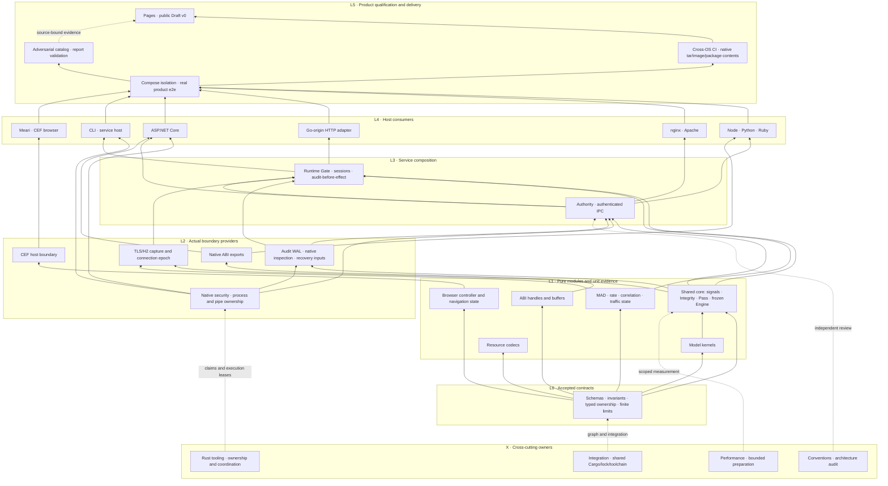

# Structural development canon

The user accepts bottom-up implementation and explicit ownership of every chat.
This SoT governs development order, layer contracts and title conventions. The
linked bottom-up plan records detailed gates, clusters and preserved constraints.
It does not assert that all depicted modules or production edges are qualified.

## Naming and responsibility

Every project chat uses exactly `Humanymous · {L0|L1|L2|L3|L4|L5|X} · {English responsibility}`.
X denotes cross-cutting integration/governance/measurement, not a runtime layer.
A title identifies the primary role; modules may span adjacent layers. Stable chat
IDs, existing path claims and source permissions survive title changes. Titles
are not filesystem write grants. No new crate or source reorganization is implied.

| Layer | Responsibility and promotion gate |
| --- | --- |
| L0 | Accepted schemas, invariants, source compatibility and provider/consumer contracts |
| L1 | Pure functions and bounded state: scoped units, negatives, fmt/check/strict Clippy |
| L2 | Actual OS/file/process/socket/FFI provider tests, resource ownership and failure evidence |
| L3 | Authenticated application services, recovery/session/ACK/lifecycle composition and narrow real integration |
| L4 | Host adapters, CLI and browser consumers: actual supported host or GUI pilots |
| L5 | Docker product/adversarial, cross-OS/artifact and public documentation qualification |
| X | Shared graph, independent review, performance and Rust developer tooling across all layers |

## Exact23-chat registry

| Canonical app title | Stable chat ID | Exclusive responsibility |
| --- | --- | --- |
| Humanymous · X · Integration and Shared Core | 01a1b25e-8e4c-7a70-b7b7-f51a66c58514 | Own shared Cargo/lock/toolchain, signals/Integrity/Pass and frozen scoring seams; coordinate layer gates and final main integration. |
| Humanymous · L2 · Native Security and Process Ownership | 01a1b30d-439d-7030-8e38-789bc0b70f6a | Complete typed binding, bounded Windows bridge and one shared capture/direct-pipe owner; actual native boundary tests before higher consumers. |
| Humanymous · L2 · Audit Storage and Recovery | 01a1b35f-d1a1-7553-a0ed-65d09b9042a7 | Own canonical/Merkle/frame kernels, actual WAL/source/FD/capacity proof and typed recovery; no premature production authority. |
| Humanymous · L3 · Authority and Authenticated IPC | 01a1b30d-454e-7a50-9ab1-48358dbd0ff1 | Own peer authentication, approval/replay/expiry and IPC; consume native/audit primitives and fix encoded-secret ownership. |
| Humanymous · L3 · Runtime Gate and Service Lifecycle | 01a1b35f-cf83-74f2-aad1-34b3aee60cda | Compose qualified services, session/RIT/ACK/audit-before-effect, temporal observation owners and Pass handler; no duplicate scoring. |
| Humanymous · L4 · CLI and Service Host | 01a1b2f5-e927-7a03-9d47-9d1084d14c53 | Consume shared native ownership; actual watchdog, installation and service pilots. Do not fork process primitives. |
| Humanymous · L4 · Meari and CEF Browser | 01a1b35f-d3e9-7042-91a4-10c910a15515 | Pure navigation/tab/controller state first, CEF boundary next, then real navigation/keyboard/IME/AT pilots and bounded cleanup. |
| Humanymous · L5 · Product Isolation and Docker E2E | 01a1b30d-4736-7281-a54f-5cb3a5fa4fe4 | Own strict typed safe outcomes, Compose topology and actual product e2e; lower boundary tests before full composition. |
| Humanymous · L5 · CI and Distribution Validation | 01a1b2da-7d8a-73f2-9bb2-78bde5ae33f9 | Own scoped runners, delivery helper, actual package/image contents and OIDC environment; no publication or release tags. |
| Humanymous · L4 · Node Python Ruby Adapters | 01a1b2da-d1e9-7a22-9052-9a90a8cba54f | One shared framework consumer contract, then actual Node/Python/Ruby ABI/server/GC/GVL pilots using qualified lower providers. |
| Humanymous · L4 · nginx Adapter | 01a1b2f5-ea98-7023-b7af-ad527b820084 | Own nginx source/contract and actual supported host tuple, preserving exact proof and missing profiles. |
| Humanymous · L4 · Apache Adapter | 01a1b4e3-b0f1-7320-81a8-13e89d1d0dff | Own Apache native adapter and three-MPM integration; requalify affected lower contracts and cleanup. |
| Humanymous · L4 · Go HTTP Adapter | 01a1b4e3-b4a2-7690-9057-24b06d04b652 | Rust-owned Go-origin HTTP compatibility; retain bounded Go8 and finish approved framework tuples, no new Go core. |
| Humanymous · L4 · ASP.NET Core Adapter | 01a1b4e3-b687-7822-88c3-20d053f7d8fd | Consume shared native/ABI/Authority contracts then actual Kestrel/GC/AOT/package; exactly three approved C# glue files. |
| Humanymous · L2 · Native ABI and C Cpp Interop | 01a1b4e3-b2b7-71d3-bf3b-66a851cb7cf4 | Pure ABI handles/buffers first, export/header/compiler/dynamic-load/allocator boundary proof next; keep unsafe exception narrow. |
| Humanymous · L2 · Network Observation and TLS HTTP2 | 01a1b4e3-b852-7d21-90d9-4f00bebb5420 | Pure MAD/rate/correlation/traffic modules then actual capture epochs; no fake fleet readiness or runtime lifecycle duplication. |
| Humanymous · L1 · Watermark and Resource Codecs | 01a1b63c-3b93-7371-b055-9fc2cec587b8 | Pure bounded payload/codecs and standards validation first, then real carrier/file/HTTP/product pilots. |
| Humanymous · L1 · Model Training and Calibration Kernels | 01a1b63c-d8c7-76c1-bc35-baf9d6cfe88c | Pure bounded record/RNG/kernel/evaluation first, actual file/process lab next; no production activation or frozen-threshold changes. |
| Humanymous · L5 · Wargame and Report Validation | 01a1b2f5-ec55-7c91-863d-f539c70417be | Pure legacy report/renderer/CLI, strict catalog contracts then actual generic26 evaluation; preserve unsupported denominators. |
| Humanymous · X · Performance and Build Optimization | 01a1b645-0e76-75b0-b509-fd8e7719fc51 | Measure the touched layer, bound preparation overhead and research cache policy; no production source writes without an exact handoff. |
| Humanymous · X · Conventions and Architecture Audit | 01a1b645-0bdc-7a53-b759-57c1eb998336 | Independent risk-prioritized layer/contract audit, batch nonblocking review, no duplicate source edits or fabricated qualification. |
| Humanymous · X · Developer Tooling and Bounded Preparation | 01a1b34e-f9e9-77d3-b883-0cc4d76763a4 | Own Rust tooling, bounded selected-input preparation, claims/title/role registry and concise rules; preserve global Git mutex and existing compatibility mode. |
| Humanymous · L5 · Pages and Public Draft v0 | 01a1b2da-2656-7a23-a60b-08a681b23117 | Consume actual source-bound layer receipts, publish maturity limits, batch render/AT checks at public-input milestones. |

All23 app rename operations succeeded, and a fresh live inventory matched all23
exact titles with zero mismatches. The JSON operation/observation proof is attached
to evidence:root/20261106194410 as bottom-up-chat-roles.json. M11 owns the projection into THREADS/LANES and
concise rules; root owns this architecture and shared graph. The projection must
replace stale read-only-only descriptions for implemented watermark/model/network
slices while preserving actual path claims, temporary loans and unqualified gates.

## Applied dependency structure

The following is an implementation/consumption relationship diagram, not a
literal complete Cargo dependency graph or proof of completion. Solid arrows
mean lower-provider to upper-consumer; dashed arrows mean governance/evidence.
Independent columns proceed in parallel, with incremental vertical integration.

Watermark/model real resource and file/process integration require their own L2
pilots before application adoption. Browser-to-protected-product traffic and
external witness/secret stores require the separate owning actual contracts;
no missing production capability is filled by an arrow in this diagram.

## Promotion and operating rules

1. Define acceptance contracts before code, then implement and verify bottom-up
   within a cluster. Do not wait for every unrelated low-level package globally.
2. Unit evidence cannot promote a mock, another OS, native ownership or full
   product. Consumers may prepare code/tests against a frozen typed API while
   actual production admission stays closed until provider gates pass.
3. Preserve first failures and source/target/features/test denominators. A routine
   reversible own-scope correction is not a request for new human approval.
4. Run fmt first and bounded relevant preparation. Separate source-lane ownership,
   compiler-target lease and readonly proof recording; return targets at terminal.
5. Keep one source writer per claimed path, one owner for shared security
   primitives and serial attributed Git operations. Root alone changes the common
   graph; M11 alone updates its registry projection.
6. Rust remains the implementation language, with exactly the existing approved
   C# and unsafe exceptions. Detection freeze, fail-closed, a11y and defense-only
   constraints and the full final main integration gate remain in force.

Research supports bottom-up incremental integration, narrow actual boundary tests
and a testing pyramid, without a fixed unit/integration/e2e percentage. References
and measured preparation bottlenecks are in the linked plans. Mandatory product
and real native tests are retained, not replaced with more unit counts.

## Continuous responsibility rotation

On 2026-11-08 (Asia/Seoul), the developer tooling chat retained its coordination
obligations and accepted bounded selected-input preparation implementation. Its
previous title was `Humanymous · X · Developer Tooling and Coordination`; the new
title in the responsibility table was applied and independently verified in the
live inventory. Other owners' incomplete gates remain assigned, rather than
being treated as exhausted merely because their last chat turn ended.

Root monitors source checkpoints, terminal execution receipts and remaining
acceptance gates across all project chats. An idle chat, a completed assistant
turn or an exhausted local task is not proof that its responsibility is complete.

Each owner reports a compact handover when its current slice reaches a terminal
state: exact source commit, implemented scope, executed and missing gates, live
process handles, retained resource reservations, remaining dependencies and owned
paths. Preserve failed and deferred gates in the original responsibility record.

Root then selects the lowest ready unmet dependency in an independent cluster.
Prefer an actual implementation or boundary-validation task that unlocks blocked
consumers; avoid inventing documentation or repeated audit work merely to keep a
chat active. A blocked upper-layer owner may take a disjoint lower-layer slice,
but cannot overwrite its provider or silently assume provider ownership.

A reassignment records the old responsibility disposition, successor or retained
follow-up owner, new acceptance criteria, exact paths, dependency contracts and
resource limits. The old writer releases or explicitly narrows its claim before
the new writer claims paths. Running processes and target leases require explicit
handover or terminal cleanup; chat rotation never authorizes foreign termination.
Shared Cargo, lockfile, toolchain and security decisions remain root-owned.

After the new responsibility is accepted and its ownership is established, root
updates the live title using `Humanymous · {L0|L1|L2|L3|L4|L5|X} · {English responsibility}`.
M11 updates the canonical responsibility registry with the same chat ID and
retains dated role history, contracts and source-bound evidence. Root verifies
the live title against the registry. Renaming is neither a write grant nor a
completion claim. No rename is needed when the next slice retains the same role.

Repeat this cycle after meaningful source/test milestones and terminal failures,
using bounded progress snapshots rather than constant polling. Concurrency follows
actual compiler/process/resource admission, not the number of active chat turns.
If no independent task is ready, retain an explicit dependency wait instead of
creating duplicate work. Full migration completion still requires the original
integration, product, documentation and post-main verification gates.

