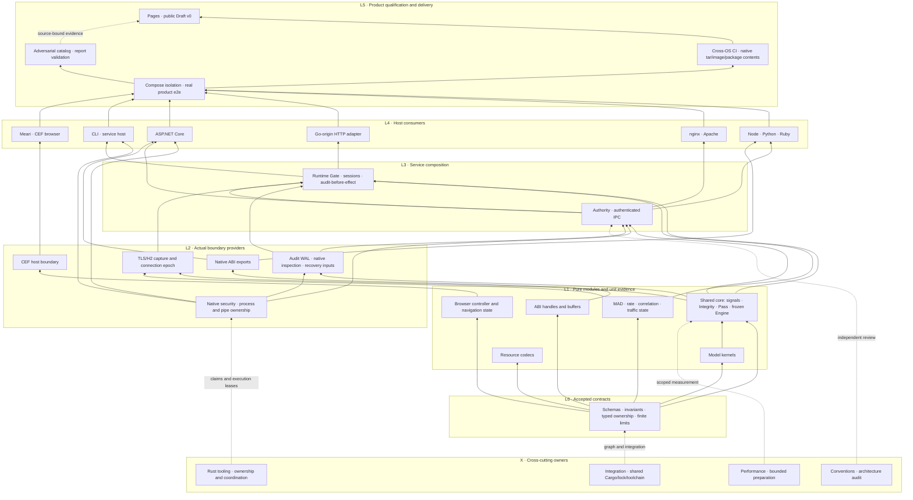

# Structural development canon

## Browser wire privacy correction, version 2

The actual selected browser passed at source f8aec286, while the product run
42429778301 failed the historical Referer-absence assertion (41/43 assertions).
The accepted Collector policy permits an exact owned origin-root Referer or
absence. It never permits a document path, query, fragment or foreign origin.
The version-2 product assertion replaces the incompatible absence-only assertion
with explicit absent, present, root-matched and other counters at both proxies.
All four counters must be unsigned integers; absent plus present must equal the
positive checked fixture request denominator, root plus other must equal present,
and other must be zero. Missing, malformed, overflowing or inconsistent counters
fail closed. The root derives only from the trusted lab browser-origin fixture.
Existing case-insensitive duplicate-header refusal and strict Origin checks stay
in force. No raw Referer values enter receipts. This is a private qualification
contract correction, not a scoring change or Runtime authentication fallback.

The first scoped Windows runner test execution passed all five browser-wire
tests, with41 other tests filtered out. Proxy producer validation, an actual
selected-browser sensitive-document control, reviewed source-pin updates and
the next Docker product run remain required. This source change alone does not
establish network privacy or whole-product qualification.

The Windows runtime-pilot filter selected zero tests (four filtered): the proxy
module is Unix-only. That successful command exit is not producer-test evidence.
An unrestricted spec check also failed on existing local-document layout issues;
retain this failure separately from the scoped public-canon check.

The selected actual runtime browser test now changes the real document history
to /private-document/path?private-query=fixture#private-fragment before bootstrap
and retains that context through all real requests. Explicit successful history
restoration is required at the end; Drop is only best-effort early-failure cleanup.
The selected test identity and request denominator stay unchanged. Its reviewed
DATA pin is6571bytes, SHA-256
abbc8badb89cc4aa879cec85e74cd776a236225df90e47707d86f17ca685d421.
The33 existing diagnostic sites shift by exactly one line after the inserted
fixture setup; new setup/cleanup failures remain unrefined, rather than widening
the safe diagnostic vocabulary. WASM all-target runtime-pilot strict Clippy and
five source-pin parser tests passed locally. The required actual-source gate
must be run by its full snapshot::source_pin selector: an initial shortened
exact selector selected zero tests and is not gate evidence. Actual browser and
Unix producer execution remain pending, including the complete two-proxy result.
The corrected full exact selector subsequently executed one required checkout
gate and passed (45 filtered); the earlier zero-selected invocation is retained
as a failed selection attempt, not added coverage.

Root fast-forwarded only the dedicated browser validation ref from f8aec286 to
3137c905ac4e52b8b345fa2306af9e4ef4d42b48. Run42432665570 was independently
observed queued and then preflight in progress; Lab owns its single terminal
watch and evidence collection. No second dispatch, publication or main push was
performed. This is execution admission, not a passing result.

The private version-3 Tools movement proposal reconciles282 tracked rows against
that exact Git source, including seven changed rows since version2. Every row's
raw worktree Git object equals the corresponding source commit blob. Previous
proposals remain retained. This proves the named source-row snapshot only, not
compiler input closure or completed movement. The CLI owner is assigned actual
Rust source candidates for14 thin composition roots in its owned evidence area;
Root retains all live source movement and shared Cargo integration ownership.

Root materialized only the eight accepted immutable DATA replicas under
crates/apps/humanymous-cli/qualification, with data-provenance.json binding each
destination to source commit3137c905, original path, exact Git blob, SHA-256,
length and Apache-2.0 license. Six Core fixture worktree byte views differed
from their committed blobs. The first preparation stopped at that mismatch
after the two matching CEF/Collector copies; continuation extracted exact Git
blob bytes for the remaining six, preserving every original worktree file.
All eight destination raw Git objects equal their recorded producer blobs.
The provenance explicitly distinguishes these views and forbids automatic
refresh. This DATA-only step adds no source clone, Cargo member or package
publication; consumer rewiring and packaged equality verification remain open.

The existing Rust Delivery role now exposes qualification-data CANONICAL_ROOT
before its legacy checkout discovery, so this new check never falls back to
CWD or CARGO_MANIFEST_DIR. It checks the fixed eight destination/producer pairs,
strict JSON, positive bounded sizes, lowercase digests, reviewed source commit
and license, and compares bounded same-read replica bytes to their recorded hash
and actual producer Git blob. Input components reject symlinks and Windows
reparse points; changed length/mtime or canonical root escape refuses. This is
trusted-checkout drift detection, explicitly not hostile-race or OS authority.
Two scoped units passed (121 other tests filtered), strict Delivery Clippy passed,
and an actual read-only qualification-data invocation verified eight replicas.
The reported provenance SHA-256 is
de66ea4c3f44f793e296c08027e2eeb7155011d4657282edcc20c986324bea87.
No source fixture was rewritten and runtime_qualified remains false. This new
Delivery module must join Root's final Tools movement map before consolidation.

Independent Delivery review found that the initial Git lookup inherited replace
objects and unbounded subprocess capture. Root corrected both producer resolution
and blob reading with --no-replace-objects, GIT_NO_REPLACE_OBJECTS=1 and
GIT_NO_LAZY_FETCH=1; ambient Git directory/object overrides are removed. A private
bounded stdout reader caps object IDs at128bytes and blob bytes at the already
verified replica length, under one30second monotonic deadline. Failure kills and
reaps the direct Git child and joins its reader. Missing original objects refuse
with explicit retained-object admission required: a shallow checkout must fetch
or retain the reviewed original commit separately before using this offline gate.
There is no current-tree or network fallback. Two units and strict Clippy passed
after correction; the actual eight-replica read-only check also passed. Isolated
replacement-ref, missing-object and process-bound negative execution remains a
hosted qualification requirement; schema units do not prove those process cases.

## Isolated Tools implementation assembly

Root assembled an isolated implementation candidate from exact source5f1010d4,
retaining the original archive SHA-256
8b4dd85edde2262c448de51e85030f716871a9090672620f97d8f7c5dcbbf28d.
No shared Cargo or original implementation path was moved. In that candidate,
274 original files moved once,37 Rust literal path sites were adjusted by their
resolved original targets,14 reviewed composition roots were linked and the13
original manifests were retained outside the candidate. The unified CLI manifest
and workspace metadata now resolve21 members. The first default CLI library/bin
check passed, then the locked Delivery role check passed. The all-target/all-
feature check failed at maintenance integration linkage; after linking actual
private contexts, it exposed ten remaining manifest-concatenated mutable inputs.
Those errors remain assigned to the maintenance reader implementation owner.

A separate locked executable-target check excluding maintenance first failed at
the report import, which still referenced the former attacker library instead of
the linked legacy leaf. Root corrected that import in the isolated candidate;
the subsequent selected executable check passed with warnings. Warnings include
unused exports and unreachable private qualification surfaces; they must be
resolved by narrower real module composition, not blanket allowances. Neither
the failed all-target check nor this warning-bearing pass is strict qualification.
Actual source-preservation, case census, per-role strict checks, extracted-package
and runtime gates remain open before live cutover.

Independent audit also found nonregular DATA inputs were checked only after
open. Root added a regular-file/size check before open while preserving held-file
post-read checks; no hostile-race guarantee follows. Strict Delivery Clippy passed
after this source correction. The Git cleanup wait/join can still outlive the
poll deadline if a descendant retains stdout; hard process-tree containment and
the isolated negative probe remain unresolved and must not be claimed complete.

Root integrated the first maintenance language-reader candidate only into the
isolated Tools assembly. Its executable compiled, initially with nine warnings.
For that private role, unused convenience exports and methods now exist only in
test builds; actual request capture remains in the executable. Explicit error
formatting reads existing diagnostic fields while retaining the original textual
shape. An initial strict check then found a test-only SystemClock import; Root
moved the reference into the test-only helper. The maintenance executable's next
locked strict Clippy check passed. No blanket lint allowance or required test
removal was introduced. Its unit/integration targets still need the ten remaining
external mutable-input rewrites and case reconciliation. The candidate honestly
reports unsupported source identity, so this compile pass does not qualify the
real repository language check or replace the required actual-source evidence.

The wargame owner is assigned concrete Rust candidates that split role composition
into simulation, verification, network execution and legacy report closures while
linking each implementation source once. These candidates remain in that owner's
evidence area; Root retains live and isolated integration custody. Existing field
and symbol preservation, negative authority controls and source test identities
must be reconciled before adoption; warning removal cannot erase functionality.

The user accepts bottom-up implementation and explicit ownership of every chat.
This SoT governs development order, layer contracts and title conventions. The
linked bottom-up plan records detailed gates, clusters and preserved constraints.
It does not assert that all depicted modules or production edges are qualified.

## Naming and responsibility

### Public package family redesign: accepted baseline v0

The user requests a small public family anchored by humanymous,
humanymous-core and humanymous-cli, with no permanently private implementation
packages. This supersedes treating every current adapter/domain crate as a
required final package. Internal modules and fields still need restricted Rust
visibility; public package status never makes every implementation API public.

The user explicitly confirmed this eight-public-package baseline on 2026-11-08
with "기준 설계 확정". The design approval gate is satisfied. Root now coordinates
package/path consolidation and subsequent branch synchronization through the
slice controls below; approval does not authorize concurrent uncoordinated moves.
The earlier fast-forward of codex/rust to9586f7e4 and its CI remain historical
source-bound observations. Main integration still requires the final migration
gates; publication remains unauthorized.

The initial workspace census found41 packages, all then publish=false,
22 binary targets and10 cdylib-bearing packages. These are not41 deployed
products. The current facade's declared normal/build local dependency closure,
including optional/target declarations, spans15 packages. A facade re-export
cannot make unpublished path-only dependencies registry-ready. Do not solve this
by flipping41 publish flags. Publication remains separately unauthorized.

The accepted baseline is EIGHT intentionally public packages. Six is a
more aggressive alternative with greater native/WASM/SDK feature coupling; three
would erase useful safety and platform boundaries. Neither a smaller count nor
faster builds is established without the required measurements and role audit.

| Target package | Current package responsibilities absorbed | Current count |
| --- | --- | --- |
| humanymous | Curated SDK facade and supported build-profile API | 1 |
| humanymous-core | signals, behavior, model, scoring, integrity, challenge, watermark as contextual modules | 7 |
| humanymous-runtime | runtime, authority, audit, capture, network, safe native-security policy | 6 |
| humanymous-platform | approved windows-object-bridge and reusable process/test support, with explicit testing capability | 2 |
| humanymous-collector | Browser/WASM collection and its target-specific dependency graph | 1 |
| humanymous-adapters | Apache safe/native, .NET safe/export, framework, Go, nginx, Node, Python, Ruby, native-abi safe/export | 12 |
| humanymous-cli | CLI/native-cli, attacker/defender, maintenance, Delivery, Pages, lab modules; standalone CEF pilot, Windows native runner, docs review and local parity qualification tools | 13 |
| humanymous-browser | Browser model, CEF bootstrap and desktop roles | 3 |

The complete maintained-package mapping covers45 initial packages:41 workspace members plus four standalone tools. Every survivor needs a deliberate public
API or application/distribution purpose and registry-compatible dependency plan;
there are no hidden permanent helper packages. Temporary publication-disabled
flags remain release guards during design/verification. A necessary additional
public loader/ABI package requires an explained design amendment, not an ad-hoc
private crate or weakened unsafe policy.

Accepted context parents are crates/sdk for facade/core/runtime,
crates/integrations for platform/collector/adapters, and crates/apps for CLI/browser.
Every manifest-bearing leaf directory matches its branded package name. Within
each package use src/<context>/... with standard Cargo targets. This is the
project convention, not a Cargo-mandated directory naming rule. Rust identifiers,
installed executable names, host init/export symbols and staged artifacts remain
separate contracts: humanymous-cli may install the humanymous command.

#### Required acceptance conditions

1. Keep core safe and browser-independent; preserve its forbid(unsafe_code)
   boundary. Preserve the approved platform/export unsafe scopes explicitly.
   Do not broaden exceptions or move unsafe code into core for a count target.
2. Audit every pub(crate) constructor/custody field during merging. Convert to
   private or context-restricted access so newly sibling modules cannot mint
   authority, native proof, handles, Ready or ownership from caller data.
   Public testing features are consumer-selectable build options, never trusted
   capabilities; no testing feature may enable a proof/readiness bypass.
3. One Cargo package has one library target. Adapters and browser helper library
   roles therefore need exact separate build profiles/target directories,
   symbols, staging and loader proof. No universal all-features host product is
   admitted. If role compatibility fails, amend the public package split first.
4. Preserve WASM versus native/Tokio/SDK dependency separation, directed package
   dependencies and one owning implementation. No source copies or path includes
   reaching outside a published package substitute for consolidation.
5. Curate the public API. Current whole-leaf facade exports include lab probe,
   scenario and qualification machinery; do not automatically turn all such
   internals into permanent SDK compatibility commitments.
6. Public release graphs must model Cargo's normal/build/optional/target and
   development-edge publication rules accurately. Versionless dev edges and
   versioned dev edges differ; an over-broad current graph check is a research
   finding, not authority to bypass release verification.
7. Browser's pinned Git-only upstream dependencies need an actual public registry
   fallback or explicitly accepted public distribution strategy. No registry
   availability or namespace ownership is inferred from source visibility.
8. Fewer Cargo packages do not mean all service roles become one process or all
   fixture binaries become installed products. Preserve role identity, witness
   independence, artifact allowlists, exact native symbols and signed bindings.
   Explicitly declare installation targets and required features; keep fixture
   and pilot targets outside the default installed command set.

#### Migration and chat control after confirmation

##### Core slice preparation and atomic boundary

Execution checkpoint: the seven context source trees have now moved into the
accepted core destination. The initial phrase "no relocation" below describes
the preserved preparation snapshot, not current implementation status. Workspace
membership is35 after replacing seven packages with one. Exact scoped evidence
is [[evidence:root/20261107202053]]:162 tests pass, strict Clippy and collector
WASM checking pass, and six same-crate forbidden accesses fail as intended with a
successful control. Core and consumer source integration is committed at
c67d07c0114bd04793410f82f7182de7bfa6df2c. Affected consumer/workspace and clean
package qualification remain pending; none of these scoped results establishes
full migration qualification.

The first slice absorbs signals, behavior, model, scoring, integrity, challenge
and watermark into crates/sdk/humanymous-core/src/<context>. The initial
read-only inventory found142 files across those seven package trees; this is
not a source-closure or test count. No relocation has occurred at this checkpoint.
Model and watermark owners must return exact dirty-path/hash and live-lease
handoffs before their trees are frozen. Root owns the remaining shared engine
integration and requests any newly discovered ownership seam before edits.

The initial tracked-file map is retained privately at
.spec.local/root/evidence/20261108054000-core-consolidation/file-map.before.json
(SHA256 3db1499f1205d69fee9c1172e50e5b109a3160355e5b2371569f966d49997824).
It records133 source/test relocation candidates and seven manifests to merge.
Two entries need explicit treatment: the integrity canonical-performance example
must remain an opt-in example target with a context-specific name, and the
watermark integration note must become historical handoff documentation rather
than an implementation module. Re-capture the final frozen map after owner
handoffs; this preparation map alone does not establish source stability.

The core slice must update both ordinary imports and Serde deserialize_with
path strings. Existing crate:: paths must become context-correct paths rather
than accidentally binding another context's root modules. Restrict each former
pub(crate) helper to its owning context where cross-context access is unnecessary;
preserve pub(super) boundaries. Review scoring rule helpers and watermark frame
budget/candidate helpers explicitly. No scoring predicate or numerical policy
change is part of the migration.

Move each frozen test corpus with its owning context. Preserve relative Unicode
table and fixture includes; redesign the signals registry test's manifest-relative
lookup against the new package root. Keep integration targets uniquely named by
context and preserve frozen oracle bytes. Update downstream consumers directly
to humanymous_core::<context>; do not retain seven compatibility helper packages
or source-copy shims. The atomic checkpoint includes workspace/lock consumers,
CI selectors, package/source inventory assumptions and current public docs.

Admission requires source inventories before and after relocation, an explicit
old-to-new file map, unchanged fixture digests, scoped unit/integration and
visibility-negative tests, all affected consumer type checks and strict lint,
and clean extracted-package consumer verification. Record unavailable Cross-OS
or actual product gates as pending. One local passing target cannot qualify the
whole relocated workspace or replace native/browser/Docker qualification.

Root owns the common workspace/lock/toolchain, final41-to8 path/module/API matrix
and atomic commits. Current domain owners retain responsibility for their source
and tests inside the destination modules; a new package is not a shared writer
lane. Freeze an exact path/hash handoff before Root moves a group. Pause writers
only on that group, return or explicitly retain its live target/process leases,
and never relocate an active compiler/CEF/Docker/preview input tree.

##### Platform slice accepted implementation map

Execution checkpoint: the two contexts have moved to the destination below and
the graph resolves34 members. [[evidence:root/20261107205600]] records41 pure
testing cases,162 core revalidation cases, explicit feature/API/compiler-negative
checks and successful default-library package verification. Source integration
is not yet the full consumer, Cross-OS or native/product qualification gate.

The next lower-layer slice absorbs test-support and windows-object-bridge into
crates/integrations/humanymous-platform. Its two contextual API modules are
testing and windows_object, without root-level forwarding exports. Default
features are empty. The testing feature enables optional serde/serde_json and
the testing module; windows-object enables optional Windows dependencies only
on Windows, exposing the bridge only under both the feature and OS cfg. Neither
feature implies the other or establishes native/provider authority.

Keep the package unsafe lint at deny and the testing module at forbid. Preserve
exactly the six existing function-local bridge exceptions inside windows_object;
no new wrapper, unsafe operation, root allow or workspace-lint weakening is
authorized by consolidation. Observation fields remain private to the bridge,
including against the newly sibling testing module. Preserve process Worker
visibility inside testing::process and one owning child/cancellation state.

Core consumes platform/testing only as a development dependency. Existing tool
consumers that normally depend on test-support explicitly select testing in the
same dependency category; do not silently convert tools into production proof
providers. Native-security remains a safe runtime context and selects platform's
Windows feature only in its Windows-target normal dependency. Update exact
harness names/selectors, fixture grants, source custody readers, examples,
manifests, locks and consumers atomically. No wildcard admission or permanent
old-name dependency alias substitutes for the new interface.

Do not begin graph/path movement while the allocated native source-guard run
uses these inputs. Freeze exact hashes and return its target/process lease first.
Preserve every old source receipt. Validate default feature dependency absence,
testing-only and Windows-only roles, legitimate imports plus sibling-forgery
compiler negatives, and target-appropriate consumers on the new graph.

The workspace-member milestones are41 initially,35 after core,34 after platform,
29 after runtime,21 after tools,10 after adapters and8 after browser. Relocating
the facade and collector changes paths without reducing this count. These are
planned structural counts, not functional completion or performance claims.

The complete maintained-package totals are45 initially,39 after core,38 after platform,33 after runtime,21 after tools,10 after adapters and8 after browser. Four standalone packages under scripts/ci/{cef-pilot,windows-native-runner,docs-review,local-parity} each have an isolated workspace today. All four join the CLI qualification responsibility at the tools stage; they are not permanent private helpers. The current tracked census is39 Cargo manifests: one virtual root,34 main-workspace members and four standalone packages. Historical workspace-only counts remain valid within their original scope.

Cargo package IDs are opaque join keys. The observed new core/platform IDs end
in #0.1.0 because their leaf directory matches their package name, while older
paths produced a name/version fragment. Never infer package ownership from
substring or suffix grammar. Native helper/role accounting must resolve the
artifact's exact package_id through the same-source metadata workspace-member
map, checking expected package name, manifest role, target and kind. Registry or
unrelated path packages with the same name cannot obtain a helper waiver. The
first platform checkpoint exposed this consumer defect; its local boundary
tests do not qualify native harness accounting until the correction is validated.

Move safe engine first, then runtime/platform contracts, developer tools, adapters
by qualified role, and browser last. Each slice updates imports, manifests,
fixtures, locks, CLI/workflow selectors, source inventories, packaging recipes,
licenses and public docs together. Preserve original historical evidence. Run
scoped unit/type/visibility/negative-feature tests, clean extracted-package
consumer checks, Cross-OS and actual native/browser/Docker gates as applicable.
Benchmark clean/incremental duration and memory rather than infer improvement.

Only after design confirmation does Root consolidate/synchronize work branches
under the Git mutex. In-flight validation sources stay immutable; each new
candidate gets an explicit source and its own receipt. No broad force-push,
foreign uncommitted staging, or premature main merge is part of this draft.

Primary comparisons: [Meari workspace at1482b746](https://github.com/modootoday/meari/blob/1482b746ebc0d867f25d17d01c48c12df888ca6c/Cargo.toml)
and [Specfold workspace at5333fd17](https://github.com/modootoday/specfold/blob/5333fd17d77b5f22992fce8da1a04729bcacd910/Cargo.toml).
Meari has13 members including demo/xtask publication exclusions; Specfold has2
packages and deliberately distinct directory/package/command identities. Their
useful naming patterns do not override the user's no-private-package decision.
See [Cargo publication dependencies](https://doc.rust-lang.org/cargo/reference/specifying-dependencies.html#local-paths-in-published-crates),
[Cargo targets](https://doc.rust-lang.org/cargo/reference/cargo-targets.html#library)
and [Cargo features](https://doc.rust-lang.org/cargo/reference/features.html#feature-unification).

### Interim adapter package taxonomy

The following table governs the current incremental naming transition only.
Upon confirmation of the public family redesign above, its many separate adapter
package targets are superseded by the accepted package/module matrix. It must
not be interpreted as a second competing final architecture.

In response to the user's naming clarification, root accepts category-first
`humanymous-adapter-<context>` as the target Rust package convention. The current
suffix-style packages are valid Cargo names, but do not express this project's
chosen family grouping. This is a migration decision, NOT a claim that the live
workspace has already been renamed.

The user's subsequent clarification fixes the PUBLIC consumer identity as
humanymous across languages. The adapter-prefixed names below are INTERNAL
implementation packages; they are not separate public imports/products.
The public Rust facade and host/package/artifact contracts are governed by
[[sot:root/adapter-artifact-abi]]. Existing host-specific names are transitional
until that coordinated migration, not permanent compatibility exceptions.

| Current package | Target package |
| --- | --- |
| humanymous-apache-adapter | humanymous-adapter-apache |
| humanymous-apache-native | humanymous-adapter-apache-native |
| humanymous-dotnet-adapter | humanymous-adapter-dotnet |
| humanymous-dotnet-adapter-export | humanymous-adapter-dotnet-export |
| humanymous-framework-adapter | humanymous-adapter-framework |
| humanymous-go-adapter | humanymous-adapter-go |
| humanymous-nginx-adapter | humanymous-adapter-nginx |
| humanymous-node-adapter | humanymous-adapter-node |
| humanymous-python-adapter | humanymous-adapter-python |
| humanymous-ruby-adapter | humanymous-adapter-ruby |

Default Rust library identifiers follow Cargo's hyphen-to-underscore conversion,
for example `humanymous_adapter_node`. Explicit host-facing library/module/ABI
names such as Python/Ruby imports or native DLL/module names require a separate
mapped contract; renaming the Cargo package alone must not silently break them.
Shared native ABI/security providers retain their own bounded-context identity;
they are not renamed as host adapters merely because adapters consume them.

Root coordinates one source/graph migration after active source-bound runs settle:
package/dependency keys, Rust imports, root and standalone locks, commands/workflow
policy, artifact/package recipes, current docs and owner path claims must agree.
Context-grouped crate paths are assessed with that change; no directory move or
foreign write permission follows from this naming decision alone. Every actual
crate retains Cargo.toml and standard src/tests layout. Existing evidence commands,
raw payloads, hashes and original source identities remain historical facts.

Owners continue current names until the coordinated migration; independent partial
renames would break shared resolution. Verify the new graph, selected adapter
units/build/lints and affected real host artifact imports before promoting it.
No alias, publication, OIDC binding or scoring/security change is inferred.

Cargo specifies name syntax and inferred target names, not the position of the
word adapter: [manifest name](https://doc.rust-lang.org/cargo/reference/manifest.html#the-name-field)
and [library targets](https://doc.rust-lang.org/cargo/reference/cargo-targets.html#library).

### Chat responsibility titles

Every project chat uses exactly `Humanymous · {L0|L1|L2|L3|L4|L5|X} · {English responsibility}`.
X denotes cross-cutting integration/governance/measurement, not a runtime layer.
A title identifies the primary role; modules may span adjacent layers. Stable chat
IDs, existing path claims and source permissions survive title changes. Titles
are not filesystem write grants. No new crate or source reorganization is implied.

| Layer | Responsibility and promotion gate |
| --- | --- |
| L0 | Accepted schemas, invariants, source compatibility and provider/consumer contracts |
| L1 | Pure functions and bounded state: scoped units, negatives, fmt/check/strict Clippy |
| L2 | Actual OS/file/process/socket/FFI provider tests, resource ownership and failure evidence |
| L3 | Authenticated application services, recovery/session/ACK/lifecycle composition and narrow real integration |
| L4 | Host adapters, CLI and browser consumers: actual supported host or GUI pilots |
| L5 | Docker product/adversarial, cross-OS/artifact and public documentation qualification |
| X | Shared graph, independent review, performance and Rust developer tooling across all layers |

## Exact23-chat registry

| Canonical app title | Stable chat ID | Exclusive responsibility |
| --- | --- | --- |
| Humanymous · X · Integration and Shared Core | 01a1b25e-8e4c-7a70-b7b7-f51a66c58514 | Own shared Cargo/lock/toolchain, signals/Integrity/Pass and frozen scoring seams; coordinate layer gates and final main integration. |
| Humanymous · L2 · Native Security and Process Ownership | 01a1b30d-439d-7030-8e38-789bc0b70f6a | Complete typed binding, bounded Windows bridge and one shared capture/direct-pipe owner; actual native boundary tests before higher consumers. |
| Humanymous · L2 · Audit Storage and Recovery | 01a1b35f-d1a1-7553-a0ed-65d09b9042a7 | Own canonical/Merkle/frame kernels, actual WAL/source/FD/capacity proof and typed recovery; no premature production authority. |
| Humanymous · L3 · Authority and Authenticated IPC | 01a1b30d-454e-7a50-9ab1-48358dbd0ff1 | Own peer authentication, approval/replay/expiry and IPC; consume native/audit primitives and fix encoded-secret ownership. |
| Humanymous · L3 · Runtime Gate and Service Lifecycle | 01a1b35f-cf83-74f2-aad1-34b3aee60cda | Compose qualified services, session/RIT/ACK/audit-before-effect, temporal observation owners and Pass handler; no duplicate scoring. |
| Humanymous · L4 · CLI and Service Host | 01a1b2f5-e927-7a03-9d47-9d1084d14c53 | Consume shared native ownership; actual watchdog, installation and service pilots. Do not fork process primitives. |
| Humanymous · L4 · Meari and CEF Browser | 01a1b35f-d3e9-7042-91a4-10c910a15515 | Pure navigation/tab/controller state first, CEF boundary next, then real navigation/keyboard/IME/AT pilots and bounded cleanup. |
| Humanymous · L5 · Product Isolation and Docker E2E | 01a1b30d-4736-7281-a54f-5cb3a5fa4fe4 | Own strict typed safe outcomes, Compose topology and actual product e2e; lower boundary tests before full composition. |
| Humanymous · L5 · CI and Distribution Validation | 01a1b2da-7d8a-73f2-9bb2-78bde5ae33f9 | Own scoped runners, delivery helper, actual package/image contents and OIDC environment; no publication or release tags. |
| Humanymous · L4 · Node Python Ruby Adapters | 01a1b2da-d1e9-7a22-9052-9a90a8cba54f | One shared framework consumer contract, then actual Node/Python/Ruby ABI/server/GC/GVL pilots using qualified lower providers. |
| Humanymous · L4 · nginx Adapter | 01a1b2f5-ea98-7023-b7af-ad527b820084 | Own nginx source/contract and actual supported host tuple, preserving exact proof and missing profiles. |
| Humanymous · L4 · Apache Adapter | 01a1b4e3-b0f1-7320-81a8-13e89d1d0dff | Own Apache native adapter and three-MPM integration; requalify affected lower contracts and cleanup. |
| Humanymous · L4 · Go HTTP Adapter | 01a1b4e3-b4a2-7690-9057-24b06d04b652 | Rust-owned Go-origin HTTP compatibility; retain bounded Go8 and finish approved framework tuples, no new Go core. |
| Humanymous · L4 · ASP.NET Core Adapter | 01a1b4e3-b687-7822-88c3-20d053f7d8fd | Consume shared native/ABI/Authority contracts then actual Kestrel/GC/AOT/package; exactly three approved C# glue files. |
| Humanymous · L2 · Native ABI and C Cpp Interop | 01a1b4e3-b2b7-71d3-bf3b-66a851cb7cf4 | Pure ABI handles/buffers first, export/header/compiler/dynamic-load/allocator boundary proof next; keep unsafe exception narrow. |
| Humanymous · L2 · Network Observation and TLS HTTP2 | 01a1b4e3-b852-7d21-90d9-4f00bebb5420 | Pure MAD/rate/correlation/traffic modules then actual capture epochs; no fake fleet readiness or runtime lifecycle duplication. |
| Humanymous · L1 · Watermark and Resource Codecs | 01a1b63c-3b93-7371-b055-9fc2cec587b8 | Pure bounded payload/codecs and standards validation first, then real carrier/file/HTTP/product pilots. |
| Humanymous · L1 · Model Training and Calibration Kernels | 01a1b63c-d8c7-76c1-bc35-baf9d6cfe88c | Pure bounded record/RNG/kernel/evaluation first, actual file/process lab next; no production activation or frozen-threshold changes. |
| Humanymous · L5 · Wargame and Report Validation | 01a1b2f5-ec55-7c91-863d-f539c70417be | Pure legacy report/renderer/CLI, strict catalog contracts then actual generic26 evaluation; preserve unsupported denominators. |
| Humanymous · X · Performance and Build Optimization | 01a1b645-0e76-75b0-b509-fd8e7719fc51 | Measure the touched layer, bound preparation overhead and research cache policy; no production source writes without an exact handoff. |
| Humanymous · X · Conventions and Architecture Audit | 01a1b645-0bdc-7a53-b759-57c1eb998336 | Independent risk-prioritized layer/contract audit, batch nonblocking review, no duplicate source edits or fabricated qualification. |
| Humanymous · X · Developer Tooling and Bounded Preparation | 01a1b34e-f9e9-77d3-b883-0cc4d76763a4 | Own Rust tooling, bounded selected-input preparation, claims/title/role registry and concise rules; preserve global Git mutex and existing compatibility mode. |
| Humanymous · L5 · Pages and Public Draft v0 | 01a1b2da-2656-7a23-a60b-08a681b23117 | Consume actual source-bound layer receipts, publish maturity limits, batch render/AT checks at public-input milestones. |

All23 app rename operations succeeded, and a fresh live inventory matched all23
exact titles with zero mismatches. The JSON operation/observation proof is attached
to evidence:root/20261106194410 as bottom-up-chat-roles.json. M11 owns the projection into THREADS/LANES and
concise rules; root owns this architecture and shared graph. The projection must
replace stale read-only-only descriptions for implemented watermark/model/network
slices while preserving actual path claims, temporary loans and unqualified gates.

## Applied dependency structure

The following is an implementation/consumption relationship diagram, not a
literal complete Cargo dependency graph or proof of completion. Solid arrows
mean lower-provider to upper-consumer; dashed arrows mean governance/evidence.
Independent columns proceed in parallel, with incremental vertical integration.

Watermark/model real resource and file/process integration require their own L2
pilots before application adoption. Browser-to-protected-product traffic and
external witness/secret stores require the separate owning actual contracts;
no missing production capability is filled by an arrow in this diagram.

## Promotion and operating rules

1. Define acceptance contracts before code, then implement and verify bottom-up
   within a cluster. Do not wait for every unrelated low-level package globally.
2. Unit evidence cannot promote a mock, another OS, native ownership or full
   product. Consumers may prepare code/tests against a frozen typed API while
   actual production admission stays closed until provider gates pass.
3. Preserve first failures and source/target/features/test denominators. A routine
   reversible own-scope correction is not a request for new human approval.
4. Run fmt first and bounded relevant preparation. Separate source-lane ownership,
   compiler-target lease and readonly proof recording; return targets at terminal.
5. Keep one source writer per claimed path, one owner for shared security
   primitives and serial attributed Git operations. Root alone changes the common
   graph; M11 alone updates its registry projection.
6. Rust remains the implementation language, with exactly the existing approved
   C# and unsafe exceptions. Detection freeze, fail-closed, a11y and defense-only
   constraints and the full final main integration gate remain in force.

Research supports bottom-up incremental integration, narrow actual boundary tests
and a testing pyramid, without a fixed unit/integration/e2e percentage. References
and measured preparation bottlenecks are in the linked plans. Mandatory product
and real native tests are retained, not replaced with more unit counts.

## Continuous responsibility rotation

On 2026-11-08 (Asia/Seoul), the developer tooling chat retained its coordination
obligations and accepted bounded selected-input preparation implementation. Its
previous title was `Humanymous · X · Developer Tooling and Coordination`; the new
title in the responsibility table was applied and independently verified in the
live inventory. Other owners' incomplete gates remain assigned, rather than
being treated as exhausted merely because their last chat turn ended.

Root monitors source checkpoints, terminal execution receipts and remaining
acceptance gates across all project chats. An idle chat, a completed assistant
turn or an exhausted local task is not proof that its responsibility is complete.

Each owner reports a compact handover when its current slice reaches a terminal
state: exact source commit, implemented scope, executed and missing gates, live
process handles, retained resource reservations, remaining dependencies and owned
paths. Preserve failed and deferred gates in the original responsibility record.

Root then selects the lowest ready unmet dependency in an independent cluster.
Prefer an actual implementation or boundary-validation task that unlocks blocked
consumers; avoid inventing documentation or repeated audit work merely to keep a
chat active. A blocked upper-layer owner may take a disjoint lower-layer slice,
but cannot overwrite its provider or silently assume provider ownership.

A reassignment records the old responsibility disposition, successor or retained
follow-up owner, new acceptance criteria, exact paths, dependency contracts and
resource limits. The old writer releases or explicitly narrows its claim before
the new writer claims paths. Running processes and target leases require explicit
handover or terminal cleanup; chat rotation never authorizes foreign termination.
Shared Cargo, lockfile, toolchain and security decisions remain root-owned.

After the new responsibility is accepted and its ownership is established, root
updates the live title using `Humanymous · {L0|L1|L2|L3|L4|L5|X} · {English responsibility}`.
M11 updates the canonical responsibility registry with the same chat ID and
retains dated role history, contracts and source-bound evidence. Root verifies
the live title against the registry. Renaming is neither a write grant nor a
completion claim. No rename is needed when the next slice retains the same role.

Repeat this cycle after meaningful source/test milestones and terminal failures,
using bounded progress snapshots rather than constant polling. Concurrency follows
actual compiler/process/resource admission, not the number of active chat turns.
If no independent task is ready, retain an explicit dependency wait instead of
creating duplicate work. Full migration completion still requires the original
integration, product, documentation and post-main verification gates.

## Adaptive lightweight validation concurrency

The user requested higher concurrency on 2026-11-08 (Asia/Seoul). Root measured
32 logical processors, CPU samples15/13/23 percent,32.69 GiB physical available
of63.34 GiB, commit82 percent and no live Cargo/rustc process. The previous
four-owner lightweight ceiling is superseded by SIX independent admitted owners.
This is an initial measured increase, not permission for unbounded builds.

Each owner uses an exclusive existing target, one Cargo build job and disabled
incremental compilation for the declared comparison/validation profile. Selected
test harnesses use one test worker where appropriate; explicit concurrency tests
retain their required internal scheduling. Source preparation and evidence work
do not retain compiler reservations after terminal commands.

### Physical target admission and explicit warm handoff

An allocation must name the resolved absolute Cargo target directory, immutable
source/workspace, provider/session and a create-new ownership lease marker before
the first compiler starts. A logical label, board claim or root grant alone is not
physical exclusivity. Different owners require different physical target paths;
warm reuse requires the previous owner's actual terminal process observations
and explicit lease return. A conflicting marker refuses admission; never remove
or release another owner's marker or kill its process.

On 2026-11-07, root allocated both Browser and Native the physical directory
C:/workspaces/humanymous/target/validation-native without a filesystem lease.
Native's first Cargo log records a build-directory lock wait during Browser's
window. Cargo locking is not a substitute for the ownership contract, nor proof
of corruption. Preserve observed command exits and source hashes, but classify
the Native transaction NOT_QUALIFIED_COLLIDED; its two actual fault cases had not
started. The original transaction deadline is not renewed. Root allocated a
separate R2 transaction at target/native-outer-faults-62f47765-r2 with fresh outputs,
an actual ownership marker and separately recorded original deadlines. R2 cannot
rewrite the failed admission or establish provenance for R1 artifacts.

Potential or confirmed overlap requires exact paths, process/session timelines
and preserved logs. Source equality alone does not prove target/cache isolation.
Record unknowns, stop new conflicting starts and qualify fresh isolated outputs
before making artifact-provenance claims. Do not infer ownership from process
names or use this rule to stop unrelated projects.

Before launch, require physical available greater than20 GiB and commit below85
percent. At or beyond either limit, admit no additional compiler and let existing
bounded commands finish; never kill another owner's process. Root measures actual
processes, memory and CPU before increasing the ceiling again. A slow preparation
phase is not evidence that compilation itself consumes the CPU budget.

CEF/SDK builds, model initialization, Docker product tests and rendering containers
remain separately scheduled heavyweight work. Six lightweight grants do not
authorize them, shared target writes, new cache directories, dependency fetching,
publication or extra hosted runs. Git writes remain globally serialized.

## CPU placement and supplementary Windows validation

The user explicitly accepts supplementary actual Windows tests on this terminal.
Local bounded process, pipe, filesystem and IPC component tests may complement
standard-runner qualification. Native capture parents precede CLI watchdog
consumers; each uses exact source, a separate bounded outer supervisor, owned
cleanup, one controlled case at a time and the existing memory admission guard.
This does not grant accounts, SCM installation, privilege elevation or production
provider authority. Final Cross-OS and product requirements remain unchanged.

Observed Intel Core i9-14900K topology is24 cores/32 logical processors. Sampled
Cargo/Clippy processes all exposed affinity maskFFFFFFFF, permitting all32 logical
processors; the observed busy logical CPUs therefore do not establish an affinity
restriction. Logical CPU numbering alone does not identify physical siblings or
performance/efficiency classes. Single-threaded compiler/test sections cannot be
made parallel merely by migrating or pinning their threads.

Keep scheduler-default affinity for current owners. Performance may design a
same-source jobs1/jobs2 or task-local affinity comparison, with actual topology,
duration, CPU and memory observations, before any wider rollout. Existing six
pipeline admission and one-job defaults remain until a measured profile change is
accepted. Never change another owner's running process affinity or the system
power policy to make utilization graphs appear uniform.

Primary references: [Cargo build jobs](https://doc.rust-lang.org/cargo/reference/config.html#buildjobs)
and [Windows process affinity](https://learn.microsoft.com/en-us/windows/win32/api/winbase/nf-winbase-setprocessaffinitymask).

## Windows-first local environment

The user requests native Windows development and stopping the unused WSL
distribution runtime to recover resources, not uninstalling WSL or deleting data.
All current REA-Ubuntu owners released compiler/SDK/hash-read handles before root
terminated that distribution. No new WSL launch is admitted by default. The
docker-desktop distribution remains running because the observed desktop-linux
daemon uses kernel6.18.33.2-microsoft-standard-WSL2; distro termination does not
prove all virtualization memory has been released.

Verified native inventory: Rust1.99.1 MSVC plus wasm32 target, CPython3.12.10 with
Python.h and python312.lib, Node24.16.0, Ruby3.3.12 mingw-ucrt, VS2022 Build Tools,
bundled CMake3.31.6-msvc6, Ninja1.12.1 and Docker client/server29.9.2. Root added
the three existing verified CMake/Ninja/Docker binary directories to user PATH and
checked their commands. winget1.29.380 is available; redundant standalone packages
were not installed over the existing VS tools. Existing sessions may need explicit
paths or environment refresh. Ruby's MinGW/UCRT versus Rust MSVC compatibility
remains an unqualified native SDK tuple, not solved by a PATH change.

Use native Windows for supported local Rust/component tests, and the Windows
Docker CLI with explicit desktop-linux context for eligible Linux user-space
container tests. Container profiles require pinned inputs and bounded resources.
Linux native filesystem/kernel/provider tests, Windows OS boundaries, macOS and
actual GUI/AT requirements retain their specific native/hosted gates. A Linux
container does not establish all GitHub runner, kernel or Cross-OS equivalence.
Docker backend switching, WSL feature removal, cache deletion and foreign daemon
termination are not part of this environment setup.

## GPU acceleration policy draft v0

The user requests GPU opportunity analysis and broader compatibility. This section
defines selection and qualification requirements; it does not claim an implemented
compute abstraction, admitted dependency, qualified backend or measured speedup.
Existing CPU experiments retain their original inputs, backend and deadlines.

| Workload | Selection priority | Admission condition |
| --- | --- | --- |
| Native UI rendering | Qualified hardware GPU preferred; visible CPU/software fallback | Actual window presentation, input, accessibility, resize and device-loss pilot |
| Local LLM and offline/batched model work | CPU reference; optional GPU after qualification | Model fit, transfer/queue overhead, matched quality and end-to-end crossover |
| Small per-request model inference and scoring | CPU default | GPU batching remains experimental until numerical and decision-boundary parity and latency gates pass |
| Authentication, cryptography, policy, audit and I/O | CPU default | No speculative secret transfer or security offload |
| Cargo, rustc, linking, documentation and ordinary unit tests | CPU | GPU kernel compilation does not establish acceleration of ordinary Rust compilation |

Presentation, computation and execution venue are separate interfaces. Proposed
logical interfaces are `PresentationBackend`, `ComputeBackend` and
`ExecutionVenue`; these names are design vocabulary, not exported API. Capability
discovery reports hardware versus software adapter, backend, driver/runtime,
precision, limits and memory observations. It never creates NativeProof, trusted
identity, human-presence evidence or a changed detection verdict.

Selection policy distinguishes `cpu`, `auto` and `require-gpu`. CPU is mandatory
as the portable reference. Auto chooses only a qualified workload/backend tuple
and records the choice and reason. Require-GPU rejects unavailable or unqualified
hardware rather than silently executing on CPU. Fallback must occur at a known
safe effect boundary: completion or cancellation is established, ownership and
in-flight resources are retained until settlement, and side effects are not
executed twice. Missing security prerequisites still fail closed. Device loss,
timeouts, cancellation and memory exhaustion require explicit terminal outcomes;
enqueue success is not execution success. UI frames must not wait indefinitely.
An expired request deadline does not establish that submitted device work has
settled. Retain an explicit uncertain owner and its memory/concurrency permits
until observed completion or qualified teardown. Require-GPU rejects CPU and
no-op adapters; virtual or unknown adapter backing needs positive qualification.
Fallback, retry and device recreation retain the same logical job and the
minimum original wall/monotonic deadline; never restart its budget. Bind
submission and device epochs and permit at most one result commit. Dropping a
future or requesting cancellation is not device cancellation. Refuse late output
without releasing unsettled custody.

Uploads require a closed approved data schema and finite staging, device-memory
and log budgets. Keys, unseal material, credentials and control state are excluded.
Host zeroization, buffer destruction and device loss do not prove erasure from
VRAM or driver-managed copies. Shared CPU authority remains the final parser,
scorer, policy decision and enforcer. GPU model output is advisory until a
separately accepted parity contract; tolerance, invalid output, missing output or
expiry must never alter frozen decisions or become ALLOW. Cover race and failure
negatives in pure contracts before actual backend pilots.

Candidate portable graphics/compute families include wgpu with DX12, Vulkan,
Metal and browser WebGPU. OS, architecture, adapter, driver and runtime versions
are independent qualification dimensions. CUDA and vendor-specific runtimes are
optional extensions, not the Cross-OS baseline. Browser WebGPU eligibility is
separate from native backend eligibility. Software adapters and compile-only jobs
must never be labelled actual GPU execution. See the upstream
[wgpu backend documentation](https://wgpu.rs/doc/wgpu/struct.Backends.html).

Rust 1.99.1 and the existing authored-language constraints remain binding. No
nightly toolchain, dependency/pin change, authored shader-language exception,
driver/SDK installation or new unsafe implementation is admitted by this draft.
Upstream kernels and shaders must be identified as external components with their
version and license. Experimental Rust GPU offload has a separate toolchain
qualification boundary; see the
[rustc offload guide](https://rustc-dev-guide.rust-lang.org/offload/usage.html).

Qualification proceeds bottom-up: source/version compatibility matrix; pure
selection, rejection and lifecycle unit contracts; actual per-backend pilot;
matched end-to-end performance, precision and failure recovery; then optional CI
and product integration. Compare optimized CPU controls against transfer,
initialization, queueing and presentation costs, including cold and warm runs.
Record CPU RAM, discrete VRAM and unified-memory residency separately. Record
unified-memory capacity once: separate accounting ledgers must not double-count
the same physical pool. Admission needs fresh joint host/device observations;
unknown telemetry is not spare capacity. Invalidate crossover qualification when
driver, model, input shape, precision, residency or concurrency changes. Check the
exact feature and transitive SDK tuple, not only the package Rust version.
Record
exact model/input/source/runtime/device tuples, quality tolerances and scoring
boundary outcomes. Frozen weights, thresholds, predicates, verdict bands and
accessibility constraints remain unchanged.

Performance owns crossover synthesis; Browser owns presentation; Model owns
numerical inference/training contracts; local evaluation owns matched LLM trials;
Native owns capability/resource lifetime boundaries; Delivery owns CPU-only and
optional actual-GPU CI classification; independent audit reviews safety and
evidence. Root owns shared policy, dependency admission and integration. Each
owner records findings and unqualified gaps in its existing SoT and evidence
lane before proposing implementation. GPU jobs require separate resource
admission; spare CPU capacity does not reserve VRAM or authorize paid runners.

## Runtime fixture ownership at the consolidation boundary

The runtime slice moves owned authority, audit, capture and network fixture trees
into context-qualified tests/fixtures directories of humanymous-runtime. Rewrite
both relative includes and manifest-relative test paths to these destinations.
Gateway may reuse the authority fixture inside that same package. Preserve every
fixture's frozen bytes and provenance; do not regenerate or normalize an oracle.

Two current cross-package inputs require explicit data-only replicas inside the
runtime package: core's tests/scoring/fixtures/frozen/human-chrome-allow.json for
authority decision tests, and collector's pilot/fixture.json for gateway browser
contract tests. Their producer files remain authoritative. Record original source
commit, path, Git blob, copied-byte digest, destination and applicable license in
a context-qualified fixture provenance manifest. The atomic slice must verify
replica equality, and subsequent producer updates require an explicit coordinated
fixture update with parity review. Do not add public SDK fixture APIs, another
helper package, build-time network access or outside-package path includes.
This is a test-data replication exception, not permission to duplicate source.

A clean extracted package must contain all compile-time fixture inputs for its
selected tests and examples. Verify package inventory and extracted compilation
independently of normal workspace success. Test targets with duplicate former
names need unique context-qualified targets and exact CARGO_BIN_EXE updates;
process tests retain actual executable identity and helper-role restrictions.
A new package ID must never grant every binary its siblings' native privileges.
## CLI qualification executable lint isolation

Root accepts preserving the four existing standalone qualification executable
names as explicit CLI package binary targets during the tools consolidation.
Disable automatic binary discovery; each qualification target requires its own
explicit non-default qualification feature. Release commands select production
binary names and production features explicitly, never all-features by default.
Package identity alone cannot satisfy a native helper or qualification role.

The workspace unsafe_code=forbid rule remains unchanged. For this one package,
a local lint table may use unsafe_code=deny, missing_docs=warn and Clippy all=warn
instead of inherited workspace lints. This is an explicit lint-isolation
exception for the existing Windows native-runner actor implementation only.
Every production library/binary crate root and every other safe qualification
binary root must declare forbid(unsafe_code). The isolated native-runner binary
uses deny and retains only the two existing approved Windows actor module allows
(actor.rs and actor/scm.rs). No other unsafe implementation or allow site is
admitted. Shared safe contexts remain forbidden; do not move actor code into the
platform testing context or link it into a production CLI root.

The atomic tools slice requires an exact target/feature/native-role matrix,
production and qualification compile controls, forbidden-unsafe negative probes,
release inventory exclusions and source checks for the exact two allow sites.
Preserve self-reexecution dispatch, executable identity, root-directory discovery,
original source-bound parity workload and isolated-lock advisory coverage through
explicit rewiring. This decision is not proof of executable isolation or release
qualification; those tests must pass on the consolidated implementation.
The tools lint matrix covers every compiled crate root, including integration
tests, examples, benches and any build script, not only the production and four
qualification binaries. Safe roots declare forbid explicitly. Review generated
or macro-expanded unsafe effects under the same boundary. Counting two allow
attributes alone is insufficient: inventory the existing actor source and unsafe
operations before and after relocation. Require byte identity except reviewed
mechanical rewiring, and reject unreviewed module/path/include/macro linkage into
an allowed subtree. Any semantic unsafe delta requires a separate decision.

Verify the final release archive/binary inventory and transitive production
feature graph. Required-features is an admission prerequisite, not an assertion
that all-features cannot compile a qualification binary. Exact native-role joins
include target name, kind, source path, features, profile and executable identity;
a matching package name/manifest alone must reject sibling executables. Preserve
negative sibling-role tests through the consolidated package identity change.
## Runtime context feature and target admission

The consolidated runtime exposes context features gateway, authority, audit,
capture, network and native-security. Default enables gateway, preserving the
former runtime application role. Gateway requires authority/audit/capture/network;
authority requires audit/network/native-security; audit requires native-security;
capture requires network. A dependency on a former smaller context selects only
its required context using default-features=false. CLI's always-needed native
security context must not implicitly activate gateway; runtime-service explicitly
activates gateway/authority and its existing optional service dependencies.
This preserves module/role admission, not a claim of minimum transitive compile
cost: external dependency optionalization requires separate measured review.

All four existing process names are explicit context-owned binary targets with
required owning-context features. Every integration target is explicit and
requires its context; capture additionally requires hosted-pilot. Disable auto
binary/test discovery. Gateway/Audit/Authority use context-prefixed hyphen aliases;
Capture/Network use the accepted underscore aliases. Native role admission must
join the exact target, kind, source path, features and executable identity after
this package merge; the shared package ID alone cannot qualify a role.
## Tools operational resource ownership

CLI qualification owns operational test contracts and immutable compiler profiles;
they are not adapter runtime authority or an SDK fixture API. During the atomic
tools slice move each original resource below into the same CLI package as its
readers. Do not duplicate the canonical contract or read an ambient replacement.

| Current original | CLI package-relative destination |
| --- | --- |
| skills/agent-maintenance/qualification-contract.json | qualification/maintenance/qualification-contract.json |
| adapters/node/host-pilot-contract.json | qualification/adapters/node/host-pilot-contract.json |
| adapters/go/pilot-contract.json | qualification/adapters/go/pilot-contract.json |
| adapters/nginx/pilot-contract.json | qualification/adapters/nginx/pilot-contract.json |
| adapters/native/header-proof-profile.json | qualification/adapters/native/header-proof-profile.json |
| test/lab/runner/go-public-receipts.json | qualification/lab/go-public-receipts.json |
| test/lab/runner/public-receipts.json | qualification/lab/public-receipts.json |
| test/lab/runner/safe-diagnostics.json | qualification/lab/safe-diagnostics.json |
| test/lab/runner/browser-outcome-contract.json | qualification/lab/browser-outcome-contract.json |
| test/lab/runner/mount-probe-contract.json | qualification/lab/mount-probe-contract.json |

Freeze exact original bytes, Git objects, hashes and all reader/source-pin paths
before movement. The Header R3 profile stays compile-time embedded from its owned
package path with the same bytes and digest; do not replace it with an ambient
filesystem reader, self-reported profile or relaxed compiler/job/proof contract.
Any profile-content change needs a separately versioned reviewed qualification.
Update current operational callers atomically and preserve historical evidence
paths/digests. This table is the known Delivery census, not a complete tools input
closure. Audit every remaining tool's includes and manifest-relative inputs.

Existing maintained project registries, agent rules and external deployment
recipes remain owned in their original contexts. Test parsers use small synthetic
owned schema fixtures; actual repository verification uses bounded explicit
repository/source-bound readers, failing closed on missing or changed inputs.
Do not embed copies of mutable chat registries in a published application.
Frozen Core/Collector test-data replicas need explicit canonical producer
commit/path/blob/hash/license provenance and coordinated equality checks, as in
the Runtime exception; implementation source copies remain forbidden.
Collector pilot source pins need a reviewed owned digest plus actual source
binding, never a blind ambient-source fallback or an implementation copy.

Prefer private qualification contexts inside their explicit binary crate roots.
Do not expose tool libraries through the production CLI library merely to avoid
rewiring old crate imports. Existing library modules can become owning private
binary contexts with restricted helpers, without permanent helper packages.
The full safe-root and approved actor unsafe inventory still applies to each
binary, test, example and generated boundary. Tools are not frozen or moved by
this ownership decision; owners must complete exact maps before Root relocation.
## Accepted tools target naming decisions

Root accepts the existing15 binary names and qualification-* feature spellings
in plan:root/20261107224511, with qualification features default off. Keep
humanymous at src/main.rs. Other composition roots use standard
src/bin/<role>/main.rs; implementation trees use src/qualification/<role>/mod.rs,
while non-Rust resources remain package-relative qualification/*. The native
planner uses native-planner. Default release inventory contains only humanymous;
humanymous-native requires a separately selected native-planner artifact. Every
qualification and service fixture binary is excluded from production releases.
This is a source/feature decision, not release execution or publication approval.

Shared attacker/defender implementation has one canonical physical tree at
src/qualification/lab_support/{attacker,defender}/mod.rs. Relevant binary roots may
link those same in-package files without copying implementations or exporting
them from the production library. Per-binary minimal module linkage, lint and
capability visibility require review before the tools freeze. Public modules in
a binary crate are not a production library API, but their helper visibility and
role reachability still must not expand native authority or approved unsafe.

Former external integration tests that only inspect private tool algorithms may
move into their owning binary's test modules. Black-box executable tests remain
integration targets with real CARGO_BIN_EXE bindings. Review and version the
maintenance qualification profile accordingly: map every old target and test name
to an exact new owner/selector, preserve the complete expected case set and all
required executable boundaries, and reject missing, duplicate or unknown names.
Do not include a former library root in each integration target and multiply all
cfg(test) cases, add a public fixture API, or lower counts to hide the split.
No target/source movement is authorized until this final identity map is frozen.
## Accepted Runtime dependency isolation slice

Root accepts the reviewed Runtime dependency activation matrix in
sot:root/performance-optimization at abad5c83. Preserve context implications,
Gateway default, pilot modifiers, exact versions/subfeatures and OS predicates.
Optionalize context-owned normal dependencies and remove the observed unused
normal Platform edge; Platform testing and existing fixture dependencies remain
development-only. No module, constructor, scoring or authority change is admitted.

Qualification requires isolated normal-only library/consumer checks and
normal/build feature trees for all12 closed context sets, both pilot modifiers,
exact public feature-key inventory and absent-API negatives for disabled contexts.
Run dev/all-target checks separately so unification cannot hide a missing normal
edge. Compare external version/source/checksum identities and retain failures.
Unix execution and matched cold/warm performance measurements remain separate;
reduced dependency closure is not evidence of measured speedup.
## Accepted maintenance identity reconciliation

Root accepts the Delivery daf541 proposal as reconciled by CLI7b5edfad and
Delivery99ec7b80 and independently reviewed at d00ba197. Preserve every one of
the33 original qualification profile0.1 case identities:23 remain integration
cases and10 move into the owning maintenance binary. The latter exercise real
owned-filesystem/provider behavior and must never be classified as pure no-I/O
tests. The final Tools target map has27 compiled roots:1 library,15 binaries,
10 integration targets and1 example. Two former maintenance integration roots
become private binary modules; do not preserve empty targets or duplicate cases.

Profile0.2 must bind the exact old-to-new target, source, selector, feature and
execution boundary for all33 cases. Existing stage-eval black-box assertions and
real CARGO_BIN_EXE boundaries remain. These33 cases do not include every legacy
library unit test: the complete per-role unit inventory and canonical source
mapping are separately required. Design reconciliation closes only the recorded
identity mismatch, not the complete Tools input freeze or any actual execution.

The remaining expanded reader census must distinguish already accepted ownership
from unresolved dispositions. Collector implementation source must not be copied
into the CLI package. Its diagnostic source contract needs an owned digest/data
profile plus bounded actual-source verification tied to the same checkout/build;
missing or changed source cannot produce a refined diagnostic. Exact caller and
snapshot-binding design remains pending owner review before implementation.

## Accepted additional Tools input dispositions

CEF desktop contract canon remains browser-owned at its existing path. Root
accepts exactly one immutable CLI DATA replica at
qualification/browser/cef/pilot-contract.json with adjacent explicit provenance.
Producer9251376f99dba1fbe36af4bb2908ed5e39dd6047, blob
4a134d4f7b613c4bd182c95a3062b2677028d1fc,3098 bytes, SHA256
eac4fab4466ae524a84dc3f33ffe70e6ab7537025bba9e7d94a93f052aa8f85a
are independently verified. Apply the license, reader and equality/source-custody
gates in the accepted Tools13 CEF section of plan:root/20261107072500. This
is DATA only; no CEF source, template, readiness or native proof is copied.

Root adopts the mutable-reader design in plan:root/20261107051013 at244f5427.
Actual verification requires an explicit root and finite source-bound manifest;
live claims are separately bounded observations, never commit-frozen writer
authority. Hash the exact parsed bytes; preserve explicit absence policies,
tighter caps, path/identity/race checks and shared deadlines. Missing, changed
or unsupported required inputs refuse qualification. No ambient CWD, manifest
ancestor or vendor fallback; synthetic parser fixtures remain non-authoritative.
Reuse existing selected-input readers where semantics match instead of adding
a generalized framework. Reader ceilings authorize no arbitrary recursive scan.
No input ownership decision alone freezes or moves the complete Tools slice.

## Accepted offline SGD implementation allocation

Root accepts the bounded offline SGD successor in
plan:root/20261107140000, subject to its exact reviewed amendments: fully
specified inactive-ReLU fixture, full input/holdout prevalidation and in-memory
evaluation before create-new candidate output, explicit retained partial-I/O
failure, changed-statistics/calibration warm-copy semantics, inherited bounded
but infallible allocation caveats, and unqualified cross-language exact parity
until a pinned actual oracle observes target/FMA/build behavior. No silent
tolerance, optimizer reinterpretation, activation or detection change is admitted.

Source responsibility is explicitly loaned to the model owner for only
crates/sdk/humanymous-core/src/model/training/mod.rs, sgd.rs and sgd/*. Root
removed those paths from its broad Core claim through its own normal lane
release/reclaim; the first same-owner update refusal is not a completed handoff.
The owner must establish its exact actual lane before writing. Implement the real
private kernel, meaningful numeric regressions and actual-file offline pilot
source without new dependencies, public facade, inference, scoring or GPU edits.
Compilation and pilot execution require a later source-bound slot after the
Performance lease returns. Coding allocation is not tested SGD or whole ML closure.

## Expanded Tools ownership table acceptance

Root reviewed the35-row Delivery input decision proposal (25 literal input rows
plus10 manifest-concatenation sites,34 distinct paths). These are lexical review
rows, not a complete compiler read closure. The accepted dispositions are:

| Rows | Accepted disposition |
| --- | --- |
| L01,L02,L18,C01-C10 | Keep original agent/skill/script canon; bounded explicit source readers and required actual repository checks, with synthetic units separately identified |
| L03-L06 | Move the original operational contracts to the previously accepted qualification/adapters paths |
| L07 | Keep browser canon; exact CEF DATA replica at qualification/browser/cef/pilot-contract.json, superseding the proposal's fixtures/cef-desktop destination |
| L08 | One pinned Collector DATA replica at qualification/fixtures/collector/pilot.json with producer provenance and equality |
| L10-L15 | One pinned replica per frozen Core scoring dataset under qualification/fixtures/core/scoring; preserve original filenames, producer bytes, license and equality checks |
| L09 | Reviewed data-only pin at qualification/pins/collector-runtime-pilot-source.json plus actual selected-source binding; no Collector implementation copy |
| L16,L17 | Keep Docker recipe and public standards corpus canonical; explicit bounded readers preserve actual recipe/corpus verification, including25 corpus cases/5accept/20reject |
| L19-L21,L23,L25 | Move each original shared Lab Rust file once into src/qualification/lab_support with its basename; all private roles link the same physical source |
| L22,L24 | Move original browser-wire-contract.json and go-configuration.json to qualification/lab with unchanged bytes and atomic reader/config/source-pin updates |

The Collector source-binding design at d49c19bc is accepted only as modest trusted-
checkout drift detection: a private selected record from the same freeze bytes,
explicit frozen root and Compose context association, bounded16KiB source read,
exact digest/UTF-8/line checks and revalidation before refinement. Missing/drifted
required source refuses the actual checkout gate; synthetic package-only parser
tests cannot replace it. Snapshot's public path alone and retained JSON are not
authenticated authority. No native custody, hostile-race, compiler-read or nofollow
proof is inferred. Keep source_prefix_authenticated false and all existing
Origin/policy/assertion/diagnostic field contracts unchanged.

These decisions complete the named ownership direction, not the13-context source,
role, feature and test freeze. Exact current pins/callers and full main/bin/unit
inventories must be reconciled before Root's atomic move. No independent source,
resource, manifest or branch movement is authorized by this table.

## Tools composition-root reconciliation before movement

Root's first279-row file proposal maps old binary main files directly to new
src/bin/<role>/main.rs paths. The separate unit-role map expects private context
prefixes such as native_runner::actor. Those two mappings are not yet one
implementation contract. Do not treat source/hash coverage as resolution of this
namespace difference or freeze/move from the first proposal alone.

For every nonprimary role, the new standard binary root must compose its owning
private qualification implementation, preserving real main return/exit behavior.
Bin-only implementation contexts use qualification role modules; contexts that
already own a former library need distinct command modules. Attacker, legacy
report and verifier command contexts have distinct prefixes. Keep shared Lab
source single-owned and all private role/unsafe/test boundaries explicit. The
CLI owner must reconcile exact old implementation path, new implementation path,
new binary composition root and every test selector before Root applies movement.
No public SDK forwarding API or duplicate implementation is authorized.

## Temporary offline SGD reachability lint exception

Root accepts only the reviewed non-test cfg_attr expectation of dead_code on the
private model::training::sgd module while its real offline composition caller is
not implemented. Tests do not receive this expectation. Remove it and verify
actual reachability when that caller is integrated; do not add fake calls, public
exports or broader suppressions. This temporary source allowance does not prove
production integration, actual learning, file cleanup or numerical parity.
