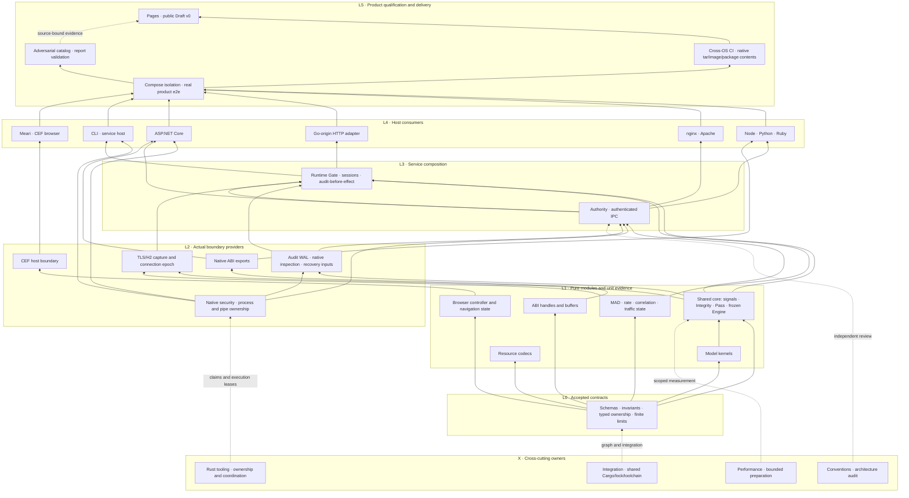

# Structural development canon

The user accepts bottom-up implementation and explicit ownership of every chat.
This SoT governs development order, layer contracts and title conventions. The
linked bottom-up plan records detailed gates, clusters and preserved constraints.
It does not assert that all depicted modules or production edges are qualified.

## Naming and responsibility

### Public package family redesign: accepted baseline v0

The user requests a small public family anchored by humanymous,
humanymous-core and humanymous-cli, with no permanently private implementation
packages. This supersedes treating every current adapter/domain crate as a
required final package. Internal modules and fields still need restricted Rust
visibility; public package status never makes every implementation API public.

The user explicitly confirmed this eight-public-package baseline on 2026-11-08
with "기준 설계 확정". The design approval gate is satisfied. Root now coordinates
package/path consolidation and subsequent branch synchronization through the
slice controls below; approval does not authorize concurrent uncoordinated moves.
The earlier fast-forward of codex/rust to9586f7e4 and its CI remain historical
source-bound observations. Main integration still requires the final migration
gates; publication remains unauthorized.

Read-only research found41 workspace packages, all currently publish=false,
22 binary targets and10 cdylib-bearing packages. These are not41 deployed
products. The current facade's declared normal/build local dependency closure,
including optional/target declarations, spans15 packages. A facade re-export
cannot make unpublished path-only dependencies registry-ready. Do not solve this
by flipping41 publish flags. Publication remains separately unauthorized.

The accepted baseline is EIGHT intentionally public packages. Six is a
more aggressive alternative with greater native/WASM/SDK feature coupling; three
would erase useful safety and platform boundaries. Neither a smaller count nor
faster builds is established without the required measurements and role audit.

| Target package | Current package responsibilities absorbed | Current count |
| --- | --- | --- |
| humanymous | Curated SDK facade and supported build-profile API | 1 |
| humanymous-core | signals, behavior, model, scoring, integrity, challenge, watermark as contextual modules | 7 |
| humanymous-runtime | runtime, authority, audit, capture, network, safe native-security policy | 6 |
| humanymous-platform | approved windows-object-bridge and reusable process/test support, with explicit testing capability | 2 |
| humanymous-collector | Browser/WASM collection and its target-specific dependency graph | 1 |
| humanymous-adapters | Apache safe/native, .NET safe/export, framework, Go, nginx, Node, Python, Ruby, native-abi safe/export | 12 |
| humanymous-cli | CLI/native-cli, attacker/defender, maintenance, Delivery, Pages tooling, lab runner/runtime pilot modules and targets | 9 |
| humanymous-browser | Browser model, CEF bootstrap and desktop roles | 3 |

The mapping covers41 packages exactly. Every survivor needs a deliberate public
API or application/distribution purpose and registry-compatible dependency plan;
there are no hidden permanent helper packages. Temporary publication-disabled
flags remain release guards during design/verification. A necessary additional
public loader/ABI package requires an explained design amendment, not an ad-hoc
private crate or weakened unsafe policy.

Accepted context parents are crates/sdk for facade/core/runtime,
crates/integrations for platform/collector/adapters, and crates/apps for CLI/browser.
Every manifest-bearing leaf directory matches its branded package name. Within
each package use src/<context>/... with standard Cargo targets. This is the
project convention, not a Cargo-mandated directory naming rule. Rust identifiers,
installed executable names, host init/export symbols and staged artifacts remain
separate contracts: humanymous-cli may install the humanymous command.

#### Required acceptance conditions

1. Keep core safe and browser-independent; preserve its forbid(unsafe_code)
   boundary. Preserve the approved platform/export unsafe scopes explicitly.
   Do not broaden exceptions or move unsafe code into core for a count target.
2. Audit every pub(crate) constructor/custody field during merging. Convert to
   private or context-restricted access so newly sibling modules cannot mint
   authority, native proof, handles, Ready or ownership from caller data.
   Public testing features are consumer-selectable build options, never trusted
   capabilities; no testing feature may enable a proof/readiness bypass.
3. One Cargo package has one library target. Adapters and browser helper library
   roles therefore need exact separate build profiles/target directories,
   symbols, staging and loader proof. No universal all-features host product is
   admitted. If role compatibility fails, amend the public package split first.
4. Preserve WASM versus native/Tokio/SDK dependency separation, directed package
   dependencies and one owning implementation. No source copies or path includes
   reaching outside a published package substitute for consolidation.
5. Curate the public API. Current whole-leaf facade exports include lab probe,
   scenario and qualification machinery; do not automatically turn all such
   internals into permanent SDK compatibility commitments.
6. Public release graphs must model Cargo's normal/build/optional/target and
   development-edge publication rules accurately. Versionless dev edges and
   versioned dev edges differ; an over-broad current graph check is a research
   finding, not authority to bypass release verification.
7. Browser's pinned Git-only upstream dependencies need an actual public registry
   fallback or explicitly accepted public distribution strategy. No registry
   availability or namespace ownership is inferred from source visibility.
8. Fewer Cargo packages do not mean all service roles become one process or all
   fixture binaries become installed products. Preserve role identity, witness
   independence, artifact allowlists, exact native symbols and signed bindings.
   Explicitly declare installation targets and required features; keep fixture
   and pilot targets outside the default installed command set.

#### Migration and chat control after confirmation

##### Core slice preparation and atomic boundary

The first slice absorbs signals, behavior, model, scoring, integrity, challenge
and watermark into crates/sdk/humanymous-core/src/<context>. The initial
read-only inventory found142 files across those seven package trees; this is
not a source-closure or test count. No relocation has occurred at this checkpoint.
Model and watermark owners must return exact dirty-path/hash and live-lease
handoffs before their trees are frozen. Root owns the remaining shared engine
integration and requests any newly discovered ownership seam before edits.

The initial tracked-file map is retained privately at
.spec.local/root/evidence/20261108054000-core-consolidation/file-map.before.json
(SHA256 3db1499f1205d69fee9c1172e50e5b109a3160355e5b2371569f966d49997824).
It records133 source/test relocation candidates and seven manifests to merge.
Two entries need explicit treatment: the integrity canonical-performance example
must remain an opt-in example target with a context-specific name, and the
watermark integration note must become historical handoff documentation rather
than an implementation module. Re-capture the final frozen map after owner
handoffs; this preparation map alone does not establish source stability.

The core slice must update both ordinary imports and Serde deserialize_with
path strings. Existing crate:: paths must become context-correct paths rather
than accidentally binding another context's root modules. Restrict each former
pub(crate) helper to its owning context where cross-context access is unnecessary;
preserve pub(super) boundaries. Review scoring rule helpers and watermark frame
budget/candidate helpers explicitly. No scoring predicate or numerical policy
change is part of the migration.

Move each frozen test corpus with its owning context. Preserve relative Unicode
table and fixture includes; redesign the signals registry test's manifest-relative
lookup against the new package root. Keep integration targets uniquely named by
context and preserve frozen oracle bytes. Update downstream consumers directly
to humanymous_core::<context>; do not retain seven compatibility helper packages
or source-copy shims. The atomic checkpoint includes workspace/lock consumers,
CI selectors, package/source inventory assumptions and current public docs.

Admission requires source inventories before and after relocation, an explicit
old-to-new file map, unchanged fixture digests, scoped unit/integration and
visibility-negative tests, all affected consumer type checks and strict lint,
and clean extracted-package consumer verification. Record unavailable Cross-OS
or actual product gates as pending. One local passing target cannot qualify the
whole relocated workspace or replace native/browser/Docker qualification.

Root owns the common workspace/lock/toolchain, final41-to8 path/module/API matrix
and atomic commits. Current domain owners retain responsibility for their source
and tests inside the destination modules; a new package is not a shared writer
lane. Freeze an exact path/hash handoff before Root moves a group. Pause writers
only on that group, return or explicitly retain its live target/process leases,
and never relocate an active compiler/CEF/Docker/preview input tree.

Move safe engine first, then runtime/platform contracts, developer tools, adapters
by qualified role, and browser last. Each slice updates imports, manifests,
fixtures, locks, CLI/workflow selectors, source inventories, packaging recipes,
licenses and public docs together. Preserve original historical evidence. Run
scoped unit/type/visibility/negative-feature tests, clean extracted-package
consumer checks, Cross-OS and actual native/browser/Docker gates as applicable.
Benchmark clean/incremental duration and memory rather than infer improvement.

Only after design confirmation does Root consolidate/synchronize work branches
under the Git mutex. In-flight validation sources stay immutable; each new
candidate gets an explicit source and its own receipt. No broad force-push,
foreign uncommitted staging, or premature main merge is part of this draft.

Primary comparisons: [Meari workspace at1482b746](https://github.com/modootoday/meari/blob/1482b746ebc0d867f25d17d01c48c12df888ca6c/Cargo.toml)
and [Specfold workspace at5333fd17](https://github.com/modootoday/specfold/blob/5333fd17d77b5f22992fce8da1a04729bcacd910/Cargo.toml).
Meari has13 members including demo/xtask publication exclusions; Specfold has2
packages and deliberately distinct directory/package/command identities. Their
useful naming patterns do not override the user's no-private-package decision.
See [Cargo publication dependencies](https://doc.rust-lang.org/cargo/reference/specifying-dependencies.html#local-paths-in-published-crates),
[Cargo targets](https://doc.rust-lang.org/cargo/reference/cargo-targets.html#library)
and [Cargo features](https://doc.rust-lang.org/cargo/reference/features.html#feature-unification).

### Interim adapter package taxonomy

The following table governs the current incremental naming transition only.
Upon confirmation of the public family redesign above, its many separate adapter
package targets are superseded by the accepted package/module matrix. It must
not be interpreted as a second competing final architecture.

In response to the user's naming clarification, root accepts category-first
`humanymous-adapter-<context>` as the target Rust package convention. The current
suffix-style packages are valid Cargo names, but do not express this project's
chosen family grouping. This is a migration decision, NOT a claim that the live
workspace has already been renamed.

The user's subsequent clarification fixes the PUBLIC consumer identity as
humanymous across languages. The adapter-prefixed names below are INTERNAL
implementation packages; they are not separate public imports/products.
The public Rust facade and host/package/artifact contracts are governed by
[[sot:root/adapter-artifact-abi]]. Existing host-specific names are transitional
until that coordinated migration, not permanent compatibility exceptions.

| Current package | Target package |
| --- | --- |
| humanymous-apache-adapter | humanymous-adapter-apache |
| humanymous-apache-native | humanymous-adapter-apache-native |
| humanymous-dotnet-adapter | humanymous-adapter-dotnet |
| humanymous-dotnet-adapter-export | humanymous-adapter-dotnet-export |
| humanymous-framework-adapter | humanymous-adapter-framework |
| humanymous-go-adapter | humanymous-adapter-go |
| humanymous-nginx-adapter | humanymous-adapter-nginx |
| humanymous-node-adapter | humanymous-adapter-node |
| humanymous-python-adapter | humanymous-adapter-python |
| humanymous-ruby-adapter | humanymous-adapter-ruby |

Default Rust library identifiers follow Cargo's hyphen-to-underscore conversion,
for example `humanymous_adapter_node`. Explicit host-facing library/module/ABI
names such as Python/Ruby imports or native DLL/module names require a separate
mapped contract; renaming the Cargo package alone must not silently break them.
Shared native ABI/security providers retain their own bounded-context identity;
they are not renamed as host adapters merely because adapters consume them.

Root coordinates one source/graph migration after active source-bound runs settle:
package/dependency keys, Rust imports, root and standalone locks, commands/workflow
policy, artifact/package recipes, current docs and owner path claims must agree.
Context-grouped crate paths are assessed with that change; no directory move or
foreign write permission follows from this naming decision alone. Every actual
crate retains Cargo.toml and standard src/tests layout. Existing evidence commands,
raw payloads, hashes and original source identities remain historical facts.

Owners continue current names until the coordinated migration; independent partial
renames would break shared resolution. Verify the new graph, selected adapter
units/build/lints and affected real host artifact imports before promoting it.
No alias, publication, OIDC binding or scoring/security change is inferred.

Cargo specifies name syntax and inferred target names, not the position of the
word adapter: [manifest name](https://doc.rust-lang.org/cargo/reference/manifest.html#the-name-field)
and [library targets](https://doc.rust-lang.org/cargo/reference/cargo-targets.html#library).

### Chat responsibility titles

Every project chat uses exactly `Humanymous · {L0|L1|L2|L3|L4|L5|X} · {English responsibility}`.
X denotes cross-cutting integration/governance/measurement, not a runtime layer.
A title identifies the primary role; modules may span adjacent layers. Stable chat
IDs, existing path claims and source permissions survive title changes. Titles
are not filesystem write grants. No new crate or source reorganization is implied.

| Layer | Responsibility and promotion gate |
| --- | --- |
| L0 | Accepted schemas, invariants, source compatibility and provider/consumer contracts |
| L1 | Pure functions and bounded state: scoped units, negatives, fmt/check/strict Clippy |
| L2 | Actual OS/file/process/socket/FFI provider tests, resource ownership and failure evidence |
| L3 | Authenticated application services, recovery/session/ACK/lifecycle composition and narrow real integration |
| L4 | Host adapters, CLI and browser consumers: actual supported host or GUI pilots |
| L5 | Docker product/adversarial, cross-OS/artifact and public documentation qualification |
| X | Shared graph, independent review, performance and Rust developer tooling across all layers |

## Exact23-chat registry

| Canonical app title | Stable chat ID | Exclusive responsibility |
| --- | --- | --- |
| Humanymous · X · Integration and Shared Core | 01a1b25e-8e4c-7a70-b7b7-f51a66c58514 | Own shared Cargo/lock/toolchain, signals/Integrity/Pass and frozen scoring seams; coordinate layer gates and final main integration. |
| Humanymous · L2 · Native Security and Process Ownership | 01a1b30d-439d-7030-8e38-789bc0b70f6a | Complete typed binding, bounded Windows bridge and one shared capture/direct-pipe owner; actual native boundary tests before higher consumers. |
| Humanymous · L2 · Audit Storage and Recovery | 01a1b35f-d1a1-7553-a0ed-65d09b9042a7 | Own canonical/Merkle/frame kernels, actual WAL/source/FD/capacity proof and typed recovery; no premature production authority. |
| Humanymous · L3 · Authority and Authenticated IPC | 01a1b30d-454e-7a50-9ab1-48358dbd0ff1 | Own peer authentication, approval/replay/expiry and IPC; consume native/audit primitives and fix encoded-secret ownership. |
| Humanymous · L3 · Runtime Gate and Service Lifecycle | 01a1b35f-cf83-74f2-aad1-34b3aee60cda | Compose qualified services, session/RIT/ACK/audit-before-effect, temporal observation owners and Pass handler; no duplicate scoring. |
| Humanymous · L4 · CLI and Service Host | 01a1b2f5-e927-7a03-9d47-9d1084d14c53 | Consume shared native ownership; actual watchdog, installation and service pilots. Do not fork process primitives. |
| Humanymous · L4 · Meari and CEF Browser | 01a1b35f-d3e9-7042-91a4-10c910a15515 | Pure navigation/tab/controller state first, CEF boundary next, then real navigation/keyboard/IME/AT pilots and bounded cleanup. |
| Humanymous · L5 · Product Isolation and Docker E2E | 01a1b30d-4736-7281-a54f-5cb3a5fa4fe4 | Own strict typed safe outcomes, Compose topology and actual product e2e; lower boundary tests before full composition. |
| Humanymous · L5 · CI and Distribution Validation | 01a1b2da-7d8a-73f2-9bb2-78bde5ae33f9 | Own scoped runners, delivery helper, actual package/image contents and OIDC environment; no publication or release tags. |
| Humanymous · L4 · Node Python Ruby Adapters | 01a1b2da-d1e9-7a22-9052-9a90a8cba54f | One shared framework consumer contract, then actual Node/Python/Ruby ABI/server/GC/GVL pilots using qualified lower providers. |
| Humanymous · L4 · nginx Adapter | 01a1b2f5-ea98-7023-b7af-ad527b820084 | Own nginx source/contract and actual supported host tuple, preserving exact proof and missing profiles. |
| Humanymous · L4 · Apache Adapter | 01a1b4e3-b0f1-7320-81a8-13e89d1d0dff | Own Apache native adapter and three-MPM integration; requalify affected lower contracts and cleanup. |
| Humanymous · L4 · Go HTTP Adapter | 01a1b4e3-b4a2-7690-9057-24b06d04b652 | Rust-owned Go-origin HTTP compatibility; retain bounded Go8 and finish approved framework tuples, no new Go core. |
| Humanymous · L4 · ASP.NET Core Adapter | 01a1b4e3-b687-7822-88c3-20d053f7d8fd | Consume shared native/ABI/Authority contracts then actual Kestrel/GC/AOT/package; exactly three approved C# glue files. |
| Humanymous · L2 · Native ABI and C Cpp Interop | 01a1b4e3-b2b7-71d3-bf3b-66a851cb7cf4 | Pure ABI handles/buffers first, export/header/compiler/dynamic-load/allocator boundary proof next; keep unsafe exception narrow. |
| Humanymous · L2 · Network Observation and TLS HTTP2 | 01a1b4e3-b852-7d21-90d9-4f00bebb5420 | Pure MAD/rate/correlation/traffic modules then actual capture epochs; no fake fleet readiness or runtime lifecycle duplication. |
| Humanymous · L1 · Watermark and Resource Codecs | 01a1b63c-3b93-7371-b055-9fc2cec587b8 | Pure bounded payload/codecs and standards validation first, then real carrier/file/HTTP/product pilots. |
| Humanymous · L1 · Model Training and Calibration Kernels | 01a1b63c-d8c7-76c1-bc35-baf9d6cfe88c | Pure bounded record/RNG/kernel/evaluation first, actual file/process lab next; no production activation or frozen-threshold changes. |
| Humanymous · L5 · Wargame and Report Validation | 01a1b2f5-ec55-7c91-863d-f539c70417be | Pure legacy report/renderer/CLI, strict catalog contracts then actual generic26 evaluation; preserve unsupported denominators. |
| Humanymous · X · Performance and Build Optimization | 01a1b645-0e76-75b0-b509-fd8e7719fc51 | Measure the touched layer, bound preparation overhead and research cache policy; no production source writes without an exact handoff. |
| Humanymous · X · Conventions and Architecture Audit | 01a1b645-0bdc-7a53-b759-57c1eb998336 | Independent risk-prioritized layer/contract audit, batch nonblocking review, no duplicate source edits or fabricated qualification. |
| Humanymous · X · Developer Tooling and Bounded Preparation | 01a1b34e-f9e9-77d3-b883-0cc4d76763a4 | Own Rust tooling, bounded selected-input preparation, claims/title/role registry and concise rules; preserve global Git mutex and existing compatibility mode. |
| Humanymous · L5 · Pages and Public Draft v0 | 01a1b2da-2656-7a23-a60b-08a681b23117 | Consume actual source-bound layer receipts, publish maturity limits, batch render/AT checks at public-input milestones. |

All23 app rename operations succeeded, and a fresh live inventory matched all23
exact titles with zero mismatches. The JSON operation/observation proof is attached
to evidence:root/20261106194410 as bottom-up-chat-roles.json. M11 owns the projection into THREADS/LANES and
concise rules; root owns this architecture and shared graph. The projection must
replace stale read-only-only descriptions for implemented watermark/model/network
slices while preserving actual path claims, temporary loans and unqualified gates.

## Applied dependency structure

The following is an implementation/consumption relationship diagram, not a
literal complete Cargo dependency graph or proof of completion. Solid arrows
mean lower-provider to upper-consumer; dashed arrows mean governance/evidence.
Independent columns proceed in parallel, with incremental vertical integration.

Watermark/model real resource and file/process integration require their own L2
pilots before application adoption. Browser-to-protected-product traffic and
external witness/secret stores require the separate owning actual contracts;
no missing production capability is filled by an arrow in this diagram.

## Promotion and operating rules

1. Define acceptance contracts before code, then implement and verify bottom-up
   within a cluster. Do not wait for every unrelated low-level package globally.
2. Unit evidence cannot promote a mock, another OS, native ownership or full
   product. Consumers may prepare code/tests against a frozen typed API while
   actual production admission stays closed until provider gates pass.
3. Preserve first failures and source/target/features/test denominators. A routine
   reversible own-scope correction is not a request for new human approval.
4. Run fmt first and bounded relevant preparation. Separate source-lane ownership,
   compiler-target lease and readonly proof recording; return targets at terminal.
5. Keep one source writer per claimed path, one owner for shared security
   primitives and serial attributed Git operations. Root alone changes the common
   graph; M11 alone updates its registry projection.
6. Rust remains the implementation language, with exactly the existing approved
   C# and unsafe exceptions. Detection freeze, fail-closed, a11y and defense-only
   constraints and the full final main integration gate remain in force.

Research supports bottom-up incremental integration, narrow actual boundary tests
and a testing pyramid, without a fixed unit/integration/e2e percentage. References
and measured preparation bottlenecks are in the linked plans. Mandatory product
and real native tests are retained, not replaced with more unit counts.

## Continuous responsibility rotation

On 2026-11-08 (Asia/Seoul), the developer tooling chat retained its coordination
obligations and accepted bounded selected-input preparation implementation. Its
previous title was `Humanymous · X · Developer Tooling and Coordination`; the new
title in the responsibility table was applied and independently verified in the
live inventory. Other owners' incomplete gates remain assigned, rather than
being treated as exhausted merely because their last chat turn ended.

Root monitors source checkpoints, terminal execution receipts and remaining
acceptance gates across all project chats. An idle chat, a completed assistant
turn or an exhausted local task is not proof that its responsibility is complete.

Each owner reports a compact handover when its current slice reaches a terminal
state: exact source commit, implemented scope, executed and missing gates, live
process handles, retained resource reservations, remaining dependencies and owned
paths. Preserve failed and deferred gates in the original responsibility record.

Root then selects the lowest ready unmet dependency in an independent cluster.
Prefer an actual implementation or boundary-validation task that unlocks blocked
consumers; avoid inventing documentation or repeated audit work merely to keep a
chat active. A blocked upper-layer owner may take a disjoint lower-layer slice,
but cannot overwrite its provider or silently assume provider ownership.

A reassignment records the old responsibility disposition, successor or retained
follow-up owner, new acceptance criteria, exact paths, dependency contracts and
resource limits. The old writer releases or explicitly narrows its claim before
the new writer claims paths. Running processes and target leases require explicit
handover or terminal cleanup; chat rotation never authorizes foreign termination.
Shared Cargo, lockfile, toolchain and security decisions remain root-owned.

After the new responsibility is accepted and its ownership is established, root
updates the live title using `Humanymous · {L0|L1|L2|L3|L4|L5|X} · {English responsibility}`.
M11 updates the canonical responsibility registry with the same chat ID and
retains dated role history, contracts and source-bound evidence. Root verifies
the live title against the registry. Renaming is neither a write grant nor a
completion claim. No rename is needed when the next slice retains the same role.

Repeat this cycle after meaningful source/test milestones and terminal failures,
using bounded progress snapshots rather than constant polling. Concurrency follows
actual compiler/process/resource admission, not the number of active chat turns.
If no independent task is ready, retain an explicit dependency wait instead of
creating duplicate work. Full migration completion still requires the original
integration, product, documentation and post-main verification gates.

## Adaptive lightweight validation concurrency

The user requested higher concurrency on 2026-11-08 (Asia/Seoul). Root measured
32 logical processors, CPU samples15/13/23 percent,32.69 GiB physical available
of63.34 GiB, commit82 percent and no live Cargo/rustc process. The previous
four-owner lightweight ceiling is superseded by SIX independent admitted owners.
This is an initial measured increase, not permission for unbounded builds.

Each owner uses an exclusive existing target, one Cargo build job and disabled
incremental compilation for the declared comparison/validation profile. Selected
test harnesses use one test worker where appropriate; explicit concurrency tests
retain their required internal scheduling. Source preparation and evidence work
do not retain compiler reservations after terminal commands.

### Physical target admission and explicit warm handoff

An allocation must name the resolved absolute Cargo target directory, immutable
source/workspace, provider/session and a create-new ownership lease marker before
the first compiler starts. A logical label, board claim or root grant alone is not
physical exclusivity. Different owners require different physical target paths;
warm reuse requires the previous owner's actual terminal process observations
and explicit lease return. A conflicting marker refuses admission; never remove
or release another owner's marker or kill its process.

On 2026-11-07, root allocated both Browser and Native the physical directory
C:/workspaces/humanymous/target/validation-native without a filesystem lease.
Native's first Cargo log records a build-directory lock wait during Browser's
window. Cargo locking is not a substitute for the ownership contract, nor proof
of corruption. Preserve observed command exits and source hashes, but classify
the Native transaction NOT_QUALIFIED_COLLIDED; its two actual fault cases had not
started. The original transaction deadline is not renewed. Root allocated a
separate R2 transaction at target/native-outer-faults-62f47765-r2 with fresh outputs,
an actual ownership marker and separately recorded original deadlines. R2 cannot
rewrite the failed admission or establish provenance for R1 artifacts.

Potential or confirmed overlap requires exact paths, process/session timelines
and preserved logs. Source equality alone does not prove target/cache isolation.
Record unknowns, stop new conflicting starts and qualify fresh isolated outputs
before making artifact-provenance claims. Do not infer ownership from process
names or use this rule to stop unrelated projects.

Before launch, require physical available greater than20 GiB and commit below85
percent. At or beyond either limit, admit no additional compiler and let existing
bounded commands finish; never kill another owner's process. Root measures actual
processes, memory and CPU before increasing the ceiling again. A slow preparation
phase is not evidence that compilation itself consumes the CPU budget.

CEF/SDK builds, model initialization, Docker product tests and rendering containers
remain separately scheduled heavyweight work. Six lightweight grants do not
authorize them, shared target writes, new cache directories, dependency fetching,
publication or extra hosted runs. Git writes remain globally serialized.

## CPU placement and supplementary Windows validation

The user explicitly accepts supplementary actual Windows tests on this terminal.
Local bounded process, pipe, filesystem and IPC component tests may complement
standard-runner qualification. Native capture parents precede CLI watchdog
consumers; each uses exact source, a separate bounded outer supervisor, owned
cleanup, one controlled case at a time and the existing memory admission guard.
This does not grant accounts, SCM installation, privilege elevation or production
provider authority. Final Cross-OS and product requirements remain unchanged.

Observed Intel Core i9-14900K topology is24 cores/32 logical processors. Sampled
Cargo/Clippy processes all exposed affinity maskFFFFFFFF, permitting all32 logical
processors; the observed busy logical CPUs therefore do not establish an affinity
restriction. Logical CPU numbering alone does not identify physical siblings or
performance/efficiency classes. Single-threaded compiler/test sections cannot be
made parallel merely by migrating or pinning their threads.

Keep scheduler-default affinity for current owners. Performance may design a
same-source jobs1/jobs2 or task-local affinity comparison, with actual topology,
duration, CPU and memory observations, before any wider rollout. Existing six
pipeline admission and one-job defaults remain until a measured profile change is
accepted. Never change another owner's running process affinity or the system
power policy to make utilization graphs appear uniform.

Primary references: [Cargo build jobs](https://doc.rust-lang.org/cargo/reference/config.html#buildjobs)
and [Windows process affinity](https://learn.microsoft.com/en-us/windows/win32/api/winbase/nf-winbase-setprocessaffinitymask).

## Windows-first local environment

The user requests native Windows development and stopping the unused WSL
distribution runtime to recover resources, not uninstalling WSL or deleting data.
All current REA-Ubuntu owners released compiler/SDK/hash-read handles before root
terminated that distribution. No new WSL launch is admitted by default. The
docker-desktop distribution remains running because the observed desktop-linux
daemon uses kernel6.18.33.2-microsoft-standard-WSL2; distro termination does not
prove all virtualization memory has been released.

Verified native inventory: Rust1.99.1 MSVC plus wasm32 target, CPython3.12.10 with
Python.h and python312.lib, Node24.16.0, Ruby3.3.12 mingw-ucrt, VS2022 Build Tools,
bundled CMake3.31.6-msvc6, Ninja1.12.1 and Docker client/server29.9.2. Root added
the three existing verified CMake/Ninja/Docker binary directories to user PATH and
checked their commands. winget1.29.380 is available; redundant standalone packages
were not installed over the existing VS tools. Existing sessions may need explicit
paths or environment refresh. Ruby's MinGW/UCRT versus Rust MSVC compatibility
remains an unqualified native SDK tuple, not solved by a PATH change.

Use native Windows for supported local Rust/component tests, and the Windows
Docker CLI with explicit desktop-linux context for eligible Linux user-space
container tests. Container profiles require pinned inputs and bounded resources.
Linux native filesystem/kernel/provider tests, Windows OS boundaries, macOS and
actual GUI/AT requirements retain their specific native/hosted gates. A Linux
container does not establish all GitHub runner, kernel or Cross-OS equivalence.
Docker backend switching, WSL feature removal, cache deletion and foreign daemon
termination are not part of this environment setup.

## GPU acceleration policy draft v0

The user requests GPU opportunity analysis and broader compatibility. This section
defines selection and qualification requirements; it does not claim an implemented
compute abstraction, admitted dependency, qualified backend or measured speedup.
Existing CPU experiments retain their original inputs, backend and deadlines.

| Workload | Selection priority | Admission condition |
| --- | --- | --- |
| Native UI rendering | Qualified hardware GPU preferred; visible CPU/software fallback | Actual window presentation, input, accessibility, resize and device-loss pilot |
| Local LLM and offline/batched model work | CPU reference; optional GPU after qualification | Model fit, transfer/queue overhead, matched quality and end-to-end crossover |
| Small per-request model inference and scoring | CPU default | GPU batching remains experimental until numerical and decision-boundary parity and latency gates pass |
| Authentication, cryptography, policy, audit and I/O | CPU default | No speculative secret transfer or security offload |
| Cargo, rustc, linking, documentation and ordinary unit tests | CPU | GPU kernel compilation does not establish acceleration of ordinary Rust compilation |

Presentation, computation and execution venue are separate interfaces. Proposed
logical interfaces are `PresentationBackend`, `ComputeBackend` and
`ExecutionVenue`; these names are design vocabulary, not exported API. Capability
discovery reports hardware versus software adapter, backend, driver/runtime,
precision, limits and memory observations. It never creates NativeProof, trusted
identity, human-presence evidence or a changed detection verdict.

Selection policy distinguishes `cpu`, `auto` and `require-gpu`. CPU is mandatory
as the portable reference. Auto chooses only a qualified workload/backend tuple
and records the choice and reason. Require-GPU rejects unavailable or unqualified
hardware rather than silently executing on CPU. Fallback must occur at a known
safe effect boundary: completion or cancellation is established, ownership and
in-flight resources are retained until settlement, and side effects are not
executed twice. Missing security prerequisites still fail closed. Device loss,
timeouts, cancellation and memory exhaustion require explicit terminal outcomes;
enqueue success is not execution success. UI frames must not wait indefinitely.
An expired request deadline does not establish that submitted device work has
settled. Retain an explicit uncertain owner and its memory/concurrency permits
until observed completion or qualified teardown. Require-GPU rejects CPU and
no-op adapters; virtual or unknown adapter backing needs positive qualification.
Fallback, retry and device recreation retain the same logical job and the
minimum original wall/monotonic deadline; never restart its budget. Bind
submission and device epochs and permit at most one result commit. Dropping a
future or requesting cancellation is not device cancellation. Refuse late output
without releasing unsettled custody.

Uploads require a closed approved data schema and finite staging, device-memory
and log budgets. Keys, unseal material, credentials and control state are excluded.
Host zeroization, buffer destruction and device loss do not prove erasure from
VRAM or driver-managed copies. Shared CPU authority remains the final parser,
scorer, policy decision and enforcer. GPU model output is advisory until a
separately accepted parity contract; tolerance, invalid output, missing output or
expiry must never alter frozen decisions or become ALLOW. Cover race and failure
negatives in pure contracts before actual backend pilots.

Candidate portable graphics/compute families include wgpu with DX12, Vulkan,
Metal and browser WebGPU. OS, architecture, adapter, driver and runtime versions
are independent qualification dimensions. CUDA and vendor-specific runtimes are
optional extensions, not the Cross-OS baseline. Browser WebGPU eligibility is
separate from native backend eligibility. Software adapters and compile-only jobs
must never be labelled actual GPU execution. See the upstream
[wgpu backend documentation](https://wgpu.rs/doc/wgpu/struct.Backends.html).

Rust 1.99.1 and the existing authored-language constraints remain binding. No
nightly toolchain, dependency/pin change, authored shader-language exception,
driver/SDK installation or new unsafe implementation is admitted by this draft.
Upstream kernels and shaders must be identified as external components with their
version and license. Experimental Rust GPU offload has a separate toolchain
qualification boundary; see the
[rustc offload guide](https://rustc-dev-guide.rust-lang.org/offload/usage.html).

Qualification proceeds bottom-up: source/version compatibility matrix; pure
selection, rejection and lifecycle unit contracts; actual per-backend pilot;
matched end-to-end performance, precision and failure recovery; then optional CI
and product integration. Compare optimized CPU controls against transfer,
initialization, queueing and presentation costs, including cold and warm runs.
Record CPU RAM, discrete VRAM and unified-memory residency separately. Record
unified-memory capacity once: separate accounting ledgers must not double-count
the same physical pool. Admission needs fresh joint host/device observations;
unknown telemetry is not spare capacity. Invalidate crossover qualification when
driver, model, input shape, precision, residency or concurrency changes. Check the
exact feature and transitive SDK tuple, not only the package Rust version.
Record
exact model/input/source/runtime/device tuples, quality tolerances and scoring
boundary outcomes. Frozen weights, thresholds, predicates, verdict bands and
accessibility constraints remain unchanged.

Performance owns crossover synthesis; Browser owns presentation; Model owns
numerical inference/training contracts; local evaluation owns matched LLM trials;
Native owns capability/resource lifetime boundaries; Delivery owns CPU-only and
optional actual-GPU CI classification; independent audit reviews safety and
evidence. Root owns shared policy, dependency admission and integration. Each
owner records findings and unqualified gaps in its existing SoT and evidence
lane before proposing implementation. GPU jobs require separate resource
admission; spare CPU capacity does not reserve VRAM or authorize paid runners.

